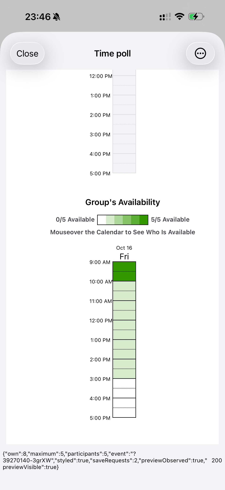
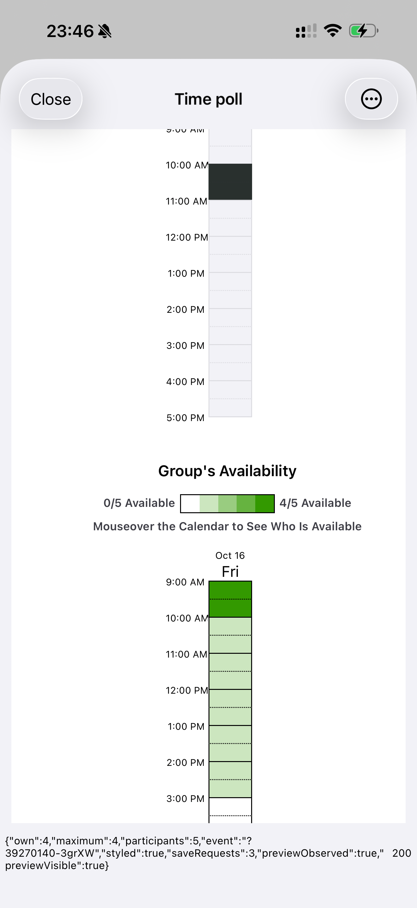

# Preview 98 真机五人时间征集验收

> ARCHIVED 2026-10-15 — historical evidence only. Do not run the old commands or use this document as current product/release guidance. See [archive policy](../../README.md).

2026-10-14，Europe/Berlin。iPhone 16 Pro Max / iOS 26.0.1。

直接操作手机原有 `app.sideseat.mobile.preview / 1.0.0 (98)`。
独立 XCTest 工程只构建测试 runner；Preview 的安装路径在测试前后相同，
没有重新构建或安装被测 App。App 功能源码为
`c1bf19d21234fb458f18c0ad2ed9f04393ba2f94`。

## 输入与结果

测试日期为 **2026-10-16**，时区 **Europe/Berlin**。五位匿名参与者由同一台
手机依次输入名字、拖选时间；保存使用真实 When2meet 服务。

| 参与者 | 首次填写 | 后续调整 |
| --- | --- | --- |
| A | 09:00–10:00、11:00–12:00 | 保留 |
| B | 09:00–10:00、12:00–13:00 | 保留 |
| C | 09:00–10:00、13:00–14:00 | 保留 |
| D | 09:00–10:00、14:00–15:00 | 保留 |
| E | 09:00–11:00 | 擦除 09:00–10:00，保留 10:00–11:00 |

- 五人首次保存后，共同时间为 **09:00–10:00，5/5**。该时段的四个
  15 分钟格均为 5 人，其余各人的替代时间只有 1 人。
- E 擦除共同时间后，五人均仍有填写记录；**没有 5/5 时段**。
  最多人可参加的时段仍为 **09:00–10:00，4/5**，其他时段最多 1 人。
  已核对原热图的 `5/5 Available`、`4/5 Available` 和逐格人数。
- 11 次保存操作均观察到原 `SaveTimes.php` 请求和 HTTP 200，每次拖选/擦除
  对应一次保存。没有改写原保存参数或人数算法。
- 完全终止 App 后重新启动，再通过最近征集逐个重新登录 A、B、C、D、E。
  每人的 **32 个时间格**逐格检查通过：A–D 各保留 8 格，E 保留 4 格。
  五次重新读取的群体人数表均与保存后的表完全一致，重新打开阶段没有
  发出保存请求，结果来自原服务器重新加载。
- 真机端到端用例 **1 项通过、0 失败**，执行时间 **426.916 秒**。





## 隔离与恢复

SideSeat 使用现有临时会话 fixture 和内存凭据存储，五人填写、保存和读取均
发生在真实 When2meet 页面。测试活动为
[SS98 QA](https://www.when2meet.com/?39270140-3grXW)，参与者名字均为匿名 QA
标记。没有发送真实聊天消息、读取私有日历或写入 SideSeat Plan。

测试截图底部的数据栏由 Preview 98 现有 DEBUG 观察参数启用，仅用于
采集原服务数据。结束后已恢复普通前台启动，参数为空，进程回读通过。
原用户的 Keychain 凭据没有被测试会话替换。

准备阶段首次生成因输出目录未创建而失败；创建目录后修正。首轮操作在
补充页面双向滚动逻辑时主动中止，完成过 A 的单独 QA 保存，不计完整验收。
最终完整运行使用新的活动，五人输入、两种人数结果和五次重开检查全部通过。
没有修改 Preview 产品代码。

## 复现与证据

保持已安装 Preview 98 的真机解锁，指定该手机的 Xcode UDID：

```sh
SIDESEAT_WHEN2MEET_PHONE_QA=1 DEVICE_UDID=<PHONE_UDID> \
  ios-native/phone-qa/when2meet98/run.sh
```

显式开关会创建一个新的匿名真实活动。脚本只生成和构建测试 runner，并在
结束时恢复普通 Preview 启动。测试脚本语法检查通过。

[结果和设备收据](evidence/2026-10-14-when2meet-phone98-five/device-and-results.json)
包含活动日期、5/5 和 4/5 结果、五次重开、原安装保持和普通启动恢复。
同目录保留 11 份逐格 JSON、3 张原始真机截图及 xcresult 摘要。
原始结果包位于本机 `/tmp/sideseat-when2meet-phone98-five-3.xcresult`。
