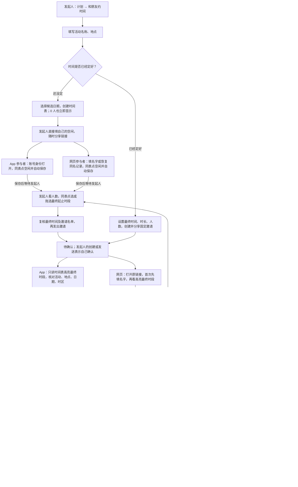

# 计划用户流程基准版本 1

2026-10-18，Europe/Berlin。用户要求暂存本版，再开始计划卡片 UI 更新。
本版对应已验收的 Preview 123 及正式分享网页。界面布局调整以本流程为基准，
保留已有记录、参与者身份、邀请版本、确认条件和日历规则。

核心流程为创建活动、收集空闲、发起人定最终时间和名单、每位受邀人明确确认，最后确定计划并进入日历。
时间已经定好时跳过征集。App 与网页参与方式可以混用，也可以只使用其中一种。

## 完整流程图

## 保留的规则

| 情况 | 行为 |
| --- | --- |
| 征集计划确定条件 | 最终邀请名单全员确认，不以预估人数作为必须收齐答复的门槛 |
| 固定时间确定条件 | 明确确认人数达到设置人数，包含发起人；拒绝不占名额 |
| 填写空闲 | 直接在同表编辑和自动保存，只改变自己的答复；填写不表示确认参加 |
| 最终邀请 | 只读时间表高亮实际时段；点击格子不会编辑空闲或接受邀请，需明确确认参加 |
| 未选入名单 | 保留填写记录，解释未被邀请，不获得日历记录 |
| 邀请改期 | 征集计划未确定前，发起人重新选时和名单并发送；版本更新，其他人重新确认；取消草稿不改变原邀请 |
| 已确定后改时间 | 取消原手动计划，再建新计划；取消撤回原日历 |
| 删除和取消 | 征集中可删除；邀请中、已确定的活动可取消；取消及过期结果可由发起人删除 |
| 过期 | 候选时间全过，或未全员确认的邀请到达开始时间，进入只读及历史，不生成日历 |
| 活动结束 | 已确认的活动进入历史，保留既有确认和日历；不自动认定实际发生 |
| 网页游客 | 无需注册、下载；同名恢复原记录，保留链接看安排，没有个人 SideSeat 日历投影 |

## 同行和私聊已有计划

已有双人计划继续沿用提出具体安排、对方接受或另提时间或拒绝、双方日历的规则。
已确认双人计划的新时间提案，在对方接受前保留原确认时间。
消息中打开共享计划链接时使用上图；不把既有双人记录转换为征集计划。
双方反馈、Outcome、再次同行等资格保留各自既有合同。

## 对照资料

- [当前完整用户流程](./USER_FLOW.md)
- [手动计划规则](./UNIFIED_PLANS.md)
- [共用呈现与既有双人规则](./PLAN_PRESENTATION.md)
- [Preview 123 验收](./qa/2026-10-18-plans123.md)

本基准保留为本次卡片调整的流程对照。后续明确改变流程时新增版本，并记录差异。
