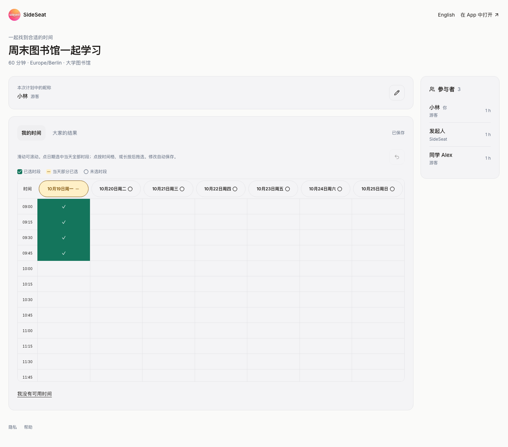
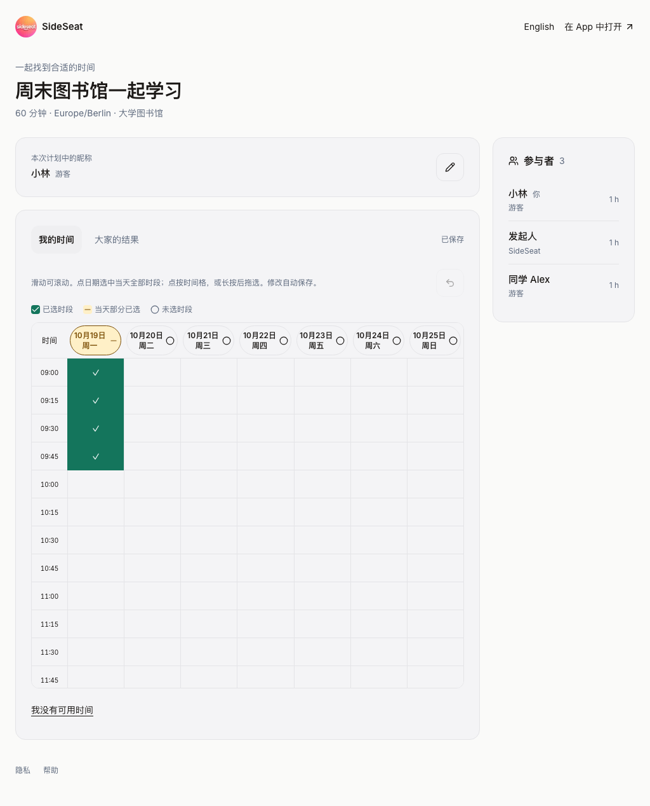

# 分享时间表桌面周视图验收 — 2026-10-15–16

开发于 10 月 15 日开始，候选/正式发布于 10 月 16 日完成（Europe/Berlin）。

本阶段只调整公开分享页的桌面布局：从 1024 CSS 像素起，内容最大宽度由 896px
提升到 1440px，参与者栏固定为 224px，剩余空间优先分配给时间表。1024px 以下保留
原布局。时间格、触控手势、保存队列、API、数据模型和原生客户端均未改。

源码 `393fc66c22d08ebb86d78daa670c11987ac5870b` 已提交、推送当前分支。
本地 TypeScript、该 TSX 文件 ESLint 和 `git diff --check` 通过。

## 浏览器验收边界

浏览器运行实际页面和实际布局/交互代码，在唯一的虚拟计划路由下拦截公开计划响应，
提供七天、每天 12 格的固定布局数据。星期全选、撤销和拖选产生的保存请求也仅由浏览器
本地响应，不发送到真实 API。本次没有创建账号、计划或修改生产数据。
这些检查验证本阶段的布局与坐标交互，不作为新一轮游客认证、持久化或日历业务验收。
此前真实 Safari → Preview 105 → 确认 → Calendar 的证据继续保留在
[统一选时 QA](./2026-10-15-unified-share-ui.md)。

Chromium 与 WebKit 各检查 320、390、768、1024、1280、1440、1920 七种宽度；
每种分别验证中/英文、我的时间/大家的结果，共 56 项测量。

| 视口宽度 | 时间表外宽 | 一周七天同时可见 | 参与者栏 |
| --- | --- | --- | --- |
| 320px | 246px | 保留横向滚动 | 下方 |
| 390px | 316px | 保留横向滚动 | 下方 |
| 768px | 361.75px | 保留原布局 | 侧栏 288.25px |
| 1024px | 682px | 是，无横向溢出 | 224px |
| 1280px | 938px | 是，无横向溢出 | 224px |
| 1440px | 1098px | 是，无横向溢出 | 224px |
| 1920px | 1146px | 是，无横向溢出 | 224px |

所有页面均无整页横向溢出，顶部操作位于视口内，时间格高度保持 44px。
320/390px 手机窄屏的时间格仍为 88px 宽，时间表与上一版实测宽度一致。
1440px 下两种浏览器均通过：直接点第七天全选 → 撤销 → 鼠标从第一天拖至第七天，
选区准确且三次保存均为本地模拟响应。手势实现源文件保持上一生产版本的原始哈希。

## 发布与核对

候选和正式网页均完成上述 56 项测量，结果与本地一致；两种浏览器的第七天全选、
撤销、跨七天拖选也通过。截图人工检查通过。使用浏览器拦截的只是虚拟计划数据，
页面 HTML、脚本、样式均来自对应的真实部署。

候选 Ready 后核验，再 promote **同一个构建**至正式域名；2026-10-16 00:01 CEST
www/API 双域名 inspect 均为 `dpl_6JpdrfEay16wvWzMnzPT5o3zxEPF`、Ready。
正式 client-config、AASA、iPhone 引导、隐私、支持、www/API 分享页面均为 200，
裸域名分享页面为 307，保留原路径跳至 www。没有通过关闭部署保护访问候选页。

从真实生产 `dpl_Eq19xTZsKQCckjdv8Py6x94E2jtS` 的 1,339 项源码逐文件校验重建，
保留 1,338 项原内容，只替换 `shared-time-poll.tsx` 并新增来源记录。
候选 `dpl_6JpdrfEay16wvWzMnzPT5o3zxEPF` 的 1,340 项上传 SHA-1 均匹配；
未上传冻结归档。构建使用 `npm run build`，显式跳过数据库迁移，不执行旧发布前置脚本。
恢复点为上一生产部署。手机仍为 SideSeat Preview 1.0.0 (105)，没有原生构建、安装、
XCTest 或 TestFlight/App Store 上传。本地预览服务已停止，临时候选访问凭据及私有检查目录已清除。

[来源清单](./evidence/2026-10-15-desktop-week-view/source-manifest.json)、
[上传核对](./evidence/2026-10-15-desktop-week-view/upload-verification.json)、
[本地测量](./evidence/2026-10-15-desktop-week-view/local-layout.json)、
[候选测量](./evidence/2026-10-15-desktop-week-view/candidate-layout.json)、
[正式测量](./evidence/2026-10-15-desktop-week-view/live-layout.json)、
[健康检查](./evidence/2026-10-15-desktop-week-view/live-health.json)、
[双域名状态](./evidence/2026-10-15-desktop-week-view/deployment-state.json)。

