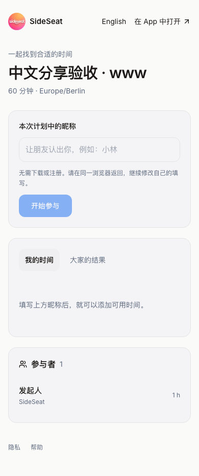
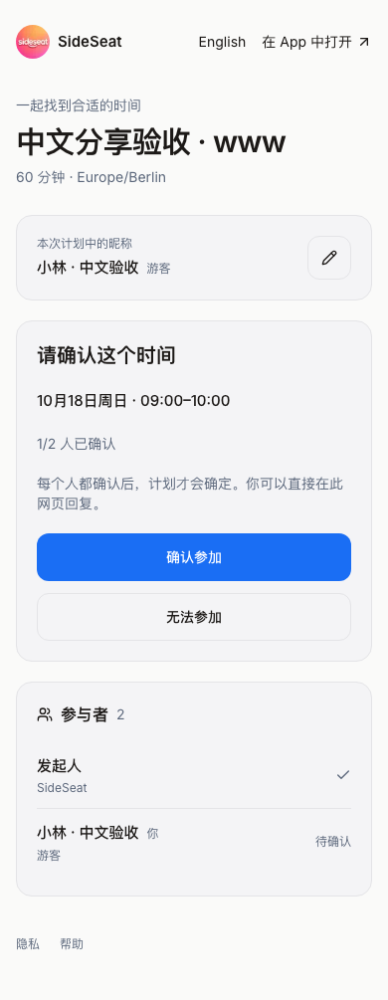
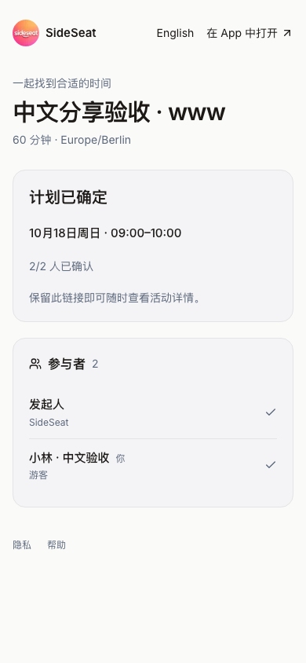

# 分享网页默认中文验收 — 2026-10-15

来源 `d3a787c2c5f79b60f46a7367836e7f97f2400a73`，分支
`codex/ios-uxui-20260922`。线上候选及正式域名验收通过。

## 用户行为

分享计划首次打开默认中文，包括英文浏览器和已有 `NEXT_LOCALE=en` 的浏览器。
昵称、参与、可用时间、结果、邀请与确认沿用同一中文状态。右上角保留 English，
用户主动切换后可跨刷新、跨计划保留选择；分享页语言不改网站全局设置。
专用 `SIDESEAT_POLL_LOCALE` Cookie 限定 `/time-polls`；页面主内容标记对应语言。

## 实际检查

- 活跃目录、分支、Git 根目录已核对，基线 `e068708` 干净；未切换分支。
- 本地服务实际使用 3105，监听进程 cwd 是活跃项目；3000 属于另一个项目，没有复用。
- 隔离本地数据库 `sideseat_ios_test` 的完整游客集成测试通过：1 项 / 21.7 秒。
  覆盖默认中文、旧英文 Cookie、英文选择刷新、切回中文及其他计划、双游客改昵称、
  逐人确认、确认前无日历、确认后游客姓名、直接定时间及既有身份/来源检查。
- TypeScript、相关文件 ESLint、React 检查通过；本次服务及本地数据库已停止。
- Ready 的生产候选 `dpl_63iB9RynVCpBdPi68S3SmAezuTND` 通过真实数据浏览器验收后，
  使用 promote 切换同一构建；临时 Vercel 授权访问没有修改保护设置。
- 正式 `www.sideseat.de` 和 `api.sideseat.de` 分别在 390×844 移动浏览器环境通过：
  默认中文 → English 切换/刷新 → 中文切回/刷新 → 游客参与 → 添加时段/自动保存 →
  改昵称/重开 → 邀请 → 中文确认 → 注册发起者日历含游客姓名。
  确认之前没有日历记录；网页运行异常与 5xx 均为 0。
- 双域名 inspect 都指向上述 Ready 部署；裸域分享链接 307 到 www 并保留计划路径。
  client-config 200；既有冻结网页入口继续 307 到 `/ios`。

首次候选脚本在已完成确认后，把日历参与者 DTO 的 `name` 误写为 `displayName`；
修正验收脚本字段后完整重跑通过，未因此修改产品代码。

## 来源、清理与范围

从此前真实生产 `dpl_6Un8qZtCE26v7edqKd2UBexBUHLx` 的 1,335 个源码文件重建，
保留 1,331 项原字节内容，仅覆盖三个语言相关文件、发布 buildCommand，并增加来源记录。
所有 1,336 个上传源码 SHA-1 与受控目录一致。没有上传归档内容，没有 Schema 修改，
构建日志确认 `SKIP_DATABASE_MIGRATIONS=1`，没有执行旧的一次性发布前置脚本。

所有临时计划和本次专用账号已删除，旧访问令牌返回 401；凭据与临时授权地址未入库。
手机保持已有 Preview 105，原生来源 `f508e64`；这次仅更新分享网页，没有重装或重跑真机。
普通 SideSeat 97 继续保留，没有 TestFlight/App Store 上传。

## 证据

[本地](./evidence/2026-10-15-share-chinese/local-verification.json) ·
[候选](./evidence/2026-10-15-share-chinese/candidate-verification.json) ·
[正式 www](./evidence/2026-10-15-share-chinese/www-verification.json) ·
[正式 API](./evidence/2026-10-15-share-chinese/api-verification.json) ·
[来源清单](./evidence/2026-10-15-share-chinese/source-manifest.json) ·
[上传核对](./evidence/2026-10-15-share-chinese/upload-verification.json) ·
[域名](./evidence/2026-10-15-share-chinese/live-aliases.json) ·
[清理](./evidence/2026-10-15-share-chinese/cleanup.json)

