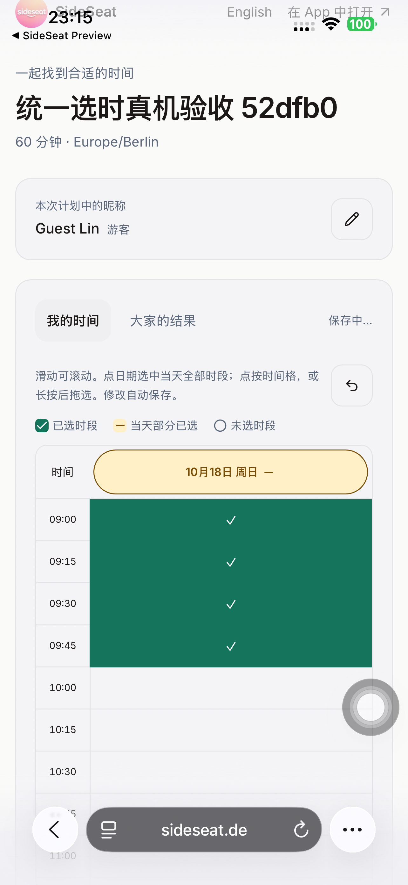
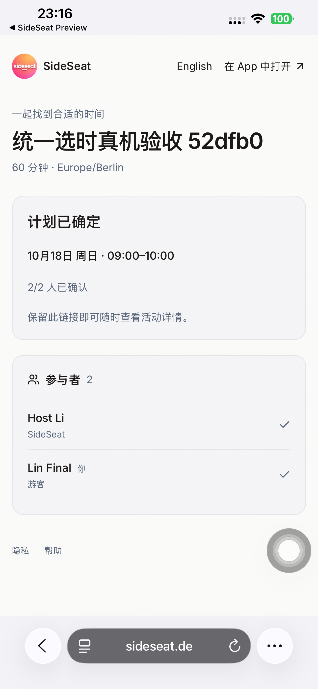
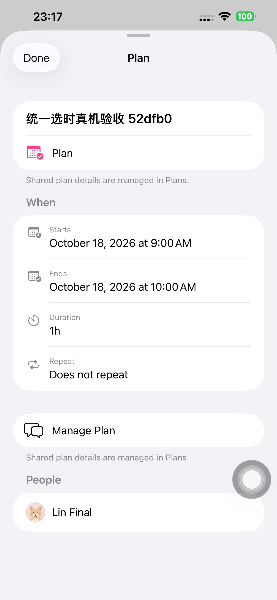

# 网页与 App 统一选时验收 — 2026-10-15

网页实现 `384a930`，连续擦除修复及最终网页来源
`4d208a1b35f33938fde48302948e68567567ead9`；Safari 真机脚本来源 `5554c2c17ccd625a4ad5d3da005349239d9cd937`。
分支 `codex/ios-uxui-20260922`，均已提交并推送。

## 统一后的行为

- 两端使用同一计划和 15 分钟 slot IDs：点按改单格；正常上下/横向滑动只滚动；
  长按 0.4 秒后预览矩形范围，松手选中/擦除，取消手势不提交。
- 点星期/日期选中该计划当天全部候选时段，已全选时再点清空；部分已选时补全当天，
  其他日期保持原样。最近一次修改可撤销，自动保存并支持失败重试。
- 青绿已选、琥珀部分日期和图例使用原生颜色；网页跟随浏览器浅/深色外观。
- 大家的结果提供相同推荐时段、人数、姓名、横向推荐卡片和只读人数热图。
  结果页没有可编辑时间格或日期按钮。
- 游客首次只需填昵称，继续免下载/免注册；默认中文、English 切换、昵称编辑、
  独立确认参加、所有受邀者确认后写入注册者日历的流程保持一致。

## 实际验收

| 范围 | 结果 |
| --- | --- |
| 本地隔离数据库完整回归 | 3 项 / 22.9 秒通过，包含 Chromium 和 WebKit |
| 真实触控输入 | Chromium CDP 普通双轴滚动不改选区；长按预览、取消、选择、连续擦除、撤销与重开通过 |
| 日期和键盘 | 跨两日期的鼠标矩形拖选；单日全选/清空/部分状态；保留其他日期；键盘 Space；切结果后仍能撤销 |
| 外观与语言 | 两引擎浅/深色原生配色、窄屏无整页横溢、中文默认及英文选择刷新记忆通过 |
| 候选与正式 www/API | 真数据填写、当天全选/清空/撤销、重开、只读热图、改昵称、邀请、确认和日历姓名全部通过；网页异常/5xx 为 0 |
| iPhone 14 Plus Safari → Preview 105 → Calendar | 1 项真机完整流程通过，133.722 秒 |
| 静态检查 | TypeScript、相关 ESLint 无警告、React 检查通过 |

本地服务实际为活跃项目 3105，监听进程 cwd 已核对；3000 的其他项目没有复用。
数据库为 127.0.0.1:5433 的 `sideseat_ios_test`，本次服务与数据库均已停止。

连续擦除回归暴露了真实浏览器边界：预览移除勾选 span 时，原触控目标会脱离 DOM。
勾选现在不接收指针事件，由稳定的时间格按钮接收整次触控。另修复了触控隐式捕获
释放被当成鼠标取消的问题。最终真实触控回归已验证，不以早期失败代替通过。

## 同一台 iPhone 的实际流程

设备 iPhone 14 Plus / iOS 26.6.1，UDID `00008110-001A69110CC1401E`，
CoreDevice `D906CC6D-3EC6-50A2-8D93-A6602521362A`；始终显式指定该机。
Preview 仍为 1.0.0 (105)，原生功能基线 `f508e64`；普通 SideSeat 97 保留。
没有原生功能修改或新构建编号；为这次 UI 验收重新构建主 Preview 的测试目标。

真实 App 填写发起者时段并复制链接 → Safari 进入正式分享页、填昵称、长按一小时、
撤销并重新选中、修改昵称 → App 显示同一游客和共同时间并发送邀请 → 双端编辑本次
计划昵称 → Safari 确认参加 → App 显示 2/2，Calendar 搜索并打开活动/管理计划。

在等待游客确认的真实中间阶段，Mac 核验 INVITING、1/2 接受、游客 `[0,1,2,3]`，
日历记录为 0；确认后为 CONFIRMED、相同游客身份、最终姓名 `Lin Final` / `Host Li`，
恰好一条注册发起者日历记录并含游客姓名。

首轮真机运行失败（63.019 秒）：Safari 将 `aria-pressed` 时间格映射为 Switch，
旧 Button 查询找不到实际控件。按真实 AX 层级修正脚本、换用新计划后重跑通过。
首次候选浏览器尝试遇到 Vercel 尚未 Ready 的部署页面；后续明确核对 Ready 再验收。
这些尝试不计入通过，也没有据此改动生产身份、权限或原生功能。

## 发布、来源和清理

Ready 部署 `dpl_Eq19xTZsKQCckjdv8Py6x94E2jtS`：候选验收后 promote 同一构建，
两个正式域名 inspect 匹配。裸域分享链接保留路径跳转 www；旧网页入口继续到 `/ios`。
候选使用临时 Vercel 授权访问，没有修改部署保护设置。

从真实前版 `dpl_63iB9RynVCpBdPi68S3SmAezuTND` 的 1,336 项源码逐项校验重建，
保留 1,333 项原内容；五项网页文件和来源记录共 6 项覆盖，1,339 项上传哈希全匹配。
API/Schema、旧兼容入口保持原样；没有上传归档，没有执行数据库迁移/旧发布前置脚本。

6 个专用临时计划及专用账号已删除，旧令牌 401。测试 runner 已卸载；Preview 105
已用空参数正常启动并核对进程 PID 826。凭据、临时授权地址、私有 xctestrun、诊断和
原始结果包不进入 Git。没有 TestFlight/App Store 上传。

[本地](./evidence/2026-10-15-unified-share-ui/local-verification.json) ·
[正式 WebKit](./evidence/2026-10-15-unified-share-ui/www-verification.json) ·
[正式 Chromium](./evidence/2026-10-15-unified-share-ui/api-verification.json) ·
[真机 XCTest](./evidence/2026-10-15-unified-share-ui/phone-xctest-summary.json) ·
[确认前](./evidence/2026-10-15-unified-share-ui/phone-before-confirmation.json) ·
[确认后](./evidence/2026-10-15-unified-share-ui/phone-api-verification.json) ·
[上传核对](./evidence/2026-10-15-unified-share-ui/upload-verification.json) ·
[来源清单](./evidence/2026-10-15-unified-share-ui/source-manifest.json) ·
[清理](./evidence/2026-10-15-unified-share-ui/cleanup.json)

