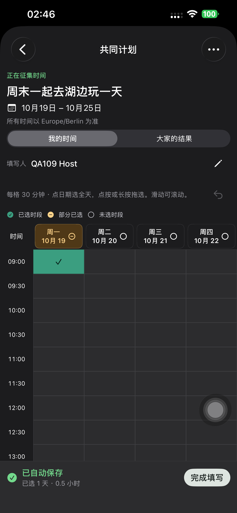
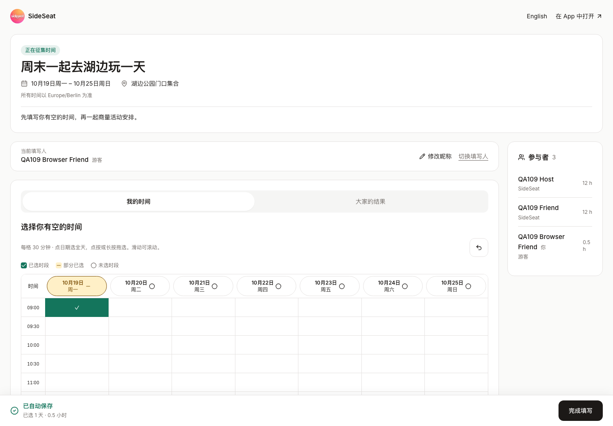
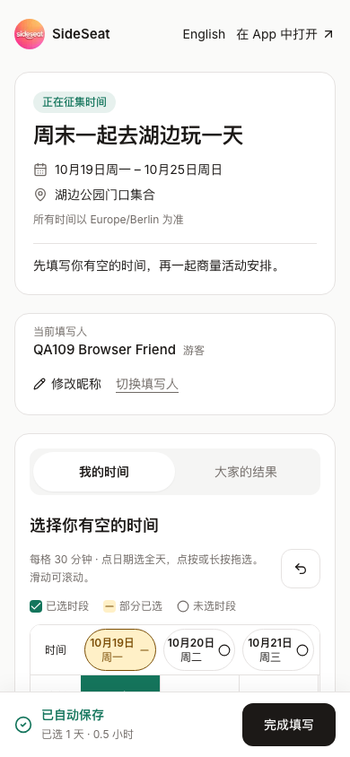

# Preview 109 计划顶部与保存反馈验收

**日期：** 2026-10-16，Europe/Berlin。范围：共享可用时间的 App、手机网页和电脑网页。

## 契约与实现

主源码 `167cb5f`，基线 `ba495a7`；最终原生配色修正 `4ed4e2f`，均在当前分支已推送。
顶部按计划状态、标题、日期范围、地点、明确标注的时区排列，昵称保持独立而紧凑。
两端使用「我的时间 / 大家的结果」。网页日期/星期表头分行，浅色卡片用中性白，主操作用深浅适配色。

底部保存栏持续可见，成功仅取自原串行保存队列的服务器确认。显示正在保存、已自动保存、
失败保留草稿与重试，附已选天数及实际总小时数。「完成填写」仅在答复已保存后可用，
进入结果并提示可返回修改。它不改变计划阶段，不替代邀请的「确认参加」。
没有改变格子 ID、半格处理、手势、撤销或邀请/日历语义；无 API/Schema/迁移变化。

## 本地集成

最终 12 个不同用例通过：整批 11 项通过，触控一项等待滚动停止后定向通过。
新 Chromium/WebKit 两项覆盖：

- 长中文标题、日期/地点/时区的层级，320/390/768/1024/1440px 无页面溢出。
- 实际保存请求暂缓返回时显示「正在保存」，完成按钮禁用；响应确认后显示「已自动保存」。
- 模拟一次保存失败时选择保留，重试成功，汇总为真实天数/小时数。
- 完成后进入大家的时间表，再返回修改、刷新重开仍保留实际 API 的选择。
- English、浅色/深色、桌面一周和手机底部按钮可见。

其余覆盖现有网格/半格/撤销、游客昵称及按名字继续、半天/全天/24 小时邀请和日历。
多轮本地登录触发 10 次/15 分钟测试账号限流，仅清理隔离本地数据库的登录计数后重跑；
未调整线上限流。旧触控测试在滑动仍减速时读取坐标，现等待滚动位置稳定后测量，
每次长按后重新读取终点；生产手势代码未改变。
TypeScript、定向 ESLint、三语言字符串和签名 Preview 构建通过。
[本地结果](./evidence/2026-10-16-feedback109/local-summary.json)。

## 默认 iPhone 14 Plus

设备 `00008110-001A69110CC1401E`、CoreDevice
`D906CC6D-3EC6-50A2-8D93-A6602521362A`，iOS 26.6.1。
签名 Team `V4238R5R53`，设备描述文件及严格/深度签名核验通过。

主源码 Preview 109 实际安装后，两项 XCTest 通过、0 失败/跳过：

- `testClearAvailabilityFeedbackAndCompletion`，34.747s：初始提示/按钮禁用，选半小时，
  已自动保存，完成进入结果，返回修改，深色重开仍保留。
- `testOrdinarySwipesScrollWithoutEditing`，24.208s：上下和左右普通滑动不修改选择。

首次检查曾因旧中文标签「我的可约时间」而找不到「我的时间」，现两端统一；
滚动夹具最初未保存空答复，修正为显式保存空答复后重跑。API 核对新填写的精确 ID `[0,1]`、
滚动答复 `[]`，两计划均为 COLLECTING，完成没有确认参加。
[主源码真机结果](./evidence/2026-10-16-feedback109/native-phone-summary.json)、
[实际 API](./evidence/2026-10-16-feedback109/phone-api-verification.json)。

深色截图人工检查发现完成按钮的系统文字与浅色填充对比不足，随后 `4ed4e2f` 使用
现有 `ProductAction.fill/foreground` 成对配色；最终聚焦复查及截图单独记录，主源码两项
通过不替代该视觉修正后的安装证据。最终重新安装后，同一填写完成流程单项通过（35.964s、0 失败/跳过），
并人工核对深色按钮文字清晰可读。见 [最终真机复查](./evidence/2026-10-16-feedback109/native-phone-final-summary.json)。
QA runner 已卸载，Preview 109 空参数普通启动 PID 999 已核验运行；普通 SideSeat 97 保留。
[最终设备状态](./evidence/2026-10-16-feedback109/device-final-state.json)。

## 网页发布依据

真实生产基线 `dpl_HHqbc44TnSUitJCAgKUjNrCxNt4s` 共 1,343 项源码逐文件 SHA-1 核验；
构建上下文原样保留 1,340 项，仅叠加三个 UI 文件并新增来源记录。候选上传 1,344 项全匹配。
候选构建 `dpl_EAJLd9xMRuyCx6fnoVeFphGtUmE1`，构建显式跳过数据库迁移。
[来源](./evidence/2026-10-16-feedback109/source-manifest.json)、
[上传](./evidence/2026-10-16-feedback109/upload-verification.json)。

[交付记录](../releases/2026-10-16-preview109-availability-feedback.md)。

候选和正式双域名均指向 Ready 的同一构建。各执行 Chromium/WebKit 两种真实流程：
两个独立注册 QA 账号与一个网页游客，验证顶部日期/地点/时区、半小时选择后的自动保存汇总、
完成进入结果且仍为 COLLECTING、返回修改/重开保留、昵称修改、桌面一周/手机固定按钮。
随后实际发出 12 小时邀请，游客在网页确认，注册朋友通过原接口确认；两个注册用户各有
一条日历记录，起止 ISO 与邀请精确一致。该阶段没有新增或修改服务器业务逻辑。
[候选流程](./evidence/2026-10-16-feedback109/candidate-results.json)、
[正式流程](./evidence/2026-10-16-feedback109/live-results.json)、
[双域名状态](./evidence/2026-10-16-feedback109/deployment-state.json)。

## 健康与清理

八项公开健康检查通过；发布后的 15 分钟范围 error 查询成功，0 条结果，未改变监控配置。
八个本次临时计划和两个专属账号全部删除，公开 API 链接均 404，旧登录令牌均 401。
最后一次真机复查的 API 再核对精确 ID `[0,1]` 和征集阶段。
本地测试服务/数据库已停止；汇出脱敏证据后删除私有临时认证、日志和 xctestrun。
受控发布上下文与构建产品保留。没有修改用户登录凭据或上传 TestFlight/App Store。
[最终手机 API](./evidence/2026-10-16-feedback109/phone-api-final.json)、
[健康](./evidence/2026-10-16-feedback109/health.json)、
[运行查询](./evidence/2026-10-16-feedback109/runtime-summary.json)、
[清理](./evidence/2026-10-16-feedback109/cleanup-summary.json)。
