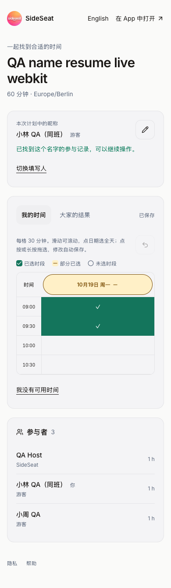

# 游客按名字继续填写 QA — 2026-10-16

Europe/Berlin。基线 `f12d384` 干净，当前分支不变。实现提交
`2dfd3a9601ae9b1690e28ab41c7dca2bc0b99b2a` 已推送。
用户明确选择熟人共享：输入已有游客名字即可修改原填写，无专属修改链接。

## 实现与范围

名字在当前计划内首尾去空白并忽略大小写匹配；新名字创建游客，已有名字恢复原 guest。
加入操作使用计划行锁，两个浏览器同时输入同名只创建一条 guest。恢复不清空时间、不增加
投票人数、不重置确认。旧随机浏览器凭据不轮换；新 cookie 在当前计划路径内记住所选 guest，
因此两个浏览器都可继续使用。该 cookie 是熟人链接中的选择记录，不是私有身份凭证。
写入仍检查页面预期的 participant ID，防止切换填写人后旧标签页误写。

网页增加「开始 / 继续填写」、原记录提示和「切换填写人」，保留昵称铅笔和自动保存。
改名到另一位游客已使用的名字时提示切换身份或使用不同名字，不自动合并或清空数据。
旧页面保存时间使用当前 guest 名字，避免撤销另一浏览器刚完成的改名。
历史同名行不自动删除，新同名入口确定地选择最早创建的 guest。
原生账号填写不通过游客名字认领；账号权限与个人日历访问仍需原有登录。
时间仅在 COLLECTING 修改，INVITING 继续原版邀请确认，关闭状态边界保持。

## 本地真实集成

服务确认运行于活跃项目目录和 3105 端口，隔离数据库为 127.0.0.1:5433 的
`sideseat_ios_test`，151 项迁移已存在、无待执行迁移。未操作 StudiFind 的 3000 端口。

- 原游客填写、改名、确认及注册用户 Calendar 流程通过。
- 原 30 分钟时间格、全天选择/清空/撤销、旧半格/热图和触控滚动共 3 项回归通过。
- Chromium/WebKit 的同名返回、空白修整、保存、原浏览器继续有效、改名后返回、切换
  填写人、清除 cookie 后恢复、改名冲突提示、确认及日历两项流程通过。
- 并发 Alice/alice 只产生一个 guest，跨计划隔离、旧随机凭据及其跨浏览器恢复通过。
- 首次共 7 项：5 通过、2 失败。两个新用例在「这个名字已有填写」断言处匹配到了
  Next.js 自带 route announcer 和正确的产品 alert；改为按文字过滤，并清除取消编辑后的
  错误提示，两项仅重跑后通过（15.6s）。最终 7 个独立用例均有通过结果，不描述成首次全过。
- TypeScript 和相关 ESLint 最终通过；生产构建通过。实际浅色手机宽度截图已检查。

## 候选与正式真实流程

候选与正式分别在 Chromium 和 WebKit 的 390px 手机布局测试，共四个独立计划、一个
通过普通 signup/login API 创建的 QA 账号。没有发送邮件/消息或写入用户原有记录。
候选保留访问保护，使用已授权 Vercel CLI 访问及临时认证 cookie 测试，没有关闭保护。

每个计划均核对：

1. 发起者先填写，游客 A 选中 09:00–10:00 两个半小时格，保存 ID `[0,1,2,3]`。
2. 另一个浏览器输入同名，guest 与答复 ID 保持，参与者仍为 2；修改为 `[0,1]` 后原浏览器
   读取和重开都一致，原浏览器没有失效。
3. 改名后旧浏览器保存仍保持新名字；切换至新名字 B 填写，再切回 A，原时间恢复。
4. 清除浏览器 cookie 后重新输入改后的名字，恢复同一份记录，最终 ID `[0,1,2,3]`；
   原生 API 列表仍为发起者加两个游客，共 3 份答复。
5. 发起邀请后，A 确认；全新浏览器输入 B 的名字恢复其邀请，再确认。计划确定，发起者
   schedule 恰有一条计划和两个游客姓名。生产仅查询发起者自己的 schedule；游客无账号、
   不生成个人 Calendar 的断言另由本地真实数据库集成覆盖，未直接查询生产数据库。
6. 完成核验后取消，删除四个专用计划和账号；旧登录令牌返回 401，四条公开链接返回 404。

## 生产来源及结束状态

上一生产 `dpl_JA6CDQp3JCxLfUnMmZaMm5QHRAQ5` 的 1,341 项源码 SHA-1 全部核对后
复制到新的受控发布目录。只覆盖六个本次服务/接口/网页文件，修改前的六项也与 Git 基线
逐项匹配，保留其他 1,335 项及现有生产差异，新增来源记录；最终上传 1,342 项全部匹配。
构建明确记录 `SKIP_DATABASE_MIGRATIONS=1`，Schema 不变，无数据库迁移或旧发布脚本。

候选 Ready、上传核对与真实流程通过后，promote 同一生产构建：
`dpl_6gNEve6aFMsmzWFD4rJpNgBB4fUH`。www/API 双域名均为该 Ready 构建。
client-config、AASA、iOS、隐私、支持、www/API 分享入口及裸域名跳转共八项通过。
限定本部署 30 分钟的 error 查询返回 0 项；未改变日志/监控配置。

默认 iPhone 14 Plus `00008110-001A69110CC1401E` 的实际安装仍为 Preview 107，原生源码
`6222c88` 不变；此次无原生重装、普通启动或新的真机 UI 验收，没有 TestFlight/App Store 上传。
临时网页凭据和本地服务在提取脱敏证据后回收，受控生产发布来源另行保留。

证据：[本地结果](./evidence/2026-10-16-guest-name-resume/local-summary.json)、
[候选流程](./evidence/2026-10-16-guest-name-resume/candidate-results.json)、
[正式流程](./evidence/2026-10-16-guest-name-resume/live-results.json)、
[来源清单](./evidence/2026-10-16-guest-name-resume/source-manifest.json)、
[上传核对](./evidence/2026-10-16-guest-name-resume/upload-verification.json)、
[正式域名](./evidence/2026-10-16-guest-name-resume/deployment-state.json)、
[入口检查](./evidence/2026-10-16-guest-name-resume/health.json)、
[错误查询](./evidence/2026-10-16-guest-name-resume/runtime-summary.json)、
[数据回收](./evidence/2026-10-16-guest-name-resume/cleanup-summary.json)、
[手机安装](./evidence/2026-10-16-guest-name-resume/phone-state.json)。

