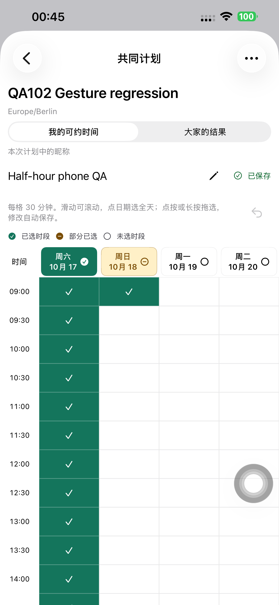
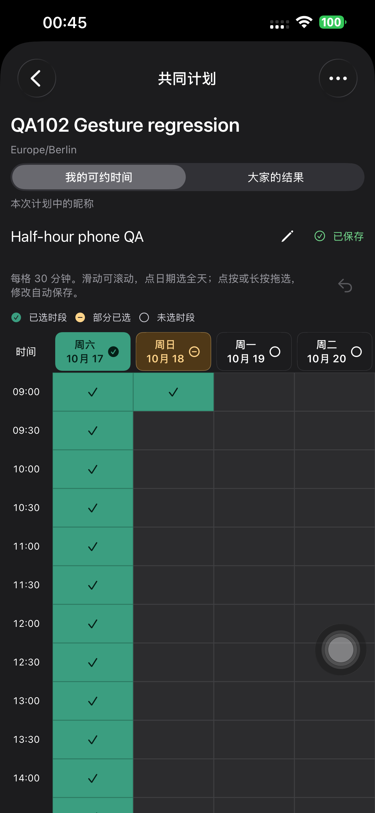
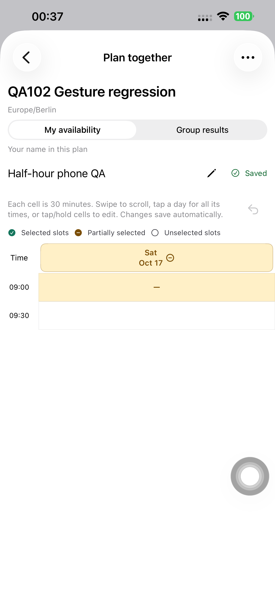

# 30 分钟时间表 — iPhone 14 Plus 真机验收

2026-10-16，Europe/Berlin。用户解锁后，在默认 iPhone 14 Plus / iOS 26.6.1 (23G83)
实际执行 XCTest。UDID `00008110-001A69110CC1401E`，CoreDevice
`D906CC6D-3EC6-50A2-8D93-A6602521362A`；未使用旧 iPhone 16 Pro Max。
初始锁状态为 `passcodeRequired: false`，实际安装为 Preview 106，源码 `8bea32b`。

## 30 分钟真机检查

Preview 106 四项全部通过、0 失败、0 跳过。使用四个独立的新 QA 计划和专用账号，
通过真实生产 API 自动保存；没有修改用户的计划或个人资料。

| 用例 | 时间 | 实际结果 |
| --- | --- | --- |
| `testDeliberateRangeTapEraseAndUndoPersist` | 33.752s | 显示 09:00、09:30，不显示 09:15；长按拖选两格、点按清除、拖动擦除、撤销、退出重开通过 |
| `testDayHeaderSelectsClearsUndoesAndPersists` | 58.619s | 点日期全选计划当天 09:00–21:00 的 24 格，部分选中后补全、再点清空、撤销通过；其他日期选择保留，结果视图只读，中文浅/深色重开通过 |
| `testLegacyPartialHalfHourFillsAndUndoesWithoutRounding` | 25.673s | 旧单个 15 分钟值显示部分选中，点击补齐半小时，撤销及重开仍精确保留原值 |
| `testOrdinarySwipesScrollWithoutEditing` | 20.141s | 时间格上的普通上下、左右滑动可滚动，未产生选择或保存值变化 |

这里的「当天全选」覆盖计划配置的当天可填写范围，非额外扩展为 24 小时。
拖选使用 30 分钟格；底层继续保存已有的 15 分钟 ID。

## 保存提示修复与 Preview 107

106 截图发现绿色状态错误显示「已收藏」。原因是可用时间复用了收藏的 `Saved` 翻译。
原生提交 `6222c88e89a7d43569afb681a2d34f937f0296e3` 改用专用键，中文改为「已保存」，
并将 Preview 增至 107；英文/德文及原收藏文案保留。签名构建、三种语言字符串、
编译包实际翻译、团队/设备描述文件和 deep/strict 签名检查通过；已实际安装 107。

第一次 107 复查在中文文字断言处失败，52.103s：SwiftUI 将同一标识同时赋给图标和
静态文字，`descendants(.any)` 单元素查询出现多个匹配。错误快照中的文字已为「已保存」。
只将测试改为 `app.staticTexts["time-poll-saved"]` 精确断言，测试提交
`24b9e0d869853abaa0c9d61090b7e7548613aae0`；未改变运行时代码。

重置专用 Day 计划为空后重跑 107 的完整 Day 用例，**58.784s，通过、0 失败、0 跳过**。
当天全选/部分/补全/清空/撤销、其他日期保留、结果只读、中文浅/深色退出重开均通过，
两种外观都断言并截图确认「已保存」。四项完整交互是在 106 执行；107 针对唯一的文案
变更复查 Day 用例，没有把它描述成 107 重新执行全部四项。

## 真实持久化与结束状态

106 之后及最终 107 之后均读取真实 API，所有值一致：

| 计划 | `mySlotIds` | 核验意义 |
| --- | --- | --- |
| Range | `[0,1,2,3]` | 两个半小时格，09:00–10:00；擦除后撤销和重开仍一致 |
| Day | `[0…49]` | 第一日期 48 个原始 ID，加第二日期首格的两个 ID；当天操作未清除其他日期 |
| Legacy | `[0]` | 原 15 分钟选择未在重开时被取整 |
| Scroll | `[]` | 普通双向滑动没有误写；测试前已有明确的空答复 |

四个临时计划和专用账号全部通过现有 API 删除；旧访问令牌 401，四条公开链接均 404。
QA runner 已卸载。Preview 107 使用空参数普通启动，PID 903 经设备进程列表核验运行；
普通 SideSeat / `app.sideseat.mobile` / 1.0.0 (97) 仍保留。测试使用临时内存凭据模式，
没有覆盖用户 Keychain。私有运行文件、凭据及原始 XCTest 结果在提取脱敏证据后回收。

本次没有启动本地服务、后端发布、数据库迁移或 App Store/TestFlight 上传。
生产仍为 `dpl_JA6CDQp3JCxLfUnMmZaMm5QHRAQ5`，API 域名 Ready 已复核；
既有网页/模型验收见 [106 QA](./2026-10-16-half-hour.md)。

证据：[106 四项结果](./evidence/2026-10-16-half-hour-phone/xctest106-summary.json)、
[106 保存值](./evidence/2026-10-16-half-hour-phone/api106-verification.json)、
[107 首次查询失败](./evidence/2026-10-16-half-hour-phone/xctest107-initial-attempt.json)、
[107 最终通过](./evidence/2026-10-16-half-hour-phone/xctest107-summary.json)、
[最终保存值](./evidence/2026-10-16-half-hour-phone/api-final-verification.json)、
[安装与普通启动](./evidence/2026-10-16-half-hour-phone/device-final-state.json)、
[测试数据回收](./evidence/2026-10-16-half-hour-phone/cleanup-summary.json)。

