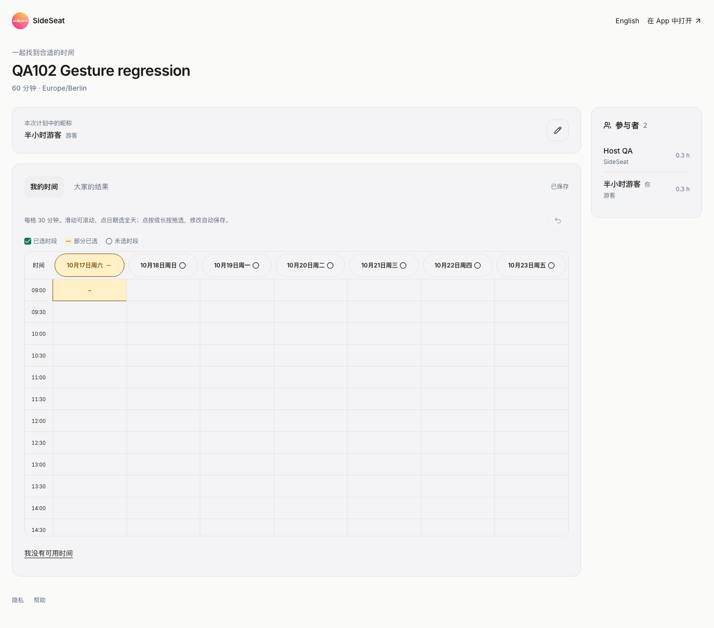
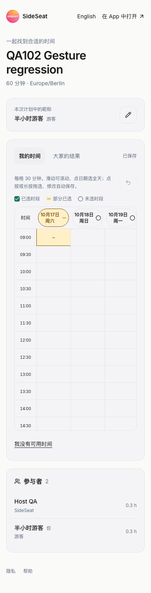
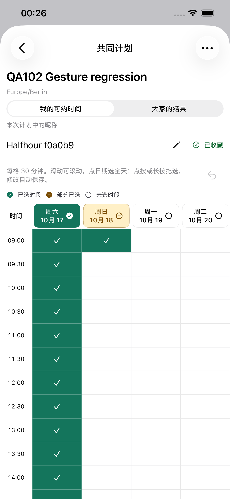
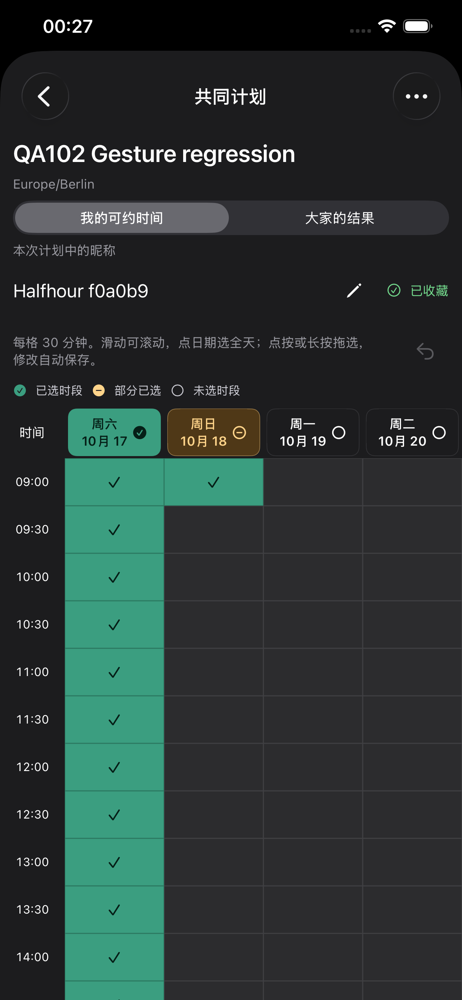
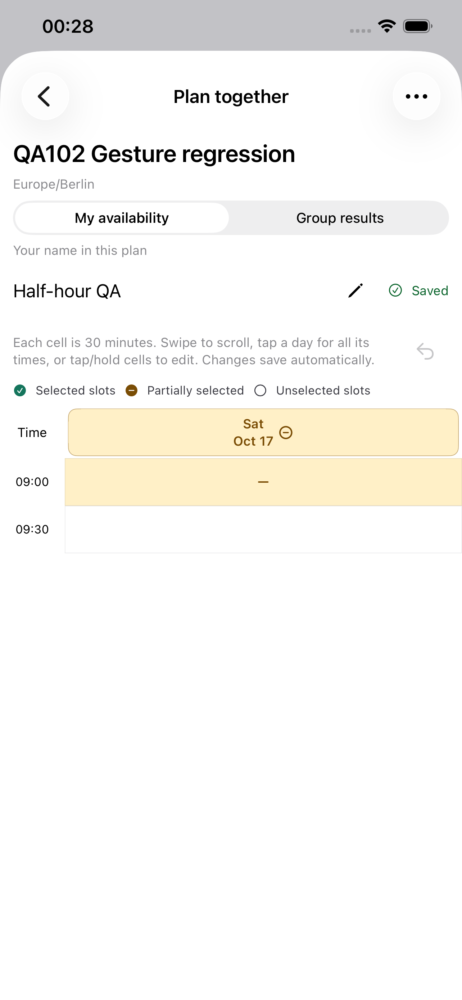

# 30 分钟时间表 QA — 2026-10-16

当前源码 `8bea32b50eacbfa111b977b9a9d200091f78aa36` 已提交、推送。
网页、原生都把相邻且连续的两个已有 15 分钟 ID 作为一个 30 分钟显示/编辑单元。
新原生日常时间范围选择使用 30 分钟步长；旧范围末尾的单个 15 分钟保留，不跨日期合并。
44px/pt 点击目标、手势判定时长、桌面加宽、保存队列与服务端推荐协议保持。

## 已完成验证

| 检查 | 实际结果 |
| --- | --- |
| TS 模型 | 2 项通过：全部底层 ID 保留、旧 09:15 起始/末尾单格、普通日及春/秋 DST 行数减半且不合并重复时间 |
| 网页集成 | 原 3 项通过 / 34.3 秒；新增旧半格与整段人数测试通过 / 4.4 秒；Chromium/WebKit、真实本地 API/数据库 |
| 原生模型/保存 | iPhone 14 Plus / iOS 26.5 独立模拟器，5 项通过、0 跳过：半小时矩形、旧半格补齐/清除、完整半小时人数、顺序保存、换账号不串写、链接 |
| 原生 UI | 同型号独立 Development 模拟器 4 个用例最终通过：Day 75.641s、Range 39.876s、Legacy 29.175s、Scroll 22.816s；原生浅/深色截图及真实 API 保存值核对通过 |
| 静态/构建 | TypeScript、相关 ESLint、diff whitespace、en/zh-Hans/de 字符串、项目/API 生成及 Preview 签名构建通过 |
| 候选网页 | Chromium/WebKit × 390/1024/1440px × 中英文 × 我的/结果 = 24 项，通过；浏览器内计划响应，无真实业务写入 |
| 正式网页 | 同样 24 项通过；使用隔离游客与真实 API，填写/保存/撤销/重开、第七天全选、跨七天鼠标拖选通过 |

12 小时 × 7 天的 336 个存储格显示为 168 格，每天 48 行变成 24 行。
含日期表头的时间表内容高度为 1112px，保持外部滚动容器；个人格与结果格均为 44px。
390px 时间表外宽仍为 316px，保留左右滑动；1024/1440px 一周七天同时可见，无横向溢出。
网页正式截图已人工检查。部分格使用原有琥珀配色、减号与 `aria-pressed=mixed`，
点击补齐、整格清除、撤销恢复原来的单个 ID。两人各选不同一半时，30 分钟热图人数为 0。
底层推荐仍检查每个实际 15 分钟区间，无数据迁移或打开页面时的自动取整。

## 原生安装与真机边界

实际签名安装 **Preview 1.0.0 (106)** 到默认 iPhone 14 Plus，UDID
`00008110-001A69110CC1401E`，CoreDevice `D906CC6D-3EC6-50A2-8D93-A6602521362A`。
设备身份、团队 `V4238R5R53`、设备在 provisioning profile 内、deep/strict 签名核验通过。
原生 XCTest 因 `Unlock iPhone (4) to Continue` 等待，已请求用户解锁；再次读取锁状态
`passcodeRequired: true`。等待后中止执行，没有把该次测试或普通启动标记为通过。
没有改用旧 iPhone 16 Pro Max，普通 SideSeat 97 保留。

初次在 Preview scheme 请求模型测试被拒，因为它仅含 UITests；最终改用独立 Development
模拟器，5 项实际执行通过。模拟器 UI 检查使用新建同型号设备及独立计划。
首次旧缓存 UI 模板在执行断言前取消，重建当前目标后运行：3 项通过；滚动用例因
新计划尚未提交过答复而不存在 Saved 指示，补一个明确的空答复后仅重跑该项并通过。
这是测试数据初始化修正，没有为满足用例改变产品行为。
实际原生 API：半小时范围保存 `[0,1,2,3]`；整天加另一日期首格为 `[0...49]`；
旧半格撤销和重开后仍恰好 `[0]`；普通滑动仍为空。该 Development 模拟器与 Preview 106
使用同一选时代码；普通分发 App 的真机安装没有被覆盖。

## 生产来源和部署

上一真实生产 `dpl_6JpdrfEay16wvWzMnzPT5o3zxEPF` 的 1,340 项源码逐文件 SHA-1
核验重建，保留 1,337 项原内容，只覆盖 `browser-types.ts`、`availability-editor.tsx`、
`use-availability-gesture.ts` 并新增来源记录。上传 1,341 项全部匹配，没有冻结归档。
构建显式 `SKIP_DATABASE_MIGRATIONS=1`，不执行旧前置发布脚本，API/Schema 不变。

候选 Ready、完整布局/手势检查及全部上传哈希通过后 promote 同一构建：
`dpl_JA6CDQp3JCxLfUnMmZaMm5QHRAQ5`。www/API 双域名 inspect 均匹配、Ready。
正式 client-config、AASA、iPhone 引导、隐私、支持、www/API 分享页面 200，裸域名分享
页面 307 跳 www 并保留路径。未关闭部署保护。上一生产部署保留为恢复点。

正式 QA 使用通过普通现有 API 创建的一个临时账号、九个独立计划及一个浏览器游客；
没有发送邮件、聊天或写入真实用户资料。模拟器与等待中的手机使用不同计划。
九个计划及专用账号已删除，九条分享链接均 404，旧访问令牌 401。真机 QA runner
卸载成功，空参数普通启动仍因锁屏失败。测试模拟器、私有凭据和本地服务在验收后回收。

[来源清单](./evidence/2026-10-16-half-hour/source-manifest.json)、
[上传核对](./evidence/2026-10-16-half-hour/upload-verification.json)、
[双域名状态](./evidence/2026-10-16-half-hour/deployment-state.json)、
[本地布局](./evidence/2026-10-16-half-hour/local-layout.json)、
[候选布局](./evidence/2026-10-16-half-hour/candidate-layout.json)、
[正式布局](./evidence/2026-10-16-half-hour/live-layout.json)、
[健康检查](./evidence/2026-10-16-half-hour/health.json)、
[原生单元结果](./evidence/2026-10-16-half-hour/native-unit-summary.json)、
[原生 UI 结果](./evidence/2026-10-16-half-hour/native-ui-summary.json)、
[实际保存值](./evidence/2026-10-16-half-hour/api-verification.json)、
[真实安装状态](./evidence/2026-10-16-half-hour/device-install.json)、
[数据回收](./evidence/2026-10-16-half-hour/cleanup-summary.json)。

