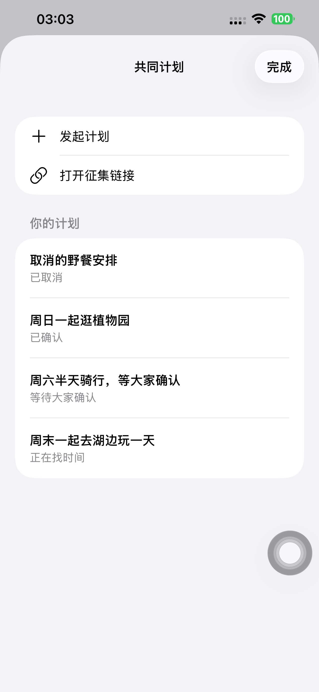
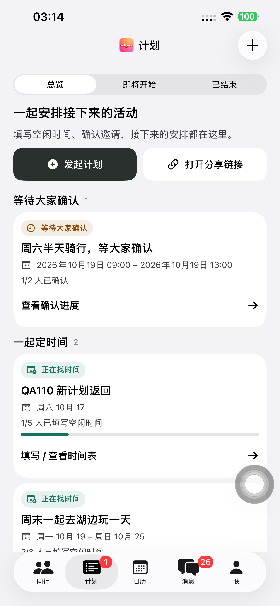
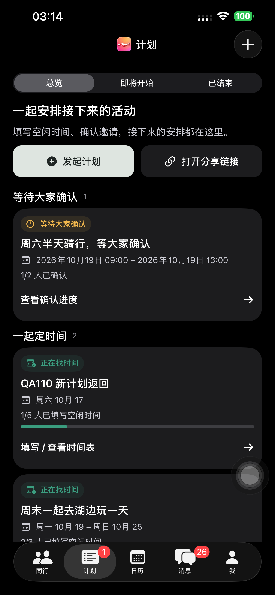

# Preview 110 一级计划页与返回导航验收

**日期：** 2026-10-16，Europe/Berlin。结论：已复现原返回缺陷，修正后默认真机验证通过，
最终 Preview 110 已安装并普通启动。分支 `codex/ios-uxui-20260922`，基线 `fed9ab2`。
最终源码 `01d6350` 已提交并推送。

## 原问题与修正

原 Preview 109 的计划卡片通过 `TimePollSheet(initialToken:)` 打开。该 wrapper 的根是
第二套共同计划列表，task 再把 initialToken 推入详情；返回时露出隐藏列表。
新建、消息和 deep link 的路径不同。新加入的真机回归在原应用上复现：完成填写后返回，
一级计划按钮不可点击，截图明确显示二级「共同计划」列表（预期失败 27.875s）。
[原复现](./evidence/2026-10-16-plans110/baseline-reproduction.json)。

现在一级计划页提供创建、打开分享链接，按确认、征集和下一次安排展示状态/进度。
所有手动计划入口使用 `RouterPath.openPlan`，路径为单个 timePoll 详情；重复打开不叠加。
创建成功先 dismiss 表单，再打开这条路径；消息快捷入口转到一级计划，消息/外部链接使用
同一详情。详情隐藏 tab bar，返回恢复一级页。保存成功通知刷新一级列表。
原双人聊天计划、Outcome/Repeat、自动保存/半格/撤销及邀请/日历语义保留。
旧列表只留在已禁止进入的群聊兼容入口中，没有重新开放旧群聊。

## 验证

- iPhone 14 Plus / iOS 26.6.1 / UDID `00008110-001A69110CC1401E`，所有安装/运行命令明确指定。
- Preview 110 签名构建通过，Team `V4238R5R53`，描述文件包含目标设备，严格/深度核验通过。
- 隔离 iPhone 14 Plus / iOS 26.5 模拟器：NavigationTests 21 项通过，含重复进入只有一层、返回根路径的回归；模拟器已删除。
- 三语言字符串检查、生成工程既有引用及 Git diff 检查通过；没有 OpenAPI 或生成 API 改动。

真机七个不同用例最终通过。初批 7 项为 4 通过、3 失败；新增分组容器的 identifier
传递影响了子控件识别，补上显式 accessibility containment，并在测试中滚动显示惰性列表。
Deep link 启动助手原先等待详情里已隐藏的 tab bar，修正为等待详情。之后三项定向通过。
这些是实际初批失败与修正记录，不作首次全通过的声明。

| 用例 | 验证结果 |
| --- | --- |
| 新建、选时、完成后返回 | 通过，实际保存 `[0,1]`，直接到一级页 |
| 已有卡片完成后与普通返回 | 最终通过 26.593s，两种返回均无隐藏列表 |
| 一级分组、打开链接、即将开始/已结束、消息入口 | 最终通过 36.180s |
| 深色链接直达后返回 | 最终通过 14.507s，浅深色均人工核对 |
| 消息入口及创建取消 | 通过 16.056s，消息转入一级计划 |
| 连续三次创建取消 | 通过 31.998s，一次取消即可返回 |
| 创建模式切换、下拉关闭、重开 | 通过 30.402s |

[真机结果](./evidence/2026-10-16-plans110/native-verification.json)、
[21 项导航测试](./evidence/2026-10-16-plans110/navigation-tests.json)。

## 数据与最终状态

两个专属 QA 账号创建征集、邀请中、已确认、已取消四个计划，真机另创建一个计划。
实际 API 核对五项阶段/人数和 UI 创建后的精确选择；只对这些 QA 数据进行清理。
五个计划删除后公开 API 均 404；两账号删除后旧令牌均 401。
[API 核对](./evidence/2026-10-16-plans110/api-verification.json)、
[清理](./evidence/2026-10-16-plans110/cleanup-summary.json)。

最终 QA runner 卸载，Preview 110 空参数普通启动 PID 1026 已核验运行；普通 SideSeat 97 保留。
本次无后端部署，既有 `dpl_EAJLd9xMRuyCx6fnoVeFphGtUmE1` 实际仍为 Ready。
无 API、Schema、迁移、TestFlight/App Store 上传，也未改写用户登录凭据。
脱敏证据导出后删除私有临时认证、xctestrun 和原始日志；构建产品保留。
[设备状态](./evidence/2026-10-16-plans110/device-final-state.json)、
[后端状态](./evidence/2026-10-16-plans110/backend-state.json)、
[交付记录](../releases/2026-10-16-preview110-plans-root.md)。
