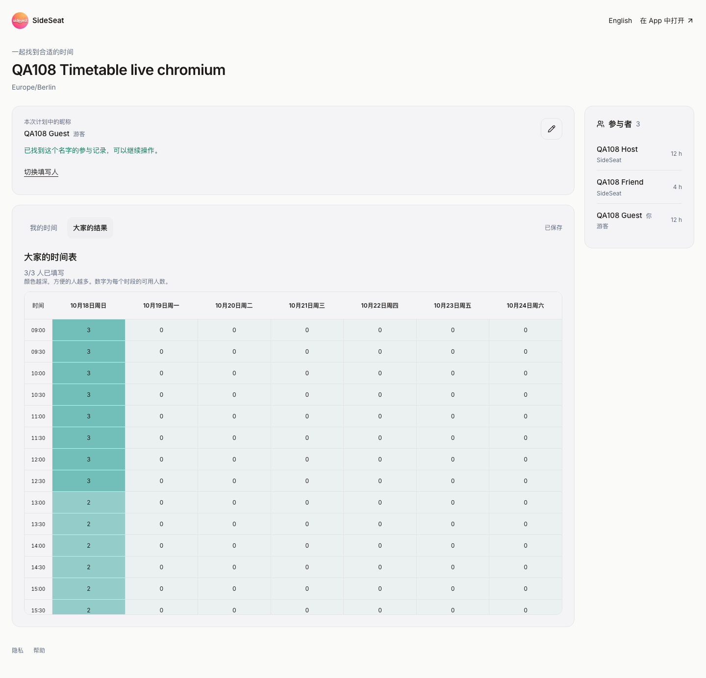
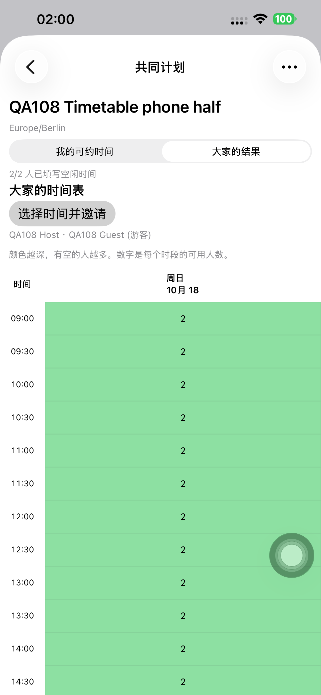
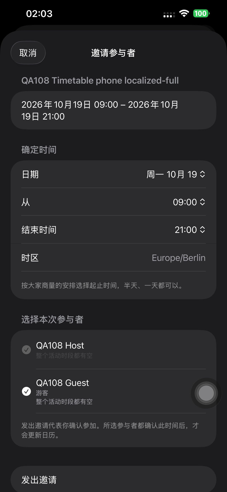

# Preview 108 完整时间表验收

**日期：** 2026-10-16，Europe/Berlin。结论：网页/API 已发布，Preview 108 已安装到默认
iPhone 14 Plus；完整结果表、无预设时长征集、手选半天/全天邀请及确认后的日历范围验证通过。

## 范围与契约

主源码 `87502492a3d3152873ded9c92c66cff0abacb2bc`，测试辅助
`dc9a8742b5fc02943a50af1b6fe96d79fd626e8d`，最终手机运行源码
`362daaba13a1724defd12db9caaab081a32530a1`，均已推送当前分支。
最终原生修正仅涉及新日期标签、日期摘要所用语言及其 UI 断言，不改变邀请范围逻辑。

结果页显示「大家的时间表」、填写人数、每格人数热图；当前网页和原生均移除共同时间及
人数最多推荐卡片。COLLECT 创建不带活动时长；邀请页明确选日期、开始和结束时间。
默认当天完整配置范围；修改开始时间时保持合法结束时间，午夜边界显示 24:00。
受邀名单由发起人明确选择，填写不等于接受；同版邀请全部接受后才写入日历。

请求增加可选 `end`，给定时要求晚于 `start`，服务按真实连续格验证完整范围。
省略时保留既有时长/60 分钟回退，旧 API summary/windows 返回和计算保留兼容；
直接选时间创建流程保留。OpenAPI 和原生生成模型同步，无 Schema 变化或迁移。
既有 30 分钟显示、底层 15 分钟 ID、旧半格、撤销、颜色、手势和游客同名恢复保留。

## 本地与静态验证

使用隔离的本地 PostgreSQL 和当前项目服务。首次 12 项运行 10 通过、2 失败：
新增 Calendar 断言把实际 `startAt/endAt` 写成 `startTime/endTime`。
修正测试字段名后两项定向重跑通过；再增加一个 24 小时跨日用例并通过。
最终有 13 个不同集成用例通过，不能把首次运行写作全部通过。

| 验证组 | 结果 |
| --- | --- |
| 既有统一计划 API、名单选择/取消删除、网格、游客和名字继续填写 | 10 项通过 |
| 新时间表 Chromium/WebKit | 2 项修正断言后通过 |
| 24 小时跨日、两注册账号确认与 Calendar | 1 项通过，起止时间精确匹配，公开确认显示两日 |
| 无时长征集 | `durationMinutes = null` |
| 网页布局 | 1440px 一屏七天；390px 表内横向滑动，页面无溢出 |
| 手选范围与兼容 | 4h、12h、24h；旧省略 end 回退 60min；相等 end 返回 422 |
| 现有交互回归 | 自动保存、旧半格/热图、触控/撤销、按名字继续填写用例通过 |
| 静态/构建 | TypeScript、定向 ESLint、191 项 OpenAPI 操作及生成校验、en/zh-Hans/de 字符串检查、签名 Preview 108 构建通过 |

[本地汇总](./evidence/2026-10-16-timetable108/local-summary.json)。

## 候选与正式线上

从真实生产逐文件重建，并核对四项覆盖文件的旧内容与修改前 Git 基线一致；
1,342 项基线已验证，1,338 项原样保留，最终 1,343 项上传哈希全匹配。
候选 Ready 后才 promote 同一构建，双域名实际指向
`dpl_HHqbc44TnSUitJCAgKUjNrCxNt4s`；构建日志确认跳过迁移。

候选和正式各执行 Chromium/WebKit 两种真实流程。每项用两个专属注册 QA 账号及一个游客：
09:00 人数为 3，13:00 为 2；新浏览器输入同一游客名字恢复原填写。
检查中文标题、推荐卡片不存在、桌面七天及手机滑动，验证旧 1h 回退、新 4h 和 12h 邀请。
注册朋友和网页游客确认后，两个注册账号各恰好一个日历条目，起止时间均与 12h 邀请精确一致。
每项验证后取消计划。

首次候选脚本把新请求发到尚未发布的旧正式 API，返回不识别 `end` 的 422。
这是测试目标错误；改为候选已认证请求上下文后两种浏览器均通过，废弃的一个临时计划已删除。

八项公开健康检查通过，包含 client config、AASA、iOS/隐私/支持入口、www/API 分享入口，
以及根域分享路径保留的 307 跳转。发布后 30 分钟范围 error 查询成功且返回 0 条；未调整监控设置。

证据：[候选](./evidence/2026-10-16-timetable108/candidate-results.json)、
[正式](./evidence/2026-10-16-timetable108/live-results.json)、
[来源](./evidence/2026-10-16-timetable108/source-manifest.json)、
[上传哈希](./evidence/2026-10-16-timetable108/upload-verification.json)、
[部署状态](./evidence/2026-10-16-timetable108/deployment-state.json)、
[健康](./evidence/2026-10-16-timetable108/health.json)、
[运行查询](./evidence/2026-10-16-timetable108/runtime-summary.json)。

## 独立模拟器与实际手机

独立 iPhone 14 Plus / iOS 26.5 模拟器使用运行源码 `8750249`、测试源码 `dc9a874`，
连接隔离本地服务 3105/数据库 5433。三项 UI 测试全部通过，无失败/跳过：

- `testCollectCreationDoesNotRequireActivityDuration`
- `testTimetableResultsAndManualHalfDayInvitation`
- `testManualFullDayInvitationInDarkMode`

另从 API 验证实际保存的 4h、12h 邀请和确认后 Calendar，UI 新建征集的时长为 null。
该模拟器截图早于最终日期语言修正；下方当前日期截图使用最终真机结果。
证据：[模拟器 UI](./evidence/2026-10-16-timetable108/native-simulator-summary.json)、
[模拟器 API](./evidence/2026-10-16-timetable108/simulator-api-verification.json)。

真机命令均明确指定 iPhone 14 Plus，UDID `00008110-001A69110CC1401E`，
CoreDevice `D906CC6D-3EC6-50A2-8D93-A6602521362A`，iOS 26.6.1。
签名 Team `V4238R5R53`，设备包含在描述文件中，深度/严格签名验证通过。
首次安装 Preview 108（运行 `8750249`、测试 `dc9a874`）后，上述三项测试全部通过，
无失败/跳过。实际 API 再核对 4h/12h 邀请和 Calendar、UI 创建征集时长 null。

视觉检查发现新日期栏为英文 Date，时间摘要跟随设备德语；修正为独立可翻译日期键和
App 所选语言日期格式。以最终源码 `362daab` 重建、重装 Preview 108，全天深色邀请测试
再次通过（1 通过、0 失败、0 跳过，21.332s），明确断言日期标签为「日期」。
最终截图中文标签/日期正常；API 再确认该 12h 邀请和 owner Calendar 精确一致。

证据：[首次真机 UI](./evidence/2026-10-16-timetable108/native-phone-initial-summary.json)、
[首次 API](./evidence/2026-10-16-timetable108/phone-api-initial.json)、
[最终真机 UI](./evidence/2026-10-16-timetable108/native-phone-final-summary.json)、
[最终 API](./evidence/2026-10-16-timetable108/phone-api-final.json)。

## 清理与最终状态

八个有效线上临时计划和一个已废弃重试计划全部删除，九个公开链接均 404；
两个专属 QA 账号删除，旧令牌均 401。只操作本次 QA 数据。
本地 UI 创建/固定夹具也已取消删除，独立本地服务和数据库停止，临时模拟器移除。
原始含认证资料的临时日志/配置在汇出脱敏证据后删除，受控发布上下文和构建产品保留。

QA runner 已卸载，Preview 108 以空参数普通启动，PID 968 及运行进程核验通过。
临时 QA 认证参数未写入用户登录凭据；普通 SideSeat `app.sideseat.mobile / 1.0.0 (97)` 保留。
没有 TestFlight/App Store 上传、Schema 修改或数据库迁移。

[清理证据](./evidence/2026-10-16-timetable108/cleanup-summary.json)、
[最终设备状态](./evidence/2026-10-16-timetable108/device-final-state.json)、
[发布记录](../releases/2026-10-16-preview108-timetable.md)。
