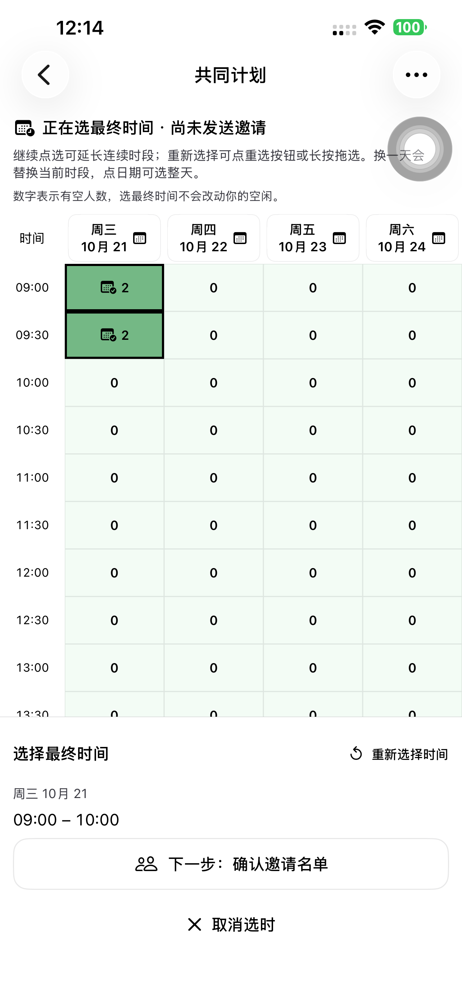
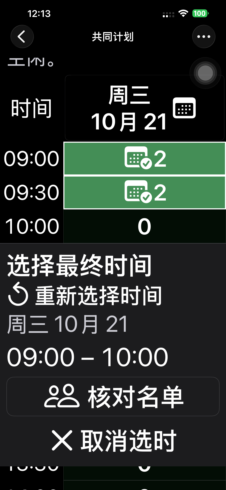

# Preview 143：最终选时连续点选回归

## 复现与修复

默认 iPhone 14 Plus（`00008110-001A69110CC1401E`，iOS 26.6.1）上的 Preview 142 已复现：点第一个、第二个、第三个时间格后，第一个格被取消。原逻辑在第二次点击完成后清掉 `finalAnchor`，第三次点击会新建单格范围。

143 移除两次点击循环：同一天继续点选会扩展现有连续时段，包含中间格；点已经包含的时间格保持原样。重选、长按拖选和换日期有明确规则。正式邀请仍是一段连续时间，不改变个人空闲、名单或邀请版本。

「重新选择时间」最终放在固定底栏，与已选时间一起显示。初版放在表头右侧，七天长表自动滚动后被这台手机的 AssistiveTouch 悬浮球挡住；完整测试命中系统菜单后停止，调整位置后重新验证。未关闭或改动用户的系统辅助功能设置。

## 已完成的专项检查

| 范围 | 结果与证据 |
| --- | --- |
| 142 真机复现 | 第三次点选触发失败断言；[原始结果摘要](./evidence/2026-10-20-plans143/repro142.json) |
| 143 原生领域/状态 | 25 项通过，含顺序/反向/乱序连续点选、已选区内点击、显式清空、跨日、断档与普通多日空闲；[结果](./evidence/2026-10-20-plans143/native-unit.json) |
| 初版 143 真机专项 | 31.976 秒通过：四格点选、反向点选、区内点击、重选、全天、拖选、撤销、取消后保留未提交空闲；[结果](./evidence/2026-10-20-plans143/focused143.json) |
| 真机专项 API | 仍为 COLLECTING、零正式答复、零邀请版本；选时没有提交空闲；[状态](./evidence/2026-10-20-plans143/focused-api.json) |
| 正式分享网页 | Chromium/WebKit 共 32 项通过，真实 API：跨日不连续点选、单格取消、绘制/擦除、撤销、日期全选/取消、触屏点击，及显式提交、慢确认期间编辑、失败重试和离开不提交；[结果](./evidence/2026-10-20-plans143/selection143.json) |
| 原有领域合同 | 13 项通过；没有 API、Schema、迁移或依赖变化 |

普通空闲允许多日、不连续时段，重点击才取消该格；日期取消只清该天，拖选只绘制/擦除矩形内区域，撤销回到上一次草稿。此次检查未发现最终选时的隐藏两次点击重置问题扩散到这些入口。App 发起人和参与者复用同一个空闲表；分享网页复用自己的空闲表，正式邀请时间表保持只读。

## 过程记录

- 第一次用 142 的复现账号继续跑 143 专项时，本地未提交草稿被正常恢复，测试却按空白表开始点击。该轮不是空白前置条件；已清理账号/计划，换新账号后专项通过。未以恢复草稿为由改写保存逻辑。
- 第一轮完整流程在表头重选被系统悬浮球遮挡时失败；第二条用例中止。仅保留实际观察到的五个 Safari API 阶段，未把旧的临时观察器输出算入本轮。[初轮结果](./evidence/2026-10-20-plans143/initial-full.json)、[部分 API](./evidence/2026-10-20-plans143/initial-full-partial-api.json)。
- Safari 新增四格检查初轮在最后一次点击后直接读取选中值，末格即时断言失败，前面三格仍保持选中。补充可见性/位置检查，并显式等待每次选中和取消状态，再以新账号独立跑通完整流程；没有据此改写网页选择逻辑。[初轮失败](./evidence/2026-10-20-plans143/safari-extra-tap-failure.json)。

## 最终完整流程与交付

- 最终 App 双账号完整用例 **311.998 秒通过**，12 个真实 API 阶段通过：创建、分享、参与者填写/修改/重开、深色最大字号、最终时间四次点选/区内点击/重选/拖选、名单复核、发送、取消改期、只读邀请、明确接受、双方唯一日历与返回管理。[用例结果](./evidence/2026-10-20-plans143/final-native-phone.json)、[API](./evidence/2026-10-20-plans143/final-native-api.json)。该原生用例在包含早期 Safari 失败的联合结果包内单独通过，未把整个联合包标为通过。
- Safari 修正测试状态等待后，使用新账号独立完整复验，**194.446 秒通过**，8 个 API 阶段通过；四格连续选择均保留，明确取消额外两格后提交，发起人选时、名单、正式发送、网页明确确认与日历往返均通过。[用例结果](./evidence/2026-10-20-plans143/final-safari-phone.json)、[API](./evidence/2026-10-20-plans143/final-safari-api.json)。
- 最终原生来源 **9aec15d4bba5c83c3a7cd9df4fc47ab8bb1c16d9**。Preview 143 构建、严格签名、安装及源码 SHA-256 复核通过；默认手机普通启动 **PID 3339**，参数为空、无 QA 环境，并观测到实际进程。普通版 97 保留，QA runner 已移除。[构建](./evidence/2026-10-20-plans143/build-verification.json)、[设备](./evidence/2026-10-20-plans143/device-verification.json)。
- 生产保持 **dpl_D7xgQPzwtP4GC9nhTLQoLtgwM8cJ**，三个正式域名均核对，7 项 HTTP 200。网页/API/Schema/迁移没有发布变更，本轮网页结果来自当前正式部署。[生产核验](./evidence/2026-10-20-plans143/production-verification.json)、[健康](./evidence/2026-10-20-plans143/health.json)。
- 合计 12 个临时账号、9 个计划/链接全部清理，验证失效令牌 401、链接 404，私密运行配置与活跃凭据 fixture 清理；本轮未启动本地服务器。[清理](./evidence/2026-10-20-plans143/cleanup-summary.json)、[私密配置](./evidence/2026-10-20-plans143/private-cleanup.json)。

最终验收通过。[机器可读汇总](./evidence/2026-10-20-plans143/final-acceptance.json)。

