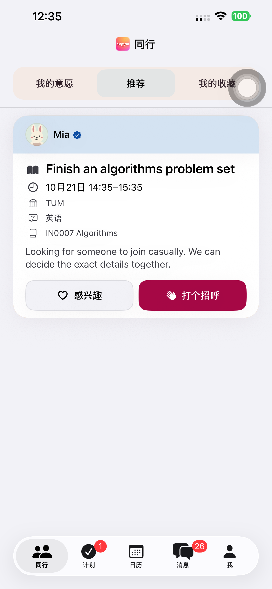

# Preview 144：计划卡片与同行视觉统一

## 变更范围

需要处理、等待他人和下一次见面三类计划摘要直接使用「同行」的 `SSFlowCard`、`SSActivityHeaderBand` 和原有活动插画；复用分类色、24pt 圆角、边界和轻阴影。活动与简短状态在色带中，白色内容区保留时间、真实参与者和原操作入口。等待卡片改为同一行呈现进度和查看入口，已确认卡片保留日期块。

需要处理仍纵向展示，等待他人仍横向排列；「查看全部」、大字号纵向回流、原滚动位置及详情入口保持。活动标题匹配仅用于装饰，不选择活动、不改变规则或存储记录。点击卡片仍进入复核/详情，不提交空闲、不发邀请、不代替确认。

## 真机视觉与导航

- 默认设备：iPhone 14 Plus，UDID `00008110-001A69110CC1401E`，iOS 26.6.1。
- 143 上先运行「同行」推荐卡与计划卡对照，确认当前实际样式；参考数据是离线 UI fixture，不代表真实用户推荐。
- 7 项最终界面回归通过：读屏标题/状态/动作、聊天确认入口、浅色、深色最大字号、横向浏览不切换主分区、展开/收起、返回位置、已确认卡片与大字号日期。
- 另用两名临时真实账号、4 个真实计划构造待处理、两个等待和一个已确认卡片，20.694 秒真机检查通过；打开详情和横向滑动后，四个计划的阶段和邀请版本全部保持。[真实 API](./evidence/2026-10-20-plans144/real-cards-api.json)。
- 标准布局实测高度：待处理 134pt，双行标题约 151.7pt，等待约 115.7pt，已确认约 126.7pt。为活动色带保留空间，已确认用例的上限从 112pt 调整为 144pt；其他原高度上限继续通过。[尺寸](./evidence/2026-10-20-plans144/card-metrics.json)。
- 16 项现有计划状态/引导单元测试通过；未增加与视觉实现重复的单元测试。[单元](./evidence/2026-10-20-plans144/unit.json)、[界面](./evidence/2026-10-20-plans144/presentation.json)、[真实卡片](./evidence/2026-10-20-plans144/real-cards-phone.json)。

## 发现与修正

1. 初次参考测试错误使用了没有展示卡片的「我的意愿」fixture；改为当前推荐卡 fixture 后，在修改前的 143 上完成对照，未据此修改同行功能。
2. 新活动色带含独立可访问性容器，造成整张卡片的默认按钮标签漏掉标题。初轮 7 项中 3 项标题断言失败；改为整卡显式提供状态、标题、日期/时间、参与上下文、地点和入口标签，最终 7 项全部通过。[初轮结果](./evidence/2026-10-20-plans144/initial-presentation.json)。
3. 默认手机在测试间歇出现 Xcode `Device is busy (Connecting…)`，首次构建/真实卡片测试未开始即超时。再次核对同一设备、等待连接后重试通过；没有切换到另一部 iPhone。

离线混合卡片截图中的网络错误来自刻意不可达的 `127.0.0.1:9`，用于既有聊天 UI fixture；最终对外效果图使用独立的真实计划/API 页面，没有把离线错误视作正式服务故障。

## 最终流程与交付

- 默认手机最终原生完整流程 **316.740 秒通过**，12 个真实 API 阶段通过：创建、分享、参与者填写/修改/重开、深色最大字号、最终选时四次点选与重选、名单、发送、取消改期、邀请高亮、明确确认、双方唯一日历和返回详情。[流程](./evidence/2026-10-20-plans144/native-flow.json)、[API](./evidence/2026-10-20-plans144/native-flow-api.json)。
- 原生来源 **f1edd7e38349a5e6d02d179d94a634f38eac075d**。构建、严格签名、安装和源码 SHA-256 核对通过；默认手机 **1.0.0 (144)** 普通启动 **PID 3397**，参数为空、无 QA 环境，实际进程已核验。普通版 97 保留，QA runner 移除。[构建](./evidence/2026-10-20-plans144/build-verification.json)、[设备](./evidence/2026-10-20-plans144/device-verification.json)。
- 本轮只更新原生 UI，没有网页/API/Schema/迁移/依赖发布；生产仍为 **dpl_D7xgQPzwtP4GC9nhTLQoLtgwM8cJ**。没有把 143 的分享网页验收当作本轮重跑结果。[生产](./evidence/2026-10-20-plans144/production-verification.json)。
- 两组真实 fixture 共 4 个账号、5 个计划/链接均清理，失效令牌 401、链接 404 核验；私密运行配置删除，活跃凭据 fixture 为零。本轮没有启动本地服务器。[清理](./evidence/2026-10-20-plans144/cleanup-summary.json)、[私密配置](./evidence/2026-10-20-plans144/private-cleanup.json)。

本轮最终验收通过，修改及上述记录均已提交推送。

