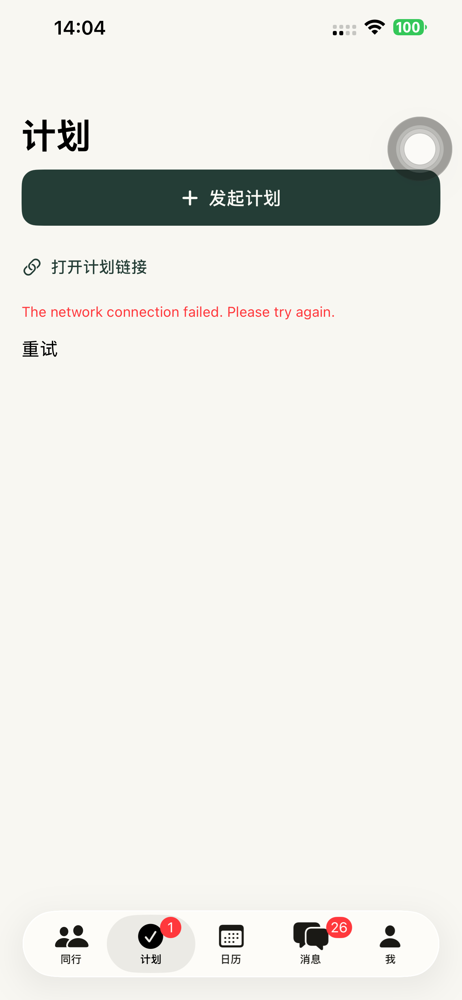
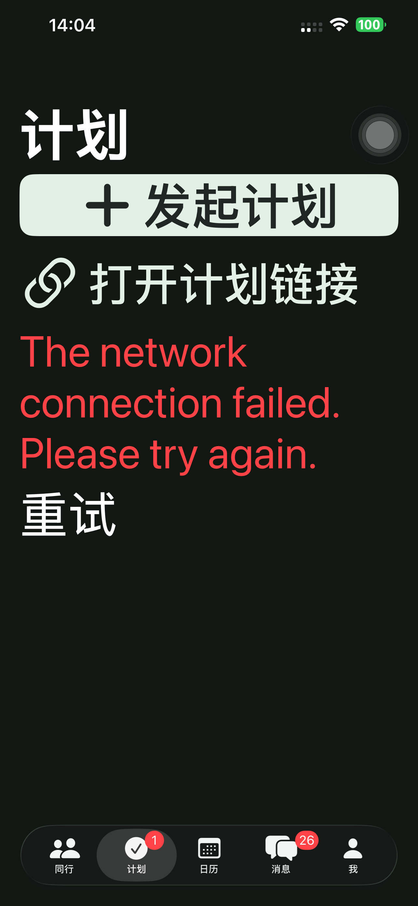

# Preview 146：直接进入计划操作

## 本轮范围

无计划时原来显示插图、宣传标题、用途说明和可打开的示例，属于计划首页的欢迎式空态，并非点击计划 Tab 后自动弹出的独立欢迎页。移除这些内容及专用示例视图，首屏保留「发起计划」和「打开计划链接」。创建仍直接打开原活动/地点/时间表单；取消返回同一计划页。

已有计划的卡片、横向分区、详情时间表、手动提交、邀请、主动正式发出和日历规则没有修改；全 App 产品导览不属于此次计划空态修改。没有 API、分享网页、Schema 或依赖发布。

## 验证边界

本轮使用默认 iPhone 14 Plus、已安装 Preview 146，运行现有首次使用/创建界面用例。离线 UI fixture 使用不可达的 `127.0.0.1:9`，页面中的网络错误来自这项测试配置，不作为正式服务故障。本轮没有创建真实账号或计划，没有重跑分享网页和邀请至日历的服务端完整流程；该流程上次 145 的证据继续作为历史记录。

## 实际结果

- 4 项真机用例全部通过、0 失败、0 跳过：首次进入直接打开创建及链接输入；默认表单填写后可创建；深色最大字号入口、输入、日期和提交按钮可达；消息入口直接进入一级计划页并可创建/取消返回。没有增加复制实现的单元测试。[摘要](./evidence/2026-10-20-plans146/presentation-summary.json)、[逐项结果](./evidence/2026-10-20-plans146/presentation-tests.json)。
- 原生来源 **64d6c3fba9eeb0ad5a7afac0075239cdb5ecfc26**；Preview **146** 构建成功、严格签名和源码/可执行文件 SHA-256 已记录。[构建核验](./evidence/2026-10-20-plans146/build-verification.json)。
- 同一默认手机实际安装并普通启动 **PID 3543**，启动参数为空、没有 QA 环境；实际进程可见。普通版 97 保留，QA runner 和临时 xctestrun 已移除。[设备](./evidence/2026-10-20-plans146/device-verification.json)、[清理](./evidence/2026-10-20-plans146/cleanup.json)。
- API 域名仍指向 **dpl_5YEFNQih1dkZX6LnurN1D2s3cLQR / READY**；本轮未发布后端或网页，没有上传 App Store/TestFlight。[生产核验](./evidence/2026-10-20-plans146/production-verification.json)。

以下为离线界面用例截图；网络错误为上述刻意不可达的测试接口返回，展示的是首次入口和字体布局。

