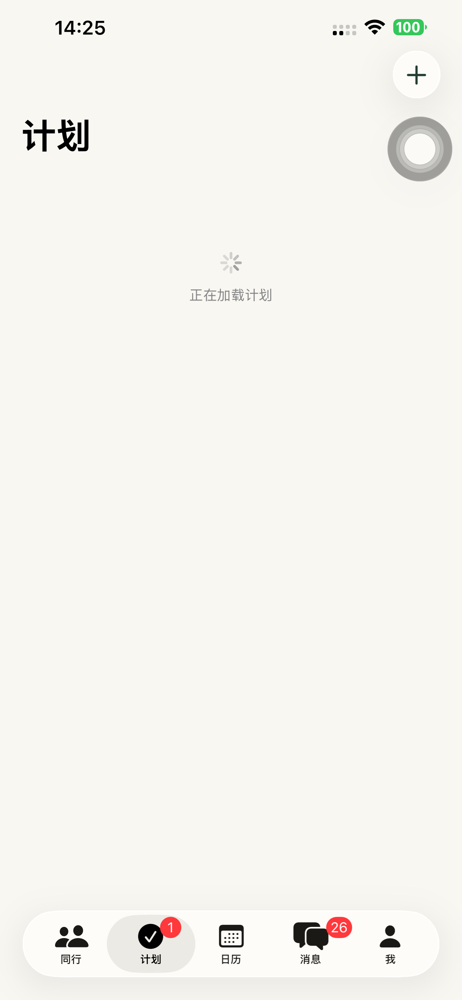
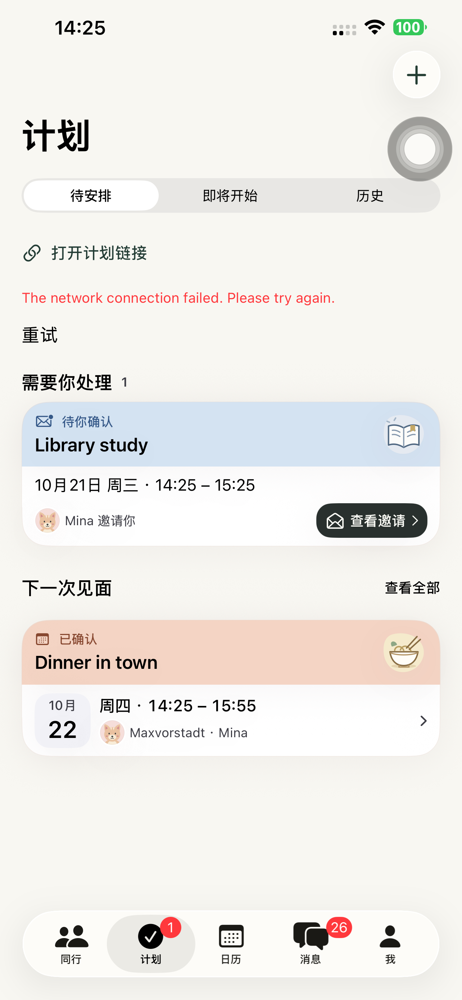

# Preview 147：首次加载不再闪出空计划旧布局

## 定位与清理

在已安装的 146 上，以已有计划但延迟答复的界面 fixture 复现：加载中的「计划」仍出现空态主按钮。针对性用例因「首个答复未返回就显示空布局」断言失败；不是安装旧包或分享网页缓存。[146 复现](./evidence/2026-10-20-plans147/before146-summary.json)。

两个计划来源初始都为空，原页面据此提前判断为没有计划；同时显示两个加载区域。147 首次先显示统一加载状态，任一来源已有实际记录时可展示真实内容；只有两项初始读取结束后才显示空态入口。加载期间仍可从导航栏创建；背景刷新保留已有内容，不重放空态。共享计划不再被聊天计划的加载或错误遮住。

| 残留 | 处理 |
| --- | --- |
| 数据未返回就显示空计划布局 | 与初始加载分开 |
| 两个独立加载区域 | 合并为一个首次加载区域 |
| `.task` 与 `.onAppear` 重复触发共享列表加载 | 保留 `.task`，返回/前台/通知刷新继续有效 |
| 已有计划仍显示宣传标语 | 移除 |
| 没有调用的 `PlanTaskHeader`、`PlanGuideRow` | 删除 |
| 旧纵向分区方法 `coordinatedSection`、两个旧展开状态及无用环境依赖 | 删除；当前分区和历史记录卡继续保留 |
| 146 已停用但仍打包的 `PlanHomeHero` | 删除，并核对最终 Assets.car 已无该资源 |
| 欢迎/示例专用文案 | 中文、英文、德文各删除 11 条，共 33 条 |

当前计划 Tab、消息入口、卡片与分享链接均通向 `PlansRootView` 或 `TimePollDetailView`。旧 `TimePollSheet` 的唯一 Swift 调用在被路由策略拦截的 `CommunityChatView` 内，属于冻结兼容面，不是此次闪屏路径；未修改旧记录/API、兼容分支或归档。全 App 产品导览不属于计划数据加载回退，也未修改。[逐项审计](./evidence/2026-10-20-plans147/residual-ui-audit.json)。

## 验证范围

本轮使用默认 iPhone 14 Plus，覆盖慢加载至已有计划、慢加载至空态、创建/取消、打开链接、消息入口、横向等待分区、展开/收起/返回，以及浅色和深色最大字号。慢加载 fixture 使聊天计划请求延迟 6 秒，只用于 DEBUG 测试参数；正式用户没有新增延迟。离线共享接口 `127.0.0.1:9` 的错误是该 fixture 的预期网络配置，不代表正式 API 异常。

未创建真实账号或计划；本轮没有重跑分享网页或服务端邀请至日历的完整业务流程。相关规则没有修改，145 的完整链路证据仍按原日期保留。

## 验收与来源

- 主体布局来源 **c65589997bf87d026343eda7f9fc84662c6221dd**：11 项真机用例全部通过、0 失败、0 跳过，包含两种慢加载、默认表单、链接、消息入口、聊天确认、横向等待/展开/返回及深色最大字号。[11 项结果](./evidence/2026-10-20-plans147/presentation-summary.json)、[逐项记录](./evidence/2026-10-20-plans147/presentation-tests.json)、[主体构建来源](./evidence/2026-10-20-plans147/layout-build-verification.json)。
- 随后仅删除没有调用的旧纵向分区、两个旧状态和无用环境依赖；最终原生来源 **229a5834e45e9a0d8923608a7316f06cf353ffed**，重新构建、严格签名、源码/可执行文件哈希及编译后的 Assets.car 检查通过。最终包 3 项复验全部通过：慢加载至已有计划、慢加载至空态并创建/取消、横向浏览/展开及详情返回。[最终 3 项](./evidence/2026-10-20-plans147/final-smoke-summary.json)、[逐项记录](./evidence/2026-10-20-plans147/final-smoke-tests.json)、[最终构建](./evidence/2026-10-20-plans147/build-verification.json)。11 项与 3 项有重叠，合计 14 次执行，不视为 14 个不同用例。
- 默认手机实际安装 **1.0.0 (147)** 并普通启动 **PID 3585**，没有测试参数或 QA 环境，实际进程可见；普通版 97 保留，QA runner 与临时 xctestrun 已移除。[设备核验](./evidence/2026-10-20-plans147/device-verification.json)、[清理](./evidence/2026-10-20-plans147/cleanup.json)。
- API 仍为 **dpl_5YEFNQih1dkZX6LnurN1D2s3cLQR / READY**；无网页、API、Schema、迁移或依赖发布，未上传 TestFlight/App Store。[生产核验](./evidence/2026-10-20-plans147/production-verification.json)。原生修改和本轮证据已提交、推送。

以下为离线 fixture 加载后的真实布局；其中网络错误仅来自测试中不可达的共享接口。

