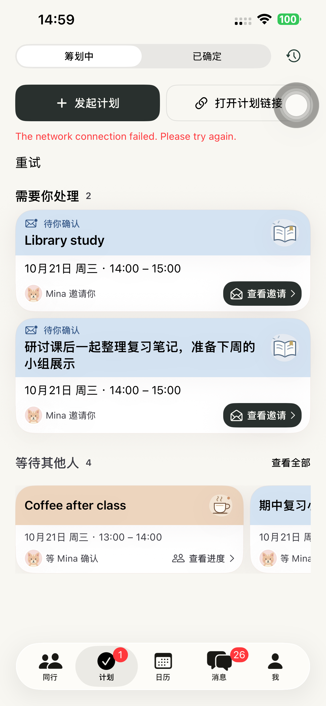
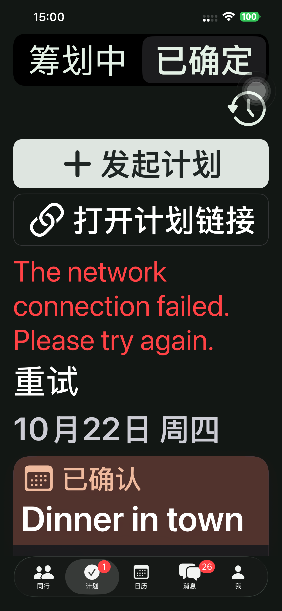
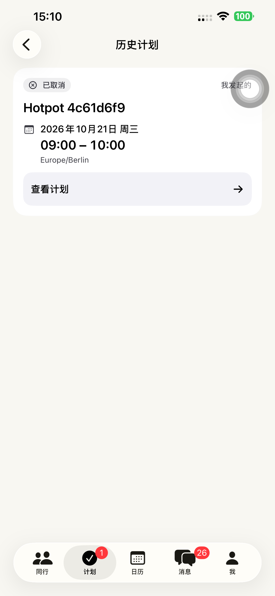

# Preview 148：两个分栏，移除计划首页导航栏

## 交互调整

- 主页面固定为「筹划中 / 已确定」两个分栏，中文名称均为三个字；英文 Planning / Confirmed、德文 In Planung / Bestätigt。未加载、空列表和已有计划都使用同一分栏布局，不再等数据回来才显示分栏。
- 移除首页的大标题、导航栏和导航栏创建按钮。「发起计划」「打开计划链接」移到页内，在两个分栏都可直接操作；主操作实心，打开链接描边，大字号纵向排列。
- 历史移到分栏旁的时钟入口，保留原记录、反馈和继续安排能力；历史详情和创建页继续提供必要的导航/返回。
- 去掉筹划页重复的「下一次见面」预览，已成行活动集中在「已确定」。筹划中的待处理纵向、等待他人横向，以及最大字号的纵向重排继续保留。
- 大字号直接显示两个可选分栏，不再先打开分类菜单。

当前用户的下一步和原分类条件保持：邀请未确认仍在筹划中；已接受但发起人尚未正式发出仍等待；发起人正式发出后，已参加者进入已确定。历史、过期、拒绝、取消、聊天双人计划等既有合同没有改写。App 底部五个一级入口不变；无网页/API/Schema/迁移/依赖发布。

## 发现与修正

初轮 4 项入口检查中 3 项通过，最大字号用例因父容器的辅助功能标识覆盖两个分栏的独立标识而失败；改为显式包含子元素后，最大字号用例复验通过。初始失败保留，不计作通过。[初轮结果](./evidence/2026-10-20-plans148/initial-entry-summary.json)。

检查历史导航时发现，普通共享计划的 `openPlan` 会把路径重置到一级根页面。历史记录改用追加详情路径，保留历史列表；普通主列表仍保持原单层详情规则。本轮补充真实取消计划的历史往返检查。

离线界面用例的共享接口指向刻意不可达的 `127.0.0.1:9`，截图中的网络错误是该测试配置的结果；完整流程使用独立一次性真实账号，未使用客户记录。

## 验收结果

- 20 项状态/路由单元通过，包含两个主分栏顺序、历史独立路由、原状态归类与日历边界。[单元](./evidence/2026-10-20-plans148/unit-summary.json)。
- 12 项真机界面回归通过：首次进入/慢加载、创建/取消、链接、消息入口、两个分栏、无主导航栏、聊天历史往返、横向等待/展开/返回、普通及深色最大字号。[界面](./evidence/2026-10-20-plans148/presentation-summary.json)。
- 最终客户端原生双账号完整流程 **353.061 秒通过**，13 个 API 阶段通过：创建、分享、填写/修改/恢复、最终选时、名单、邀请、取消改期、最终时段高亮、深色最大字号、接受后仍待正式发出、发起人发出、参与者已确定分栏及双方唯一日历、返回计划。[真机](./evidence/2026-10-20-plans148/native-flow-summary.json)、[时长](./evidence/2026-10-20-plans148/native-flow-tests.json)、[13 API 阶段](./evidence/2026-10-20-plans148/native-flow-api.json)。
- 随后只对该一次性计划执行取消，确认历史保留和双方日历均为 0；真实共享历史 → 详情 → 历史 → 主页面、普通两栏/历史和最大字号已确定页面共 3 项最终复验通过。[历史 API](./evidence/2026-10-20-plans148/history-api.json)、[最终复验](./evidence/2026-10-20-plans148/history-summary.json)。
- 原生主体/辅助功能来源 **e12e2fc354f55096e762b0cab1752b90aefdebc4**；最终历史返回修正来源 **7653a3a4706c56aa5500364d3d2a018e50c50e22**。单元与 12 项界面后仅修改历史共享详情的路径追加，并由最终完整流程/3 项复验覆盖；不把前一源码的检查冒充为最终源码全量重跑。[来源边界](./evidence/2026-10-20-plans148/source-versions.json)。
- 默认手机实际安装 **1.0.0 (148)**、严格签名和源码/可执行文件哈希核验，正常启动 **PID 3647**，没有测试参数或 QA 环境，实际进程可见。普通版 97 保留，runner 和私密配置清理。[构建](./evidence/2026-10-20-plans148/build-verification.json)、[设备](./evidence/2026-10-20-plans148/device-verification.json)。
- 2 个临时账号、1 个计划/链接已清理，旧令牌 401、分享链接 404 核验。[清理](./evidence/2026-10-20-plans148/cleanup-summary.json)、[私密配置](./evidence/2026-10-20-plans148/private-cleanup.json)。
- 无后端或分享网页发布，API 仍为 **dpl_5YEFNQih1dkZX6LnurN1D2s3cLQR / READY**；本轮未重跑分享网页浏览器/Safari 流程。未上传 TestFlight/App Store。修改及本轮证据均已提交推送。[生产核验](./evidence/2026-10-20-plans148/production-verification.json)。

以下主页面来自离线 fixture，网络错误为上述测试配置；历史截图使用真实一次性计划。

