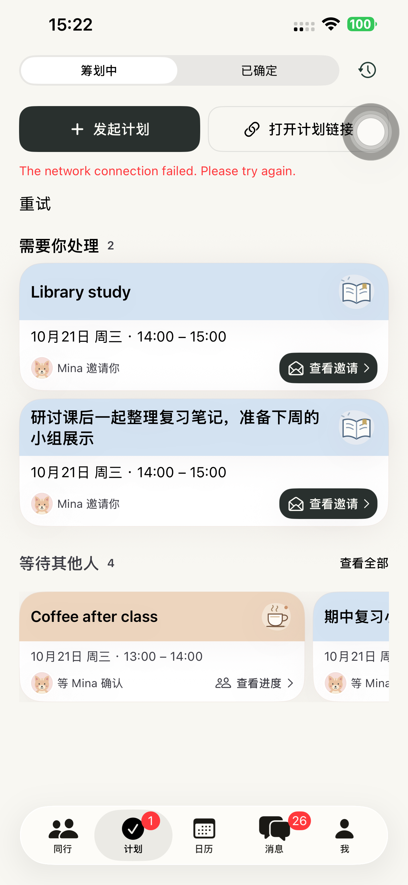
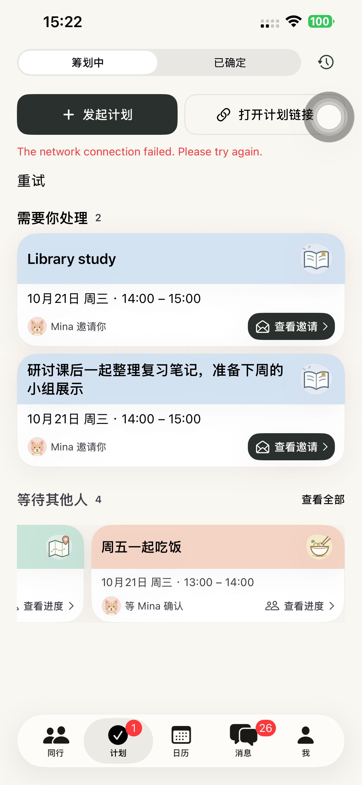
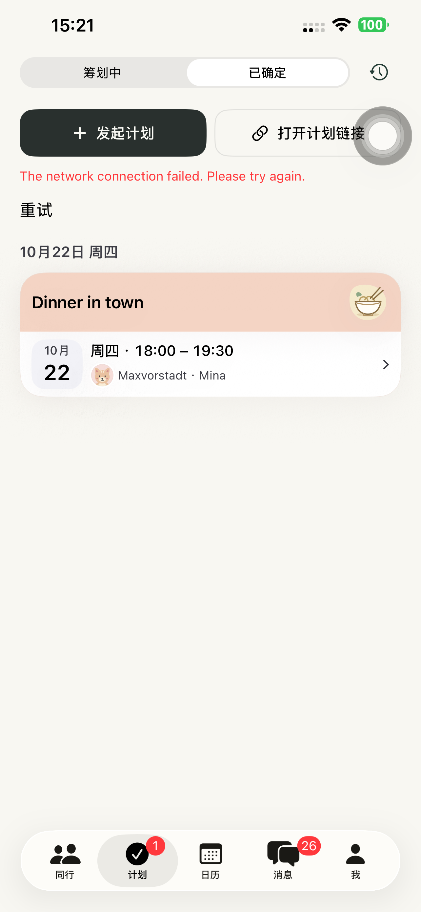

# Preview 149：活动名称独占彩色标题区

`PlanOverviewLabel.activityHeader` 删除状态图标和状态文字，直接显示活动名称，活动插画及下方内容保留。三类摘要共用此标题区，历史白色记录、聊天详情和既有邀请/日历规则未改动。读屏的完整状态标签保留。

最终原生来源 **d2430c75b02a9804581edfa0cbcbd921cd2d51b1**。构建、严格签名、源码/可执行文件哈希和 build 149 核验通过。[构建证据](./evidence/2026-10-20-plans149/build-verification.json)。

默认 iPhone 14 Plus 上 5 项既有界面检查全部通过：待确认卡片打开详情、明确确认并进入日历；横向等待浏览/展开/返回；长活动名；普通已确定卡片打开/返回；深色最大字号的等待和已确定页面可打开。[测试结果](./evidence/2026-10-20-plans149/presentation-summary.json)、[各用例](./evidence/2026-10-20-plans149/presentation-tests.json)。普通样例高度为待处理 134pt、长标题 134pt、等待约 115.67pt、已确定约 126.67pt。[高度](./evidence/2026-10-20-plans149/card-heights.json)。

截图逐张检查：色带只出现活动名，长名称正常换行，横向分区及下方进度/按钮保留，大字号采用纵向重排。截图使用既有离线 fixture，刻意不可达的 `127.0.0.1:9` 导致上方网络错误；不代表线上 API 故障。附件命名中的 117 为旧测试辅助函数前缀，实际被测 App 为 149。[截图来源](./evidence/2026-10-20-plans149/screenshot-sources.json)。

普通启动 **PID 3666**，参数为空且没有 QA 环境变量，实际进程已核对；普通版 97 保留，runner 与临时配置清理。[设备](./evidence/2026-10-20-plans149/device-verification.json)、[清理](./evidence/2026-10-20-plans149/cleanup-summary.json)。

本轮未创建真实账号或计划，未重跑真实 API 完整流程或分享网页/Safari。源码未改业务状态、网络或服务端。无后端或网页发布，现有部署 **dpl_5YEFNQih1dkZX6LnurN1D2s3cLQR / READY** 只读核验；未上传 TestFlight/App Store。[生产记录](./evidence/2026-10-20-plans149/production-verification.json)。

