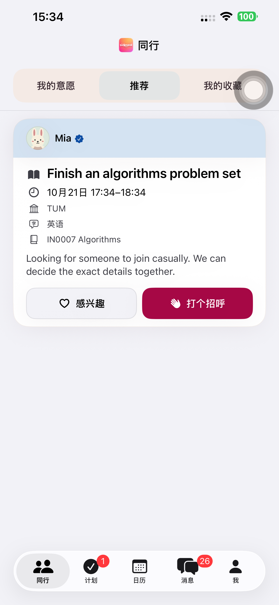
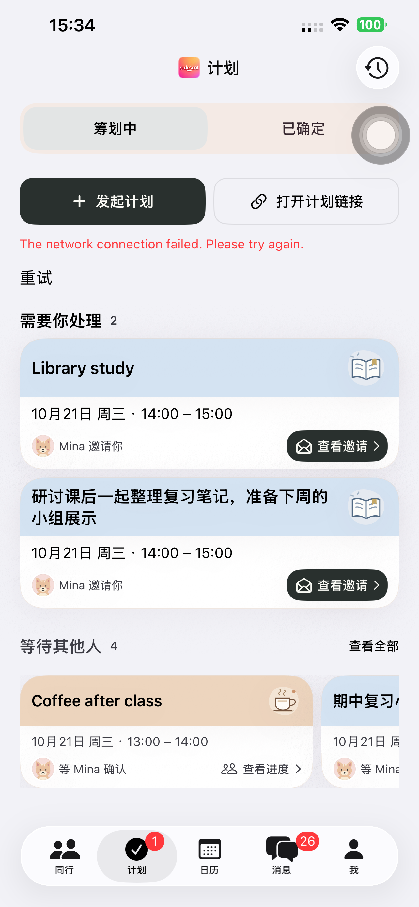
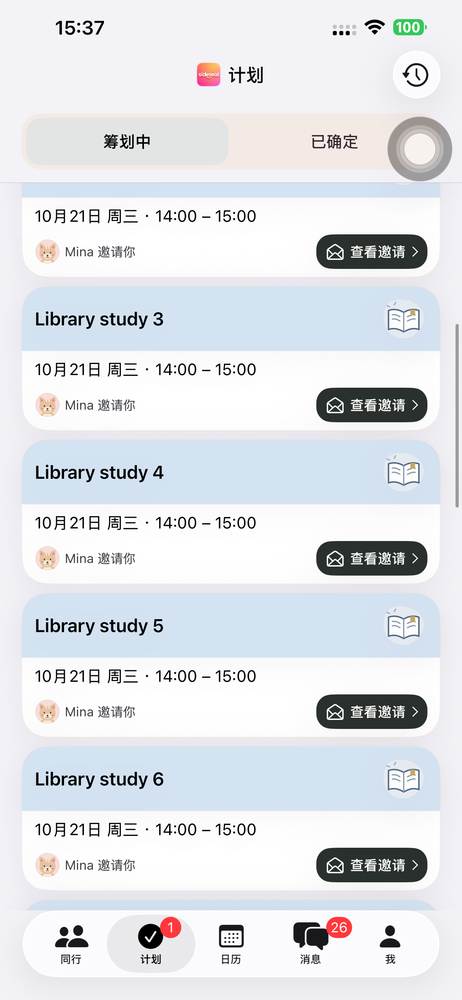
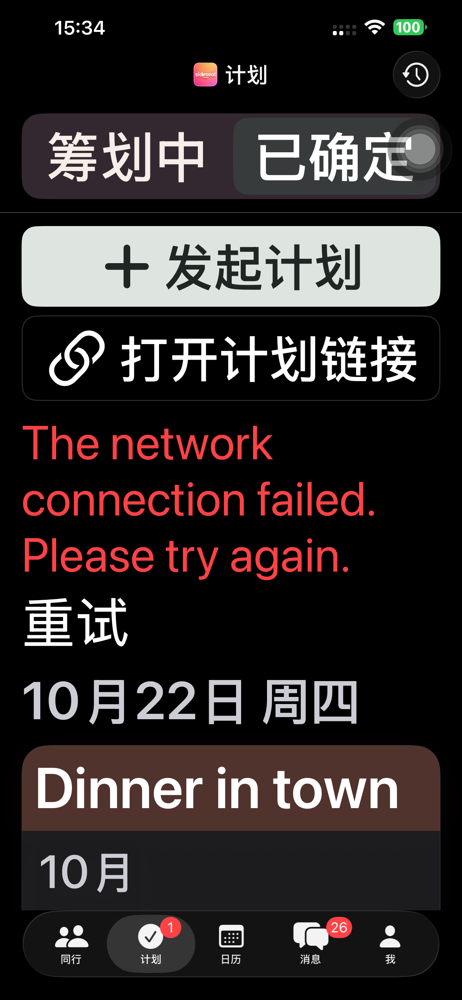

# Preview 150：固定抬头与同行样式对齐

计划首页恢复 `ssRootNavigationTitle("Plans")`，直接复用其他四个主页面的品牌抬头。历史使用标准导航栏右上角入口，二级历史页保留标题和返回。两个分栏采用同行 `decisionWell` / `navigationSelection`、圆角、字号与间距，页底色统一为 `bgGrouped`；分栏独立固定，内容单独滚动。两种字号均直接显示两个分栏，保留独立按钮标识、选中状态和读屏语义。

卡片继续只在彩色标题区显示活动名，等待横向/待处理纵向不变。创建/打开链接仍位于内容区域，原状态、邀请、手动提交和日历规则未改动。既有 UI 测试选择器改为按稳定标识查找分栏容器，适配同行样式按钮组。

- 原生来源 **3ace153adbff293ce7d6283d399b538cd5a53254**，build 150，构建和严格签名通过，源码/可执行文件哈希已记录。[构建](./evidence/2026-10-20-plans150/build-verification.json)。
- 默认 iPhone 14 Plus 的 **8 项界面检查全部通过**：同行与计划的标题位置、分栏顶部/高度对齐；固定标题和分栏/历史/聊天详情往返；首次慢加载；创建、链接/取消；深色最大字号的表单、等待和已确定页面；横向等待浏览/展开/详情返回。[汇总](./evidence/2026-10-20-plans150/presentation-summary.json)、[用例](./evidence/2026-10-20-plans150/presentation-tests.json)。
- 首轮标准样例可完整放入屏幕，故追加溢出长列表来真正验证滚动。测试来源 **42558bd670675a25bfc91f7268ea41e66af7fc05**，仅改既有用例配置和断言，未改原生代码。确认创建按钮从可点击变为滚出视区后，标题/分栏坐标仍不变且历史可点击，再完成历史/详情往返；**25.851 秒通过**。[补验](./evidence/2026-10-20-plans150/long-list-summary.json)、[来源边界](./evidence/2026-10-20-plans150/verification-scope.json)。
- 标准、加载、长列表及深色最大字号截图已查看，固定抬头可见，卡片长标题和横向轨道保留。均使用离线 fixture，`127.0.0.1:9` 为刻意不可达的接口，截图中网络错误属于该测试配置。附件中的 117 / 132 是旧辅助函数前缀，实际 App 为 150。[截图来源](./evidence/2026-10-20-plans150/screenshot-sources.json)、[长列表截图来源](./evidence/2026-10-20-plans150/long-list-screenshot-source.json)。
- 最终手机 **1.0.0 (150)**、普通启动 **PID 3689**，参数为空、无 QA 环境且实际进程可见；普通版 97 保留，runner 与临时配置清理。[设备](./evidence/2026-10-20-plans150/device-verification.json)、[清理](./evidence/2026-10-20-plans150/cleanup-summary.json)。

本轮未创建真实账号或计划，未重跑真实 API 完整流程或分享网页；148 的完整流程作为此前证据保留。无网页/API/Schema/依赖发布，沿用既有后端部署记录，本轮未重新查询就绪状态。未上传 TestFlight/App Store。

