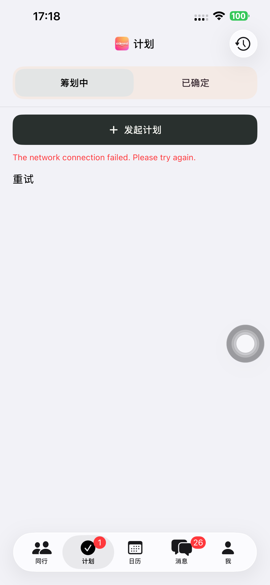
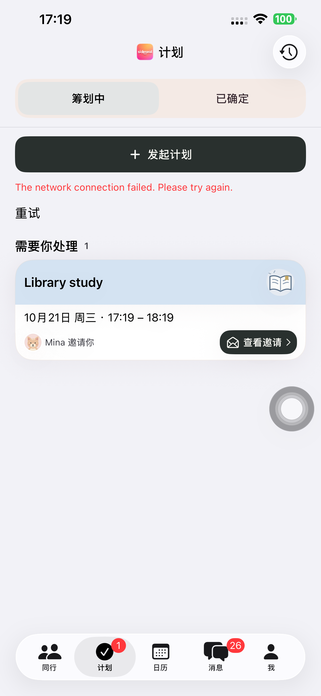
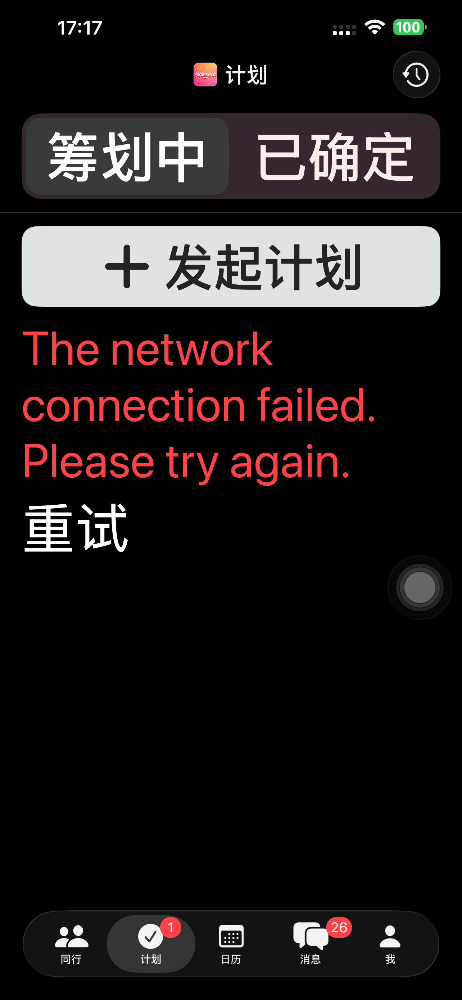

# Preview 151：移除 App 首页手动粘贴入口

计划首页保留单一「发起计划」操作，删除「打开计划链接」及粘贴弹窗，不把它转移到更多菜单。空页面说明改为「你发起的计划和收到的邀请会显示在这里」，三语同步。收到的计划卡片、聊天邀请和通知保留原生详情路由；对 App 外朋友的网页分享及现有外部路由保持兼容。未增加联系人选择或新的邀请投递能力。

原生来源 **806cba04f4b928273d0e62d0a1fab480e1717d5b**，build 151。构建、严格签名和文件哈希通过。[构建](./evidence/2026-10-20-plans151/build-verification.json)。

默认 iPhone 14 Plus 上 **6 项既有界面检查通过**：

- 首次进入直接创建/取消，手动链接入口不存在。
- 慢加载到空页面，创建入口保持可用，无旧链接按钮。
- 深色最大字号的首页、表单、日期和创建操作。
- 消息页入口进入一级计划页并创建/返回。
- 已有原生邀请卡片直接打开，明确确认参加后进入日历。
- 长列表真实滚动后抬头和分栏固定，历史/聊天详情往返并保留分栏。

[汇总](./evidence/2026-10-20-plans151/presentation-summary.json)、[各用例](./evidence/2026-10-20-plans151/presentation-tests.json)。截图已查看，普通/深色最大字号只显示创建主操作，已有邀请保留「查看邀请」。使用既有离线 fixture，`127.0.0.1:9` 刻意不可达，截图中的网络错误属于测试配置。附件中的 117 / 132 是旧辅助函数前缀，实际 App 为 151。[截图来源](./evidence/2026-10-20-plans151/screenshot-sources.json)。

手机最终普通启动 **PID 3744**，无 QA 参数/环境且进程可见；普通版 97 保留，runner 与临时配置清理。[设备](./evidence/2026-10-20-plans151/device-verification.json)、[清理](./evidence/2026-10-20-plans151/cleanup-summary.json)。

本轮未创建真实账号或计划，未运行真实 API 完整流程、通知实际投递或分享网页。仍依赖旧手动粘贴前置的历史真实流程用例不计为当前通过证据，后续应使用实际收到邀请的前置复验；不能用路由注入替代邀请投递验证。无网页/API/Schema/依赖发布，沿用既有后端部署记录，本轮未重新查询就绪状态。未上传 TestFlight/App Store。[验证边界](./evidence/2026-10-20-plans151/verification-scope.json)。

