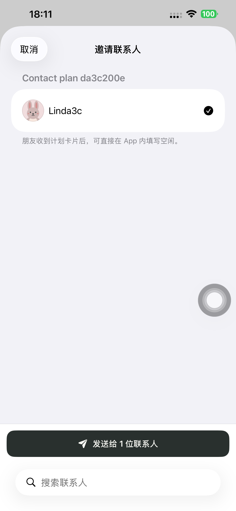
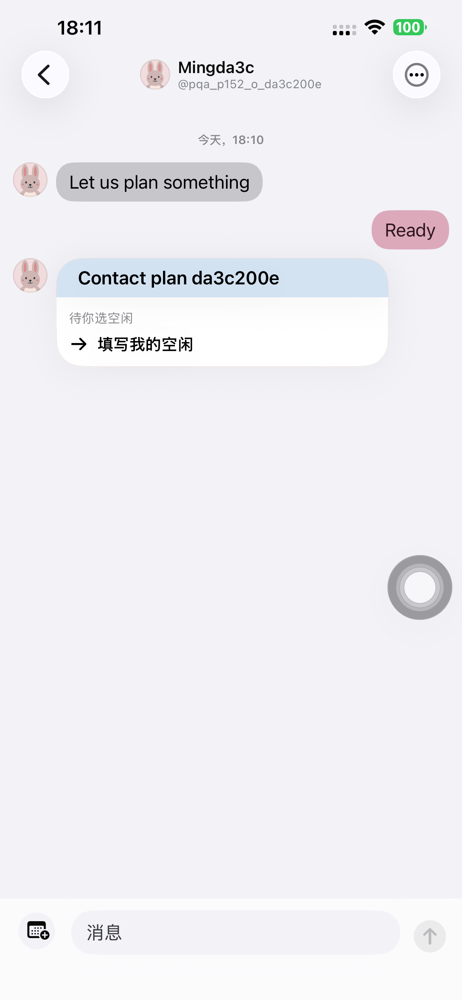
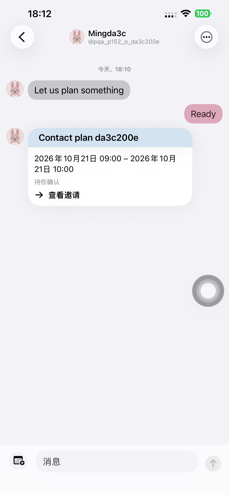

# App 联系人计划卡片 · Preview 152

## 行为和边界

发起人创建 → 在时间表选时但暂不提交 → 邀请 App 联系人 → 搜索/勾选/发送 → 保留本地草稿 → 手动提交。朋友无需复制链接，先在计划列表看到活动，再从真实私聊卡片打开、填写及手动提交。发起人选最终时间、复核名单、发送正式邀请；朋友在同一卡片查看最终时段并明确接受；发起人正式发出后，朋友在已确定分栏及日历搜索找到该活动。

联系人选择只建立投递关系，不建立空闲答复或参加同意。未答复联系人可列入后续正式邀请；未被本轮选中的投递成员不能接受关闭名单的邀请。游客网页流程保留。

## 后端和兼容验证

最终本地、候选和正式各 8 组通过：真实联系人投递/列表归属，重复请求不重复投递，所有者及版本边界，未填联系人邀请、排除成员不能确认、正式发出与晚接受的唯一日历，已发布未来计划继续邀请，固定时间 App/网页共存，容量/不可用联系人整批回滚，普通未回复消息限制，以及屏蔽关系。未填写的联系人名单仅发起人可见，公开页面及其他账号不获得该名单。

候选和正式各使用 5 个一次性账号、6 个计划，均已删除并核对令牌 401/公开链接 404。浏览器真实输入游客名字、显示最终时段、明确接受及发起人发布均通过。初始本地测试的用户名过长、Block 接口状态码断言不符已修正测试脚本；对应清理结果保留，没有以部分通过替代最终全组通过。

生产发布保留原 `dpl_5YEFNQih1dkZX6LnurN1D2s3cLQR` 的全部已核验源文件，叠加本次 6 文件。受保护候选通过现有 Vercel 身份访问，未关闭保护。候选通过后直接 promote，未重建；API、www 和根域名均指向 `dpl_BgDTcfFfXnT2UFTbhsgHjrtf85pL`。基础/上传文件、来源及覆盖文件哈希见证据。

## 原生验证

37 项 Navigation/PlanPresentation 单元通过，新增计划卡片解析、旧客户端文字回退和新邀请通知分类检查。领域 13 项与 OpenAPI 13 项通过，接口清单 196 项匹配，TypeScript 与相关 ESLint 通过。

第一轮真实双账号完整流程 **163.638 秒**通过，8 阶段 API 断言全部通过：发送前 0 卡片，发送后始终 1 卡片；手动提交前 0 答复；双方分别提交后各精确 4 个底层时隙；邀请/接受均不写日历；发起人发布后双方各唯一 1 条一小时记录。深色最大字号单项通过，卡片可打开，已发送联系人不可再次发送，固定发送按钮可见且可触达。

截图复查发现卡片两个操作标签未本地化，已补齐中/英/德并新增中文可见标签断言。最终修正包以全新双账号重跑 **165.526 秒**通过，8 阶段 API 再次全部通过；同一包深色最大字号 **33.156 秒**通过，关键截图已逐张复核。第一轮结果单独保留。初始临时测试配置路径错误发生在用例执行前，未计入真机通过数量。

默认 iPhone 14 Plus 明确核对 UDID 后实装 **1.0.0 (152)**；最终源 `69f3ef8dc8c5f56df163934bdaebe12881286dd1`，严格签名、主程序/动态库/资源签名文件哈希及安装信息保留。测试结束后移除 runner，普通启动 **PID 3802**，参数为空、无 QA 环境、实际运行进程存在。普通版 97 仍安装。两轮真机共 4 个一次性账号、2 个计划/链接已删除，旧令牌 401/公开链接 404；私有账号文件、xctestrun 和候选访问 cookie 清理。此次启动的本地 3102 服务器及本地数据库进程已停止。

本次不以接口调度或旧 APNs 记录声称新通知实际到达锁屏。实际验收覆盖 App 消息收发、列表、原生路由、明示确认、网页及日历数据；无 TestFlight/App Store 分发。

## 证据

[接口和部署证据](./evidence/2026-10-20-plans152/production-contacts152.json)、[候选文件核验](./evidence/2026-10-20-plans152/candidate-source-verification.json)、[最终包来源与安装](./evidence/2026-10-20-plans152/native-final-build-manifest.json)、[第一轮 8 阶段](./evidence/2026-10-20-plans152/native-attempt1-api.json)、[单元结果](./evidence/2026-10-20-plans152/unit-summary.json)。

[最终完整真机结果](./evidence/2026-10-20-plans152/native-final-summary.json)、[最终 8 阶段](./evidence/2026-10-20-plans152/native-final-api.json)、[最终最大字号结果](./evidence/2026-10-20-plans152/native-final-ax-summary.json)、[清理核验](./evidence/2026-10-20-plans152/native-final-cleanup.json)、[普通启动及两个版本](./evidence/2026-10-20-plans152/normal-launch.json)。

