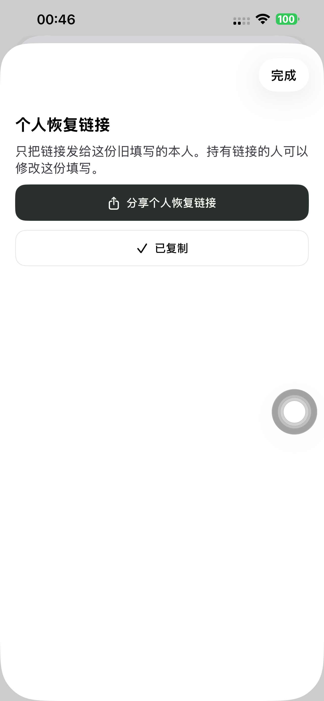
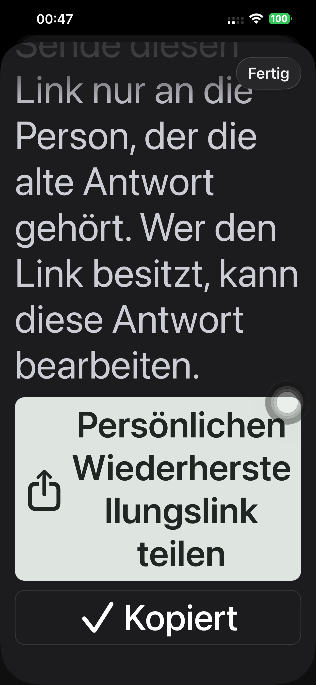

# 游客独立身份、个人恢复链接及旧记录迁移

2026-10-21，Europe/Berlin。网页/后端已上线，Preview 177 已安装默认 iPhone 14 Plus 并通过真机恢复入口测试及普通启动核验。用户要求的首次填写、再次打开、清除缓存恢复和多人同名全部通过；旧填写、邀请回复保留。代码 26339fbe、c49a8bf3、16589adc 已推送。

## 实际规则

无需注册登录。名字仅显示，首次参与生成独立随机凭证；服务器保存摘要，浏览器使用按计划隔离的 HttpOnly / Secure / SameSite=Lax Cookie。所有游客写入均验证凭证及当前页面 participant ID，同名不能认领、读取修改钥匙或写入别人的记录。

个人链接使用独立 /time-poll-recovery/ 网页路径，避免已安装 App 的通用链接拦截。恢复密钥放在 fragment，立即从地址移除后经 POST 校验，不进入请求 URL；恢复接口禁止缓存。清除 Cookie 与 localStorage 后，链接恢复同一 guest / response 及原时段，不新建游客或重复计票。未提交草稿仍只保留在原浏览器。个人链接是修改钥匙，应本人私密保存；新凭证与个人链接都遗失时，不能凭姓名认领。

旧随机浏览器凭证可验证时自动原位升级；只有旧 ID Cookie 或名字则保留填写，由发起人在 App 参与名单核实归属后私下提供恢复链接。未领取的旧链接可重新生成，旧链接随之失效；领取后，发起人不能再重置。新游客从创建起受保护，不能通过旧记录迁移入口取得其修改权。[完整身份合同](../GUEST_IDENTITY.md)。

## 闭环结果

| 环境 | 范围 | 结果 |
| --- | --- | --- |
| 独立本地数据库 / 3106 | Chromium、WebKit 首次填写→重开→多人同名→清 Cookie/localStorage→同页及新页恢复→分别回复邀请→发起人发布→唯一 Calendar；另含旧随机凭证升级、伪造凭证/ID、跨人/跨计划/非发起人拒绝、并发同名 | 4 项通过，87.725 秒；0 失败/跳过/重试 |
| 领域与静态检查 | 14 项时间表领域测试；相关 TypeScript、ESLint；原生实际编译及严格签名 | 通过 |
| 最终候选，16589adc | Chromium / WebKit 各一组新游客完整链路及一组在旧正式版 API 预先创建的真实旧格式记录恢复 | 四组通过，后提升同一已测 Production 构建 |
| 正式 www.sideseat.de | 相同四组完整浏览器/数据流程，使用实际 canonical 个人链接；Cookie 安全属性、恢复不缓存、密钥不在请求 URL | 四组通过 |
| 原生独立 iPhone 14 Plus 模拟器 | 中文及德文深色最大字号，发起人打开旧游客名单→核实提示→生成个人链接→复制成功 | 最终 1 项 / 2 语言通过，36.275 秒 |
| 默认实体 iPhone 14 Plus，Preview 177 | 同上真实 Production API 的发起人恢复生成/复制，两种语言及最大字号，截图复核 | 1 项 / 2 语言通过，35.146 秒 |

本地旧记录测试额外核对原 response / invitation ID、已接受状态及时间保持，不增加日历。候选与正式实测只有旧 ID Cookie 时拒绝写入；同名创建独立新游客；发起人给出的链接恢复旧 response ID / 时间，领取后发起人重置返回 409。正式浏览器完整链路核对两位同名游客分别回复，最后仅创建一个发起人 Calendar 条目。

两种浏览器指 Chromium 与 Playwright WebKit 引擎；本轮没有声称在实体 Safari 重跑新游客全流程。实体手机验收范围为原生旧游客恢复入口、复制反馈、安装和普通启动。原生 QA 工程历史名称 guest-identity171 不代表安装版本，实际 App 为 177。

[本地结果](./evidence/2026-10-21-guest-private-identity/local-browser-summary.json)、[领域测试](./evidence/2026-10-21-guest-private-identity/domain-tests.txt)、[最终候选](./evidence/2026-10-21-guest-private-identity/candidate-browser-results.json)、[正式站](./evidence/2026-10-21-guest-private-identity/production-browser-results.json)、[模拟器](./evidence/2026-10-21-guest-private-identity/native-simulator-summary.json)、[真机](./evidence/2026-10-21-guest-private-identity/phone-summary.json)。

## 发布与默认手机

最终 dpl_FxvJcb9Sh3WB3heBP28w5TNgXr9v，https://sideseat-2imh71za0-baichus-projects.vercel.app，来源 16589adc。以当时最新现网 176（dpl_2NNNNsJy3nwtDhksLQY87rgMPzqx）的全部 1,382 项源码逐个 SHA1 核验，仅叠加 13 项游客功能文件：8 项既有文件、5 项新文件，加本次来源标记；1,374 项现网文件字节保留，最终上传 1,388 项源码全部相符。保留 176 的表头色块图例及既有生产差异；没有 Schema 或数据库迁移，构建日志确认 SKIP_DATABASE_MIGRATIONS=1。

候选完成四组浏览器闭环并再次确认现网基线后，提升同一 Production 构建，未重建后直接切换。api.sideseat.de、www.sideseat.de、sideseat.de 均解析到该 deployment，client-config 均为 200；旧姓名认领部署的生成域名仍要求 Vercel 认证，不能绕过新身份检查。AASA 没有接管个人恢复路径。按 deployment 查询最近 15 分钟 error/fatal 日志，无返回分组；该结论限于查询窗口。

默认手机 UDID 00008110-001A69110CC1401E / CoreDevice D906CC6D-3EC6-50A2-8D93-A6602521362A。Preview 177 的 246 项原生源文件在构建前后哈希一致，保留 b5fa6256 图例和 c49a8bf3 恢复界面修正，版本明确指定 177。严格签名通过，安装后只读核验 Preview 177 / 普通 SideSeat 97。移除本轮 Runner 后无 QA 参数正常启动，PID 4343 与进程列表一致。没有上传 TestFlight 或 App Store。

[生产源码核验](./evidence/2026-10-21-guest-private-identity/final-candidate-source-verification.json)、[正式域名](./evidence/2026-10-21-guest-private-identity/production-aliases.json)、[健康及旧部署保护](./evidence/2026-10-21-guest-private-identity/production-health.json)、[原生构建](./evidence/2026-10-21-guest-private-identity/native-build-manifest.json)、[普通启动](./evidence/2026-10-21-guest-private-identity/normal-launch.json)。

## 测试中发现与修复

同页恢复 fragment 未触发页面重载，已补 hashchange 并重跑全部本地闭环。截图复核发现深色系统突出分享按钮文字不可见，已使用计划统一按钮配色，内层恢复面板保留最大辅助功能字号，重新通过模拟器和实体手机测试。其余初轮中断来自测试脚本：QA 深链传完整 URL、共享构建/模拟器被另一阶段替换、固定底栏遮挡的按钮被 XCTest 误报可点击、未等邀请写入完成便查询，以及缺少既有 Idempotency-Key；均修正测试后闭环复验，没有把失败当成通过。

发布期间现网从连续时段版本依次更新为 174、176；已先后重新核对基线、保留对方改动，并递增手机交付版本，未覆盖旧包。已测中间候选均未提升；一次来源 metadata SHA 填写有误的未发布构建已取消。最终来源标记、部署 metadata 与文件哈希一致。

19 个专用 QA 计划和测试账号全部回收，公开计划均 404、账号令牌 401；本轮 Runner 移除。仅停止本轮 3106 服务及专属模拟器，保留其他项目服务和共享 PostgreSQL。[清理回执](./evidence/2026-10-21-guest-private-identity/cleanup.json)。

