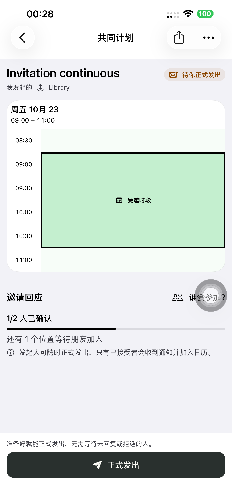
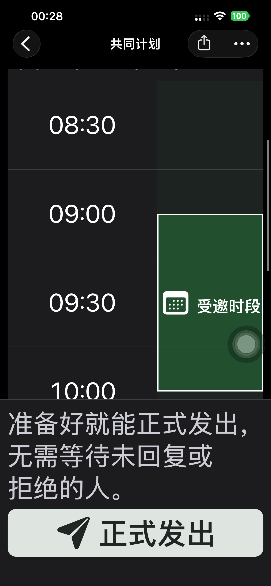
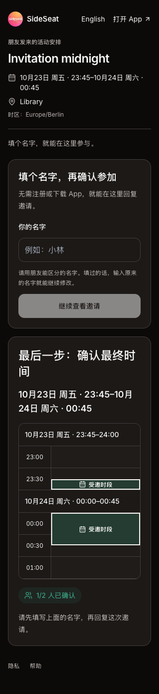

# 计划 174：精简受邀时间表

App 和分享网页的受邀/已定时间表移除独立标题及说明，直接显示日期、起止时间和连续高亮块。网页同时去掉表格内部重复的活动名和地点，上方活动信息保留。时区继续参与计算并保留在辅助功能信息中，App 原滚动定位标识保留。选择、保存、邀请、回应及日历规则没有修改。

实现 `07cecc3f` 已提交并推送。原生隔离构建以实际安装 173 的 `6d26c048` 为基准，只覆盖本项两个 Swift 文件及 Preview 174 配置，未混入并行的游客身份功能。网页以当时生产 `dpl_2ifkV5RZ2Dy2cguEeBfoaAo7LLWj` 的完整 1,380 个源文件为基准，只改显示组件和两个调用点，新增来源标记；全部 1,381 个候选源文件 SHA1 核对一致。未改 API、Schema、依赖或迁移。

## 本轮验证

- Swift 语法解析、两处 TSX ESLint、差异空白检查通过；删去失效属性，没有新增状态、请求或依赖。
- 默认 iPhone 14 Plus（`00008110-001A69110CC1401E`）安装 Preview **174**，严格签名及源文件输入核验通过。
- 最终两个真机用例通过，0 失败、0 跳过，合计 **40.549 秒**：普通字号 14.467 秒，深色最大辅助字号 26.082 秒。每项覆盖连续、非整点、跨午夜三个场景，检查标题/说明消失、每天一个高亮标签及只读展示，六张截图已复查。
- 初次普通字号通过，最大字号用例因 XCTest 将屏幕下方标签判为可点击而未滚动，越过可视范围断言失败。保留初次摘要，滚动改为根据导航栏和固定底栏边界定位，随后两项完整重跑通过；没有用此测试修正改动产品逻辑。
- 候选与正式网页分别六项布局检查通过：Chromium 390px 浅色、WebKit 320px 深色，各覆盖三个时段。检查无内部标题/说明、连续块数、跨日分段、非整点边界、无横向溢出，点击高亮不产生写请求，无页面异常。
- 已测 Production 构建 `dpl_HFaJwZhU8fVXgpk1yYRK4bjXkdKw` 提升正式；提升前确认生产仍是原基准，提升后核验 api/www/根域名一致。正式浏览器检查通过。
- 本轮只验证展示变化，**未重跑创建到日历的完整业务链**。此前完整链路证据仍在 [计划 167 QA](./2026-10-20-plans167.md)，不能算作 174 新测试。

测试完成后清理两个临时账号、三个计划链接，并复查旧令牌 401、链接 404。移除本轮 UI Runner 和私密启动配置。Preview **174** 无测试参数正常启动 **PID 4326**，实际进程一致；普通 SideSeat **97** 保留。

## 证据

[最终真机摘要](./evidence/2026-10-21-plans174/phone-summary.json)、[初次测试摘要](./evidence/2026-10-21-plans174/initial-phone-summary.json)、[构建来源/签名](./evidence/2026-10-21-plans174/native-build-manifest.json)、[普通启动](./evidence/2026-10-21-plans174/normal-launch.json)、[候选来源](./evidence/2026-10-21-plans174/candidate-source-verification.json)、[候选检查](./evidence/2026-10-21-plans174/candidate-web-layout.json)、[正式检查](./evidence/2026-10-21-plans174/production-web-layout.json)、[发布](./evidence/2026-10-21-plans174/production-release.json)、[清理](./evidence/2026-10-21-plans174/final-cleanup.json)。

普通字号实际截图：

最大字号非整点时段，已滚动到高亮区域：

正式分享网页跨午夜：

