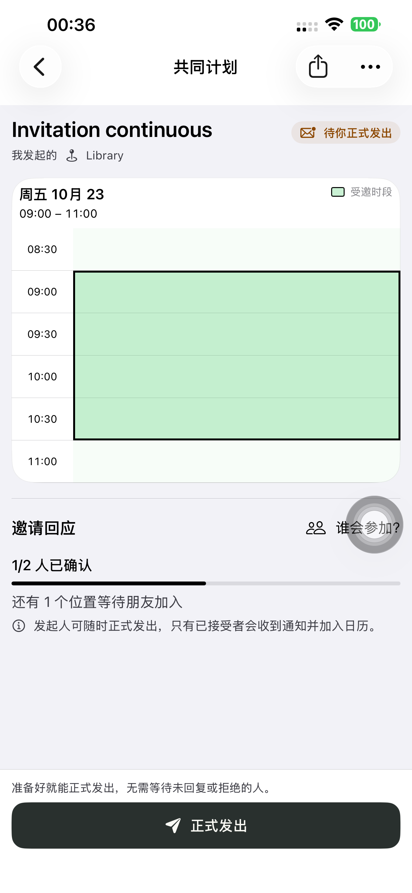
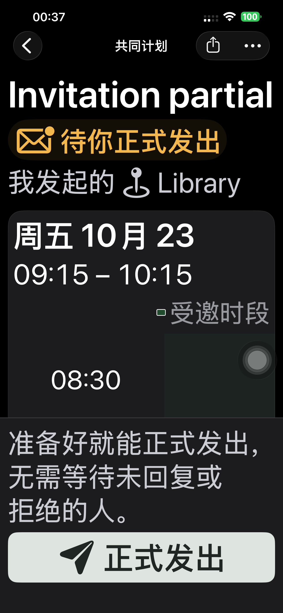
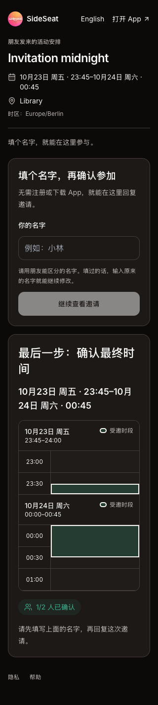

# 计划 176：把受邀时段图例移到表头

App 和分享网页在每个日期抬头右侧显示小色块和「受邀时段」，高亮块内部移除文字和日历图标。已定时间草稿沿用对应文案。日期、起止时间、跨日分段、非整点边界与只读规则保留；辅助功能仍描述各行是否受邀。App 大字号空间不足时图例换行靠右。

实现 `b5fa6256` 已提交推送。原生以实际安装的 174 隔离源码为基准，仅覆盖 `UnifiedPlanViews.swift` 和 Preview 176 配置，保留此前收藏/计划调整，未混入尚未交付的游客身份功能。网页基于当时生产 `dpl_HFaJwZhU8fVXgpk1yYRK4bjXkdKw` 全部 1,381 个源文件，仅改一个显示组件并添加来源标记；候选 1,382 个源文件 SHA1 全部一致，未改 API、Schema 或依赖。

## 验证与交付

- Swift 解析、TSX ESLint 和差异空白检查通过，签名构建成功。
- 默认 iPhone 14 Plus（`00008110-001A69110CC1401E`）安装 **Preview 176**，严格签名及输入源码哈希核验通过。
- 两项最终真机测试通过：普通字号 **15.118 秒**，深色最大字号 **15.147 秒**，共 **30.265 秒**、0 失败、0 跳过。每项覆盖连续、非整点和跨午夜三场景，确认图例在抬头右侧、原内部标签消失、无恢复表格标题/说明，六张实际截图已复查。
- 候选和正式网页各六项显示检查通过：Chromium 390px 浅色、WebKit 320px 深色，各测三种时段。验证表头图例靠右、色块和高亮背景一致、高亮内无文字、非整点边界和跨日连续块准确、无横向溢出；点击只读高亮无写请求，无页面异常。
- 已测 Production 构建 `dpl_2NNNNsJy3nwtDhksLQY87rgMPzqx` 原样提升，提升前生产基准未变化；提升后 api/www/根域名核对一致。
- 两个临时账号和三个计划链接清理，旧令牌 401、链接 404 复查通过。移除本轮 UI Runner、私密测试启动配置与候选 Cookie。
- 无测试参数正常启动 **PID 4336**，实际进程一致，手机清单确认 **176**，普通 SideSeat **97** 保留。未上传 TestFlight/App Store。

本轮仅验证显示调整，未重跑创建到日历的完整业务流程；此前完整业务链证据在 [计划 167 QA](./2026-10-20-plans167.md)。

[真机摘要](./evidence/2026-10-21-plans176/phone-summary.json)、[源码与签名](./evidence/2026-10-21-plans176/native-build-manifest.json)、[正常启动](./evidence/2026-10-21-plans176/normal-launch.json)、[候选来源](./evidence/2026-10-21-plans176/candidate-source-verification.json)、[候选网页](./evidence/2026-10-21-plans176/candidate-web-layout.json)、[正式网页](./evidence/2026-10-21-plans176/production-web-layout.json)、[发布](./evidence/2026-10-21-plans176/production-release.json)、[数据清理](./evidence/2026-10-21-plans176/final-cleanup.json)。

普通字号：

最大字号时图例换行靠右，时间表可以继续滚动：

正式网页跨日展示：

