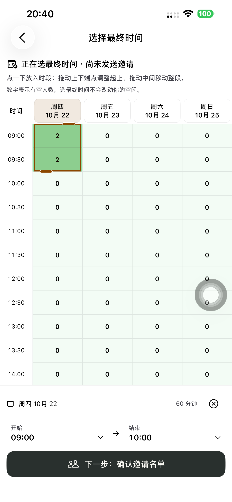
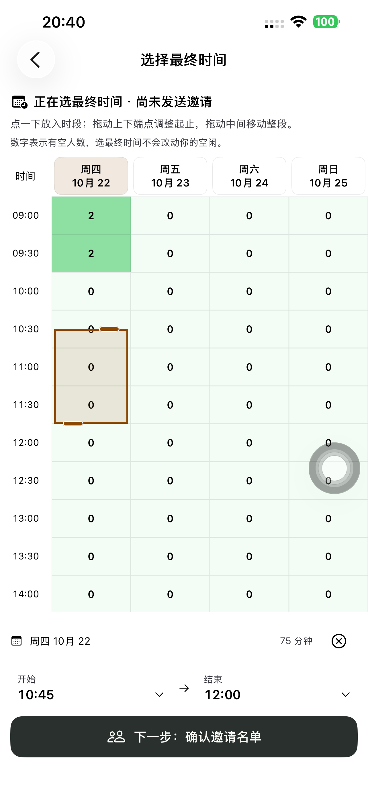
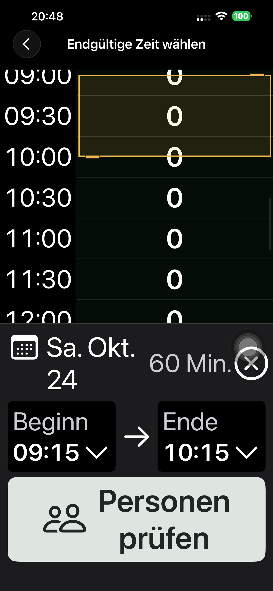

# 计划 178：可调整的最终时间块

实现 `496ae91c` 已提交推送。发起人在原时间表点一下放入活动时长或默认一小时的连续时段；初次放置接近候选结束时，只截短这次初始时段。之后点空白位置移动整段、保留时长，点已选区域保持原样。上下端点分别伸缩，拖中间移动；日期抬头换日期并保留当地起点和时长，不再选择当天全部时间。底部可直接改日期、开始、结束，并进入邀请名单复核。

空闲填写、手动提交、活动与名单、邀请版本、明确接受/拒绝、发起人正式发出及日历规则保留。时间块编辑只改本地草稿，未引入选时请求。App 的游客身份恢复、受邀时间表图例及收藏间距保留。

## 验收

| 范围 | 最终结果 |
| --- | --- |
| 原生单元 | **24 通过、0 失败、0 跳过**。覆盖默认时长、初次末端放置、整体移动、独立起止修改、日期与夏令时、午夜/旧边界，以及手动提交、失败重试、草稿恢复与邀请刷新合同 |
| App 好友完整流程 | **207.619 秒通过**。实际创建、App 联系人卡片、双方填写，时间块放置/区内点击/移动/延长/缩短/换日/精确改时/清除/返回保留，名单复核、发送邀请、朋友明确接受、发起人正式发出及双方日历 |
| App 流程独立 API | **八阶段通过**，双方原空闲保持 `[0,1,2,3]`，正式邀请前无邀请版本；接受前后仍待发出，正式发出后双方各一条日历 |
| 手机 App → Safari 完整流程 | **139.848 秒通过**。新账号首次进入、创建、系统分享并复制实际链接，Safari 填名/选择并提交空闲，App 选时/名单复核/返回调整，Safari 明确接受，App 正式发出和日历往返 |
| Safari 流程独立 API | **七阶段通过**，确认前无日历，接受后仍等待发起人，正式发出后唯一日历且时长一小时 |
| 最终包深色最大字号 | 中文、德文两场景，**54.521 秒通过**。日期/起止菜单可操作，时间块能完整滚动到视口内，触摸范围至少 44pt，截图已复查 |
| 选时服务端边界 | 独立计划多次放置/拖动/精确修改/取消后仍为 COLLECTING、零正式答复、空的已提交空闲、邀请版本零 |
| 交付 | 默认 iPhone 14 Plus 安装 **1.0.0 (178)**，严格签名和源码输入通过；无测试参数普通启动 **PID 5015** 与实际进程一致，普通 SideSeat **97** 保留 |

完整普通字号流程在 178 的最终交互上通过。截图复查后，辅助功能字号主按钮改为复用已有「核对名单 / Personen prüfen」短文案，解决德文长词断开；普通字号入口与业务路径未改，最终包另行完成上表的 54.521 秒中德复验。没有将两条完整流程描述为此文案微调后的重新执行。

## 复查与精简

- 时间块、底部控件和邀请复核共用一个 `TimePollFinalRange`，没有并行的起止时间状态。
- 删除只会扩展的点选算法、旧最终拖选分支、每格日历图标和对应旧说明；保留普通空闲的点选/取消、长按绘制与撤销。
- 拖动只作用于时间块，共用一个坐标系；绘制、触摸和辅助功能位置一起偏移。普通空白区域继续交给已有触摸/滚动机制。中途尝试的 UIKit pan 分支已经移除。
- 底部独立小视图复用既有日期/时钟、主题及短文案；没有新依赖、API、Schema 或迁移。

初轮完整测试发现高亮块被布局居中，绘制位置与实际手势范围分离；修正为明确的左上对齐。拖动验证又暴露偏移修饰顺序与滚动竞争，最终将手势绑定到块并一起偏移，完整复验通过。测试同时修正了触摸扩展区与可视边缘的区别、大字号滚动定位，以及当前分享入口；未以此放宽邀请或日历规则。保留 [开发尝试摘要](./evidence/2026-10-21-plans178/development-attempts.json)、[初次完整测试](./evidence/2026-10-21-plans178/initial-native-phone.json) 和 [初次部分 API](./evidence/2026-10-21-plans178/initial-native-api.json)，只将最终结果列为通过。

## 来源、清理与证据

原生隔离构建以实际 177 对应的 `eff9bb7f` 为基准，覆盖本项源码；159 个其余已跟踪 Swift 文件逐字节保留。代码、资源、实际包版本、主二进制/debug dylib 哈希与严格签名见 [构建清单](./evidence/2026-10-21-plans178/native-build-manifest.json)。本轮未发布网页/后端，三个正式域名仍为 `dpl_FxvJcb9Sh3WB3heBP28w5TNgXr9v`，两条流程使用真实生产服务。

初轮和最终合计五个专用测试账号、四个计划链接清理，旧令牌 401、链接 404 验证通过；本轮手机 Runner 和私密启动文件删除。保留其他工作区修改，未上传 TestFlight/App Store。

[单元摘要](./evidence/2026-10-21-plans178/final-unit-summary.json)、[App 完整流程/初版大字号摘要](./evidence/2026-10-21-plans178/final-native-summary.json)、[App 八阶段 API](./evidence/2026-10-21-plans178/final-native-api.json)、[Safari 完整流程](./evidence/2026-10-21-plans178/safari-summary.json)、[Safari 七阶段 API](./evidence/2026-10-21-plans178/safari-api.json)、[最终大字号](./evidence/2026-10-21-plans178/final-accessibility-summary.json)、[只改本地的边界](./evidence/2026-10-21-plans178/picker-api.json)、[普通启动](./evidence/2026-10-21-plans178/normal-launch.json)、[生产未变](./evidence/2026-10-21-plans178/production-verification.json)、[清理汇总](./evidence/2026-10-21-plans178/cleanup-summary.json)。

