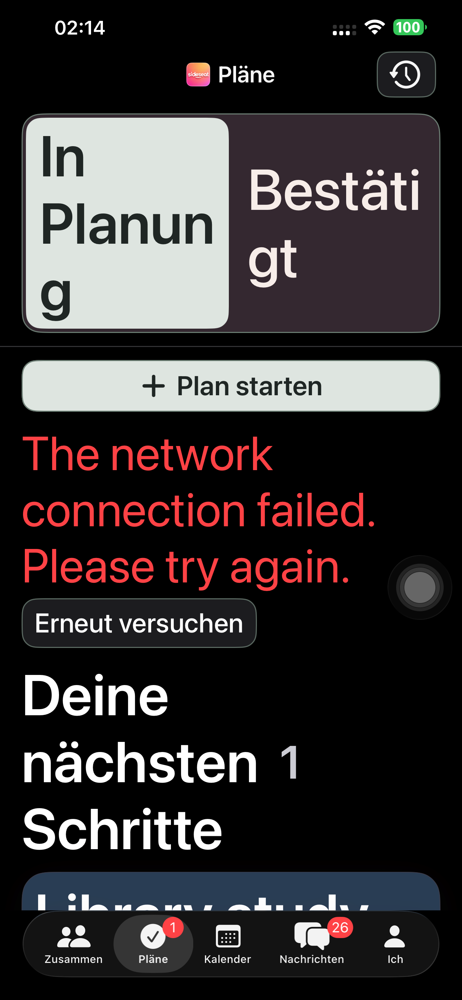
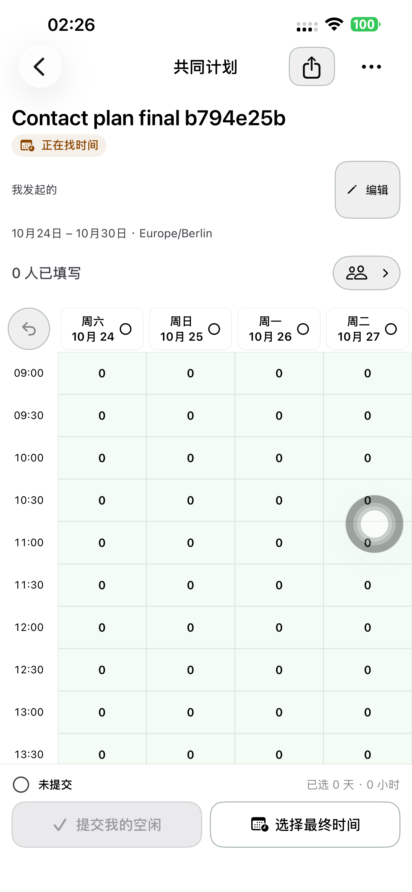
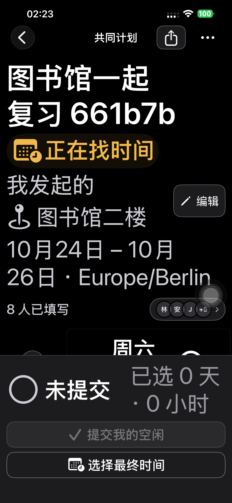
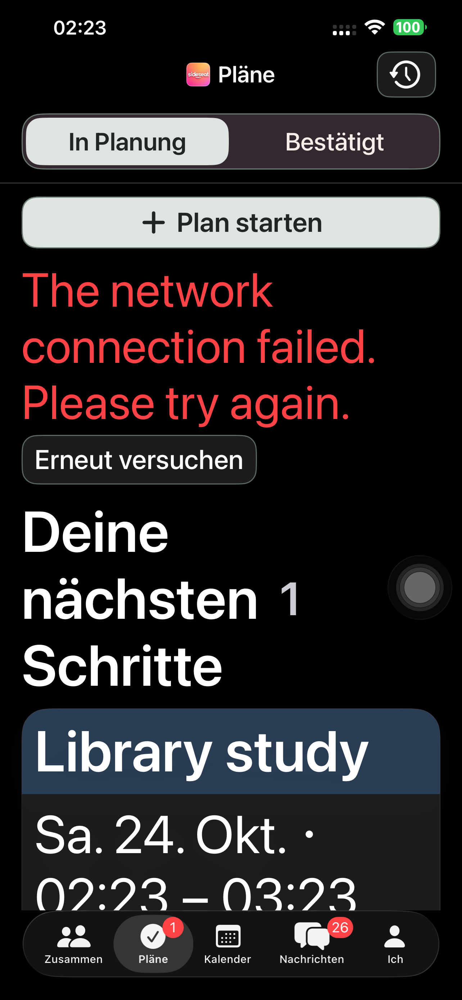
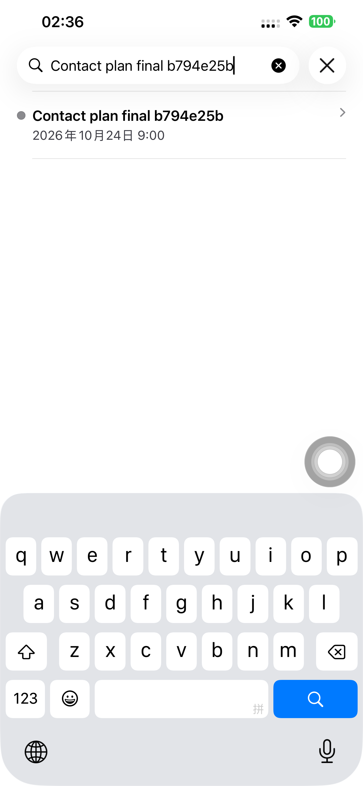

# 按钮层级与填写人数留白 — Preview 184

## 问题与修正

用户指出统一轮廓使用过度，且「0 人已填写」碰到边框。原因是人数与头像原先共用一个整行按钮，并传入 `horizontalPadding: 0`。

- 人数改为独立信息文字，移到按钮外；右侧头像/人数图标单独打开原有完整名单。最多三枚头像，超出显示 +N，0 人也可打开名单。
- 计划/同行分栏只保留整组边界，选中项使用实心底色，移除每个选项的重复框。
- 小操作使用柔和底色胶囊；独立图标使用圆形；标准次操作保留圆角，主操作实心、危险操作红色。保留既有点击范围、导航样式和禁用语义。
- 初轮实图发现德文最大字号把分栏撑高，已限制分栏控件字号至 xxxLarge；正文保留系统字号。新增分栏高度与人数/头像分离位置的回归断言。

本轮只修改原生 UI；既有邀请、手动提交、最终选时、日历及网页规则保持。分享网页/后端没有新发布。

## 验证记录

首次 App 构建及独立 xctestrun 启动遇到 Xcode 的设备通知观察失败。手机连接、开发者模式、DDI 和未锁屏均已核实；App 构建重试、安装和普通启动成功。改用临时工程 scheme 启动测试后成功。

初轮认证检查通过（5.093 秒）；初轮主页面检查通过（92.615 秒），但实图发现上述分栏问题，未作为最终视觉验收。初轮三个带数据测试因临时 scheme 继承 Launch 环境而跳过；已改为 TestAction 独立环境并确认专用数据进入测试配置。中断中的旧数据测试不计通过。

后续数据测试发现头像入口的 AX 类型由 Button 变成 Other。实际层级证实人数已独立且间距充足，但 `accessibilityElement(children: .ignore)` 需要显式保留按钮 trait；现已补回 `.isButton`。该轮三项失败没有计入最终通过，见 `before-people-trait-summary.json`。

修正按钮 trait 后，页面、认证和深色最大字号名单已通过。普通字号测试命中 XCTest 返回的 43.99999999999997pt 浮点尺寸；44pt 点击范围的断言改用 0.01pt 容差，没有修改 UI 尺寸。随后重跑普通名单与完整流程。

普通名单复验通过（25.556 秒）。主流程在真实 App UI 完成创建、好友卡片、双方填写、最终选时、邀请及接受，六阶段 API 确认日历仍为 0。第七次切回登录时触发服务端重复登录限流，实际页面显示「尝试次数过多，请稍后再试」；该 200.257 秒运行不记为整条一次通过。保留同一计划、既有凭证及已核验的六阶段，用独立的临时 XCTest 接续 App 正式发出与参与者日历查找；不改限流或业务规则。接续测试源码保存在证据目录。

正式发出的 API 与双方唯一日历记录均通过。第一次接续使用 authenticated shell，日历仍是该 shell 的静态样例，因此搜索未命中，不计真实日历验收；临时验收改为参与者正常登录并从「计划 → 已确定 → 活动 → 查看日历 → 搜索」进入真实数据，最终 **24.792 秒通过**，第八阶段 API 同步核验。测试 shell 的问题没有改动产品代码。

## 最终验收与交付

所有最终验证使用同一 Preview 184 二进制，源码提交 `25799369`：

| 验证 | 结果 |
| --- | --- |
| 五个主页面、表单，中/英/德，浅/深色含最大字号 | 92.570 秒通过；分栏高度不超过 80pt |
| 认证页按钮 | 3.998 秒通过 |
| 8 人头像 / +5 / 完整名单，深色最大字号 | 29.926 秒通过 |
| 8 人头像 / 完整名单，普通字号 | 25.556 秒通过 |
| 0 人创建、好友卡片、双方填写、选最终时间、邀请与接受 | 主流程前六个真实 API 阶段通过；200.257 秒运行在后续登录限流处停止 |
| 同一计划正式发出 | 接续 UI 已发出；第七阶段 API：双方各 1 条日历。40.303 秒运行后续搜索用了错误测试 shell，未作为完整通过 |
| 参与者真实「已确定 → 日历 → 搜索」 | 最终 24.792 秒通过，第八阶段 API 通过 |

八阶段合并记录明确保留接续边界；**不宣称整条流程一次无中断通过**。实际人数位置、头像留白、分栏和按钮截图已查看。

默认 iPhone 14 Plus（`00008110-001A69110CC1401E`）安装 **1.0.0 (184)**，严格签名、248 项 App 源码/资源与另 18 项配置/脚本、普通启动 **PID 6256** 及实际进程核验。启动参数为空、无 QA 环境；普通 SideSeat **97** 保留。2 个专用账号、4 个计划链接已删除并核验 401/404，Runner、私密 fixture、临时 scheme/xctestrun 凭证清除。

本轮无网页/后端发布，沿用 `dpl_3QAxBxySh4RLrQYf849ozaqdmZEz`。未上传 TestFlight/App Store。相关 Git 空白检查通过；其他业务测试没有扩展重跑。
