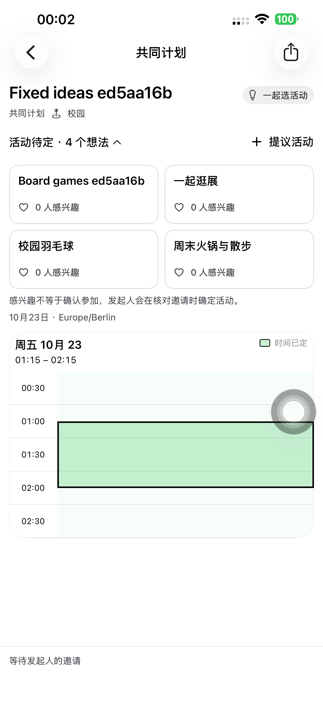
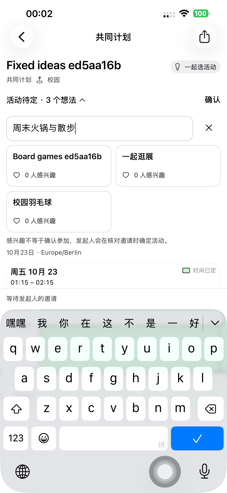
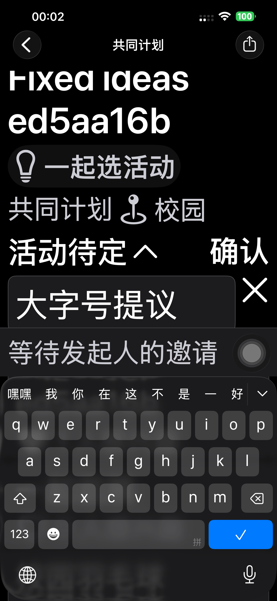

# 活动提议布告栏：Preview 179–180

活动提议改为两列紧凑卡片。标题行左侧为活动待定与数量，右侧为「＋提议活动」；编辑时右侧变为「确认」，输入区在全部提议之前展开。成功添加后保留展开，取消只清除本地草稿。原生辅助功能字号自动改为单列，网页窄于 360px 改为单列。地点、兴趣、发起人选活动、邀请版本、明确回应、正式发出和日历规则保留。

App 和分享页复用各自原有活动接口、提议数据及兴趣操作。原生只调整 `PlanActivityIdeasView`；网页把活动收起/展开、标题和输入框交给一个组件，移除外层重复标题。没有引入依赖、服务端代码、Schema 或数据迁移。

## 验收范围

- Preview 179 真机完整流程 **194.468 秒通过**，七阶段独立 API 核对：创建「时间已定＋一起选活动」、选择 App 联系人发送卡片、朋友连续添加四个提议、两列位置断言、顶部输入/右侧确认/取消草稿/标记兴趣、深色最大字号单列、发起人选择活动及名单、发送正式邀请、朋友明确接受、发起人正式发出、朋友日历查看。接受前零日历，正式发出后双方各一条且起止时间不变。
- 图片复查发现最大字号长标题换行过多，180 将该字号下的标题缩为「活动待定」，完整数量仍供读屏读取；确认文案缩短，中英德翻译齐全。最终 180 包完整流程 **194.030 秒再次通过**，七阶段 API 全部通过，普通字号、中文深色最大字号均使用最终实现。
- 网页候选、正式站分别使用 Chromium 和 WebKit 跑完整流程，合计 **四组通过、零页面错误**。实际连续添加四项，核对两列对齐、顶部输入、标题行右侧确认、取消不新增、收起后仍可从顶部新增，以及 320px 单列。之后标记兴趣、App 发起人选活动、网页和 App 明确接受、发起人发布，核对唯一日历；普通征集、活动征集和直接固定邀请创建合同保留。
- 原生 UI 测试和网页测试均使用本轮专用账号。网页在真实候选/正式服务执行，原生在默认 iPhone 14 Plus 执行；本轮未执行手机 Safari 界面测试。

## 来源与复查

网页实现 `74a8be75` 已推送。从上线的 `dpl_FxvJcb9Sh3WB3heBP28w5TNgXr9v` 核对全部 1,388 个源码文件，只覆盖两个活动 UI 文件，另加一份来源标记；1,386 个既有生产文件保持字节一致。上传的 1,389 个源码核验通过，测试后提升同一 Production 构建 `dpl_Gsjh8qTdCVimd1FYZnCpKCkht48D`，三个正式域名均已核对。[源码比较](./evidence/2026-10-22-plans179/source-verification.json)、[部署核验](./evidence/2026-10-22-plans179/production-verification.json)。

复查确认没有新增业务状态机或持久化分支：仍用原来的草稿、展开状态和提交操作；卡片与输入区留在同一组件。原生和网页编译、网页类型检查、相关 ESLint、Git 空白检查通过。初次测试启动使用错误的 xctestrun 格式，没有进入产品测试；修正测试配置后执行完整流程。候选访问命令的参数位置也在测试开始前修正，没有关闭部署保护。

[179 原生摘要](./evidence/2026-10-22-plans179/native-summary.json)、[179 七阶段 API](./evidence/2026-10-22-plans179/phone179-api.json)、[候选 Chromium](./evidence/2026-10-22-plans179/candidate-chromium-activity-board179.json)、[候选 WebKit](./evidence/2026-10-22-plans179/candidate-webkit-activity-board179.json)、[正式 Chromium](./evidence/2026-10-22-plans179/production-chromium-activity-board179.json)、[正式 WebKit](./evidence/2026-10-22-plans179/production-webkit-activity-board179.json)。

最终界面截图与清理回执保存在同一证据目录。普通 SideSeat 97 保留，未上传 TestFlight/App Store。

最终默认手机安装 **1.0.0 (180)**，247 个已跟踪原生资源/源码构建输入核验一致，严格签名通过；普通启动 **PID 5895**，无测试参数或测试环境，进程匹配。普通版 97 保留。两轮真机及四组网页合计 12 个专用账号、18 个计划链接清理，401/404 核验，Runner、私密启动文件与候选保护 Cookie 清理。最终原生实现 `94d33f43` 与网页实现 `74a8be75` 已推送。

[最终真机摘要](./evidence/2026-10-22-plans179/final-native-summary.json)、[最终七阶段 API](./evidence/2026-10-22-plans179/phone180-api.json)、[最终构建来源](./evidence/2026-10-22-plans179/final-native-build-manifest.json)、[普通启动](./evidence/2026-10-22-plans179/normal-launch.json)、[清理](./evidence/2026-10-22-plans179/cleanup-summary.json)。

