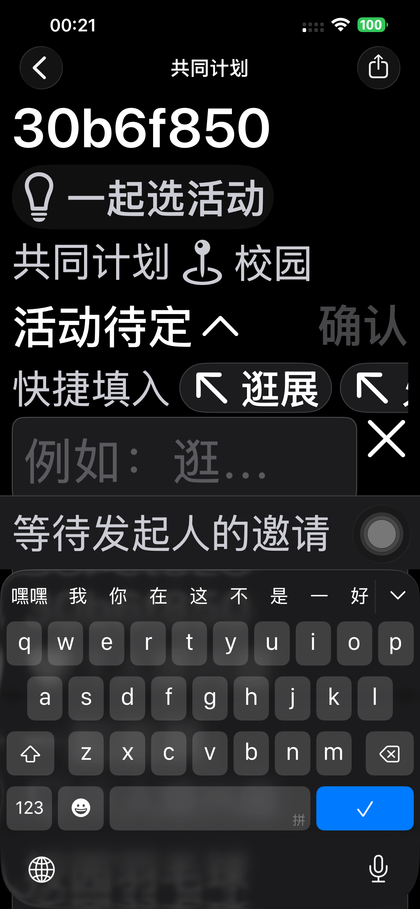
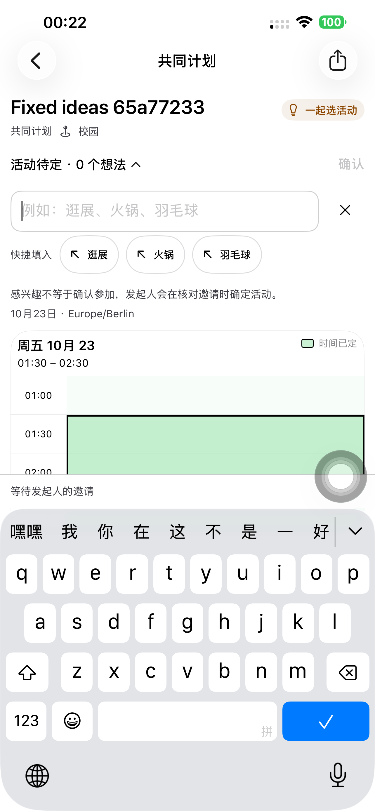
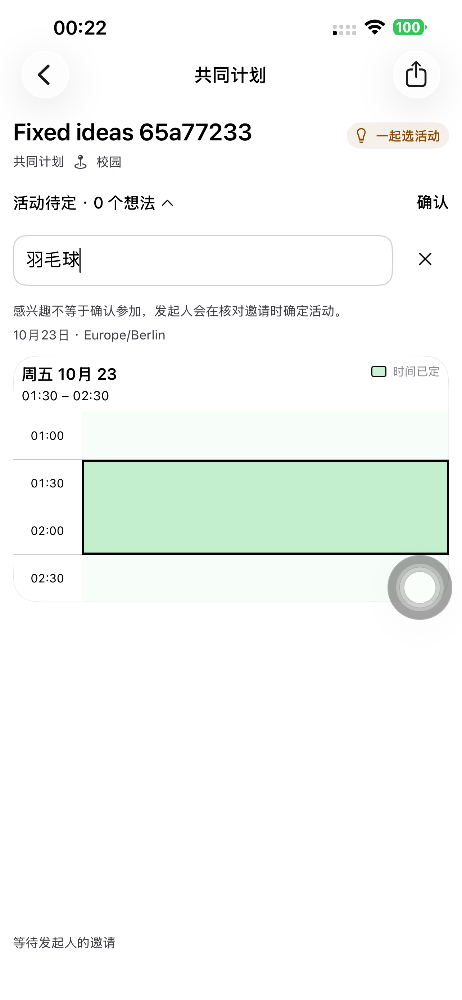

# 活动提议快捷填入：Preview 181

沿用默认推荐「逛展、火锅、羽毛球」。提议输入区显示可点选标签，点选把整项填入草稿并保留输入焦点；输入部分文字后按前缀匹配，Tab 填入第一个匹配项。已有完整推荐或无匹配项时不截获 Tab；Shift/Ctrl/Alt/Command 组合键保留正常行为，网页中文输入组合期间也不截获 Tab。确认按钮仍独立提交，补全不会创建提议、标记兴趣或确认参加，不读取/写入剪贴板，不发补全请求。

原生直接使用当前 TextField 和 iOS 17 起提供的键盘处理，无自定义输入组件；推荐通过已有本地化资源显示，中英德文案齐全。网页复用当前输入框，只增加本地派生的匹配项和输入框引用，没有增加异步请求、依赖或业务状态。三项常量没有引入配置加载器、网络服务或额外数据库。

## 验证与修复

- 第一轮默认手机测试在普通字号下实际点「火锅」填入，输入「羽」后注入 Tab 补成「羽毛球」，没有发布提议。随后最大字号下，输入框下方的标签点选未生效。修正为辅助功能字号把同一标签行放到输入框上方；单独真机深色最大字号 **27.042 秒通过**，点选、输入值和取消核验，保留修复前失败摘要。
- 最终原生完整流程和七阶段独立 API 结果见下方追加的最终交付记录。使用默认 iPhone 14 Plus，App 好友实际创建、卡片发送、提议、兴趣、选活动、邀请、明确接受、发起人正式发出及日历；快捷填入只编辑草稿。
- 网页候选 Chromium、WebKit 最终均通过，正式站 Chromium、WebKit 均通过，共四组最终流程。实际点选/空输入 Tab/部分输入 Tab、IME、Shift+Tab、无匹配 Tab、正常移焦和取消均检查；监听提议 POST 并读真实数据，补全测试阶段请求为零、提议数量为零。之后仍按确认创建四项提议，并完成选活动、明确接受、正式发出及唯一日历。两列、顶部输入、右侧确认和 320px 单列保留。
- 初轮 WebKit 测试错误地假定 Tab 必定聚焦取消按钮；Safari 默认键盘导航会跳过按钮。测试改为核对原输入框失去焦点且文字保持，产品没有增加焦点覆盖，修正后的完整流程通过。保留初轮失败结果，没有把它计为通过。

本轮未执行手机 Safari UI 或领域单元测试；网页使用真实候选/正式服务的 Chromium/WebKit，原生的 Tab 使用 XCTest 在真机注入键盘事件。邀请和 Calendar 规则未改。

## 发布来源

实现 `94c71f74` 已推送。从实际生产 `dpl_Gsjh8qTdCVimd1FYZnCpKCkht48D` 逐项核对 1,389 个源码，只覆盖 `components/time-polls/activity-ideas.tsx`，其余 1,388 个生产文件字节保持，新增一份来源标记；最终 1,390 项上传源码核验。候选验证后提升同一 Production 构建 `dpl_9WUXBm5orPvRbgpnvbJh8kczs5sR`，三个正式域名核对一致，无服务端逻辑、Schema 或迁移变更。原生编译、网页编译/类型检查、相关 ESLint 及 Git 空白检查通过。

[源码比较](./evidence/2026-10-23-plans181/source-verification.json)、[生产核验](./evidence/2026-10-23-plans181/production-verification.json)、[初轮原生失败](./evidence/2026-10-23-plans181/initial-native-summary.json)、[最大字号修复复验](./evidence/2026-10-23-plans181/largest-summary.json)、[正式 Chromium](./evidence/2026-10-23-plans181/production-chromium-activity-completion181.json)、[正式 WebKit](./evidence/2026-10-23-plans181/production-webkit-activity-completion181.json)。

## 最终交付

最终 Preview 181 的完整真机流程 **208.527 秒通过**，包含普通字号点选与注入 Tab、四项实际提议、取消与兴趣、深色最大字号快捷填入，再到邀请和日历；七阶段独立 API 全部通过。最终包与单独最大字号复验使用同一原生实现。247 个已跟踪原生源码/资源输入核验、严格签名及安装通过。默认手机普通启动 **PID 5991**，无测试参数/测试环境，实际进程匹配，普通 SideSeat 97 保留。

14 个专用账号、19 个计划链接均清理并核验 401/404，Runner、私密 xctestrun 与候选保护 Cookie 清理。实现 `94c71f74` 已提交推送；未上传 TestFlight/App Store。

[最终原生摘要](./evidence/2026-10-23-plans181/final-native-summary.json)、[七阶段 API](./evidence/2026-10-23-plans181/final-phone181-api.json)、[构建与安装](./evidence/2026-10-23-plans181/native-build-manifest.json)、[普通启动](./evidence/2026-10-23-plans181/normal-launch.json)、[清理回执](./evidence/2026-10-23-plans181/cleanup-summary.json)。

