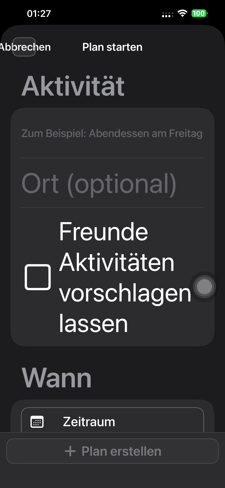
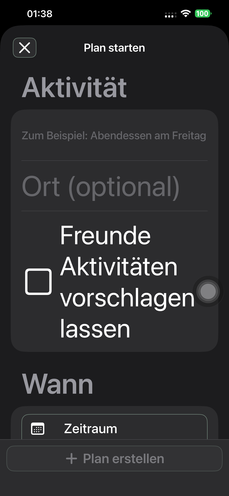
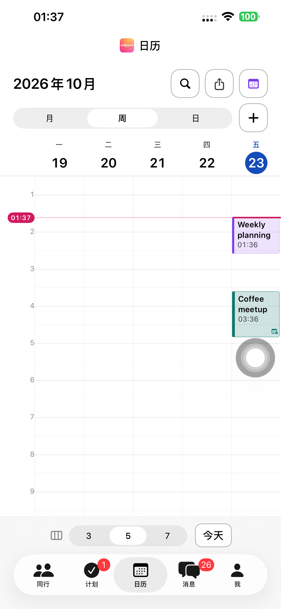
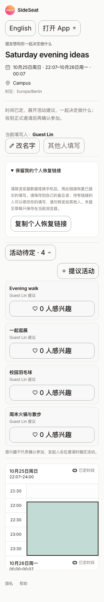
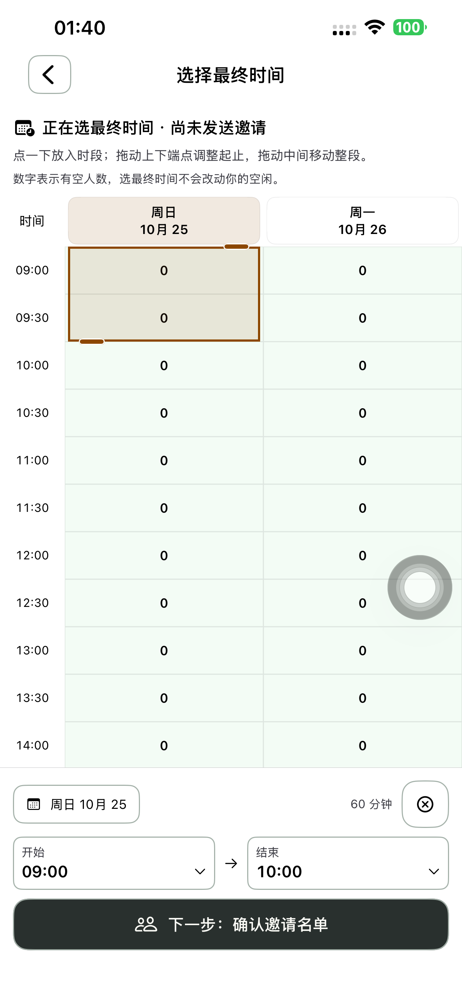

# 按钮实际布局修正：Preview 183

182 的功能回归通过不等于按钮视觉合格。本轮针对实际截图逐项修正尺寸、文字与轮廓的关系，并保留需要描边的要求。

## 修正

- 原来的全局紧凑描边内缩 6pt，却没有给大字号文字分配内边距，文字容易与边框相交。现在边框跟随内容尺寸，标准按钮在轮廓内保留垂直空间；紧凑操作、图标和导航使用明确尺寸，外层点击范围至少 44pt。
- 图标原有 44pt 框再套普通文字按钮的留白，会变成过大的矩形。密码显示、撤销、分享/关闭、更多菜单、日历工具等使用图标规格。已有布局的分栏和消息快捷入口只复用描边与按压效果，避免重复加尺寸；个人头像相机保留已有圆形轮廓。
- 日历工具原来同时有自己的底色/描边和通用描边。统一到共享样式，删除重复布局与未使用的局部按钮样式；今天与新增按钮也分别使用紧凑文字/图标规格。
- 导航栏的系统底座和自定义边框叠加；德文大字号「取消」在系统固定宽度里溢出。常用取消/完成/保存改用 xmark/checkmark，保留原本地化读屏名称与动作，iOS 26 隐藏该操作的重复系统背景；分享和返回同样使用紧凑图标。正文按钮继续显示操作文字。
- 主/次按钮补齐垂直留白；操作文案独立设置字号上限，页面正文保持完整系统缩放。活动提议使用紧凑操作，兴趣按钮居中，提议卡片补齐底部留白。
- 分享网页按钮增加内容高度、垂直留白、图标居中/防压缩和最大宽度。初轮截图显示 320px＋20px 字号把「提议活动」拆开，已改为整颗按钮换行、短标签保持一行；普通宽度仍保持左右排布。

所有动作闭包、记录、提交、邀请和日历规则保留。没有新增业务状态、API、依赖、Schema 或迁移。

## 已执行的页面检查

原生五个主页面、计划和同行表单覆盖中文浅色、英文深色、德文深色最大字号；认证入口另测。前期共享尺寸修正后的两项真机检查 **94.180 / 4.047 秒通过**。该组仍暴露德文导航栏文字溢出，截图复查后继续修正，未把这次通过作为最终视觉验收。最终导航修正后的结果另行记录。

初轮新增的边界断言误把 SwiftUI 合并读屏标签的整颗按钮 bounds 当作字形 bounds，导致测试失败；修正为只检查独立文字节点，保留失败摘要。实际效果仍以截图复核为必要条件。网页使用 DOM Text Range 和 SVG 的实际矩形检查，不使用合并辅助功能 bounds 代替字形。

网页初轮候选双浏览器完整流程通过，但人工复核指出窄屏大字短标签拆行；随后修正 CSS，最终候选浅色 Chromium / 深色 WebKit 均通过。新增断言核对所有独立操作文字/图标距边框至少 3px、44px 点击高度、320px 不横溢，并在 20px 字号核对短操作文案只有一行。正式站结果见最终交付记录。

本轮没有执行手机 Safari UI 或领域单元测试。原生截图不是所有长表单整页可见性的证明；最大字号检查聚焦当前操作、导航与内容边界。

[初轮界面失败](./evidence/2026-10-23-buttons183/initial-smoke-summary.json)、[导航修正前摘要](./evidence/2026-10-23-buttons183/pre-toolbar-smoke-summary.json)、[网页最终候选实际内容检查](./evidence/2026-10-23-buttons183/candidate-final-chromium-large-content-audit.json)、[正式来源](./evidence/2026-10-23-buttons183/source-verification.json)。

## 最终导航与真实流程

共享尺寸实现 `991a483e`、标准导航图标修正 `44faa463`、最终选时控件去重 `6b60879e` 已提交推送。两条真实真机流程分别 **204.847 / 203.428 秒通过**，固定时间/活动提议与普通空闲征集完整走到明确接受、正式发出及双方唯一日历；独立 API **7＋8 阶段**全部通过。它们使用 `991a483e` 安装包，业务截图记录该包，不能替代后续导航图标的视觉验收。

导航修正包 `44faa463` 的最终三项真机检查分别 **91.408 / 37.831 / 4.064 秒通过**，覆盖五个主页面、计划/同行表单、邀请复核返回和认证入口，中英德/浅深色/最大字号保存并复查 25 张截图。确认德文取消不再穿过边框；返回后最终时段保留。最后只在 `6b60879e` 收紧日期菜单和起止菜单：有自带布局的控件不再套通用留白，菜单背景与轮廓圆角一致。该包单独复验最终选时，结果见下方最终安装记录。

[真实流程摘要](./evidence/2026-10-23-buttons183/full-native-summary.json)、[七阶段 API](./evidence/2026-10-23-buttons183/phone183-fixed-api.json)、[八阶段 API](./evidence/2026-10-23-buttons183/phone183-contacts-api.json)、[最终导航/界面摘要](./evidence/2026-10-23-buttons183/final-ui-summary.json)、[各安装包验证范围](./evidence/2026-10-23-buttons183/native-build-manifest.json)。

网页共有六组真实完整流程通过：两组初轮候选用于发现短标签拆行，最终候选及正式站各浅色 Chromium / 深色 WebKit 两组通过，最后四组均含实际字形/SVG 内边距和 320px＋20px 字号的一行短标签断言。正式分享网页是已测同一构建 `dpl_3QAxBxySh4RLrQYf849ozaqdmZEz`，三个正式域名一致。基于实际生产 `dpl_F6DMSv9jgcpZEmPoSNsQZk98rMJd` 的全部 1,391 项源码，仅覆盖一个分享 CSS，1,390 项字节保留；新增来源标记后最终 1,392 项上传源码核验。

## 最终安装与收尾

最终 `6b60879e` 包的选时交互 **26.880 秒**、中文/德文最大字号 **44.636 秒**通过。日期、起止、清空、拖动与复核入口可用，手动提交/邀请规则保留；API 另证专项未写空闲或邀请。最终控件截图已替换，原来重复留白的截图另存。

最终 Preview **1.0.0 (183)**，248 个原生源码/资源输入与隔离构建一致，严格签名、指定 iPhone 14 Plus 安装及普通启动 **PID 6158** / 实际进程核验；启动参数为空且无测试环境，普通 SideSeat **97** 保留。16 个专用账号、27 个计划链接已删除并核验 401/404；本轮 Runner、私密 xctestrun 与两份候选 Cookie 清理。未上传 TestFlight/App Store。网页编译/类型检查、相关 ESLint 与 Git 空白检查通过。

[最终控件专项](./evidence/2026-10-23-buttons183/final-controls-summary.json)、[无业务写入核对](./evidence/2026-10-23-buttons183/picker-api.json)、[普通启动](./evidence/2026-10-23-buttons183/normal-launch.json)、[清理汇总](./evidence/2026-10-23-buttons183/cleanup-summary.json)。

