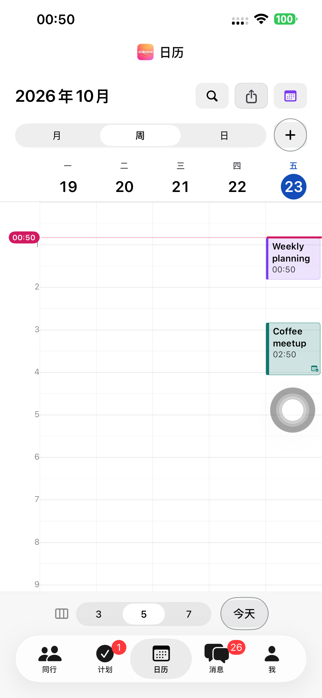
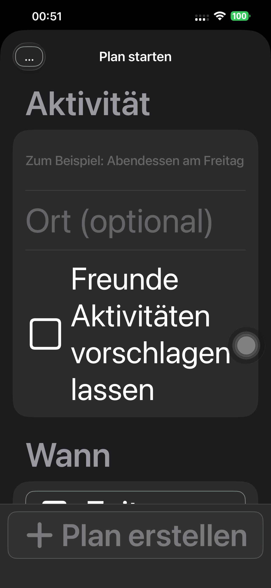
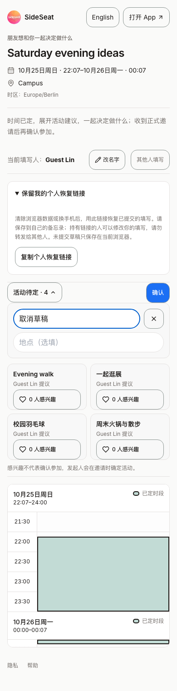
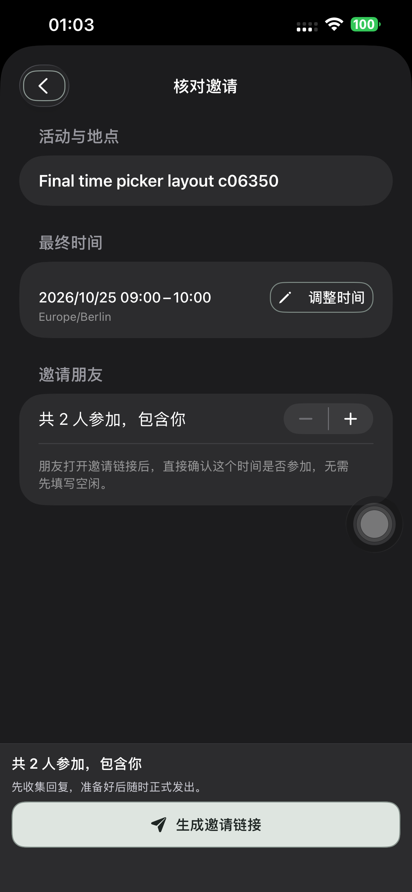
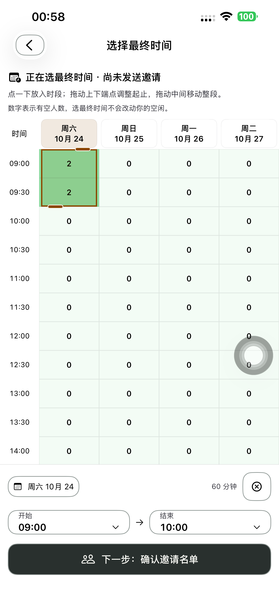

# 统一操作按钮轮廓：Preview 182

本轮将 App 活跃页面与分享网页的独立操作按钮统一为清晰可见的轮廓，尤其是原来的小文字/图标操作。主操作保留实心强调并增加轮廓，次要操作采用统一圆角描边，删除/取消类危险操作保留红色语义；已选与禁用仍可辨认。既有圆形图标保留圆形。卡片、列表行、时间格沿用其原有交互形状，流程和规则不变。

原生新增一个 `SSActionButtonStyle` 和一个轮廓 helper，接到默认样式及已有主/次操作组件；计划页、时间表、活动提议、消息/聊天、同行、日历、个人资料和认证入口补齐显式操作样式。导航栏可见边框内缩 6pt，保留 44pt 点击范围。网页只在分享页作用域内统一边框/圆角/点击高度，保留时间格和日期表头的已有尺寸。没有新增业务状态、API、数据库或依赖。

## 页面与浏览器验收

- 最终真机界面两项通过：五个主页面、计划和同行表单分别在中文浅色、英文深色、德文深色最大字号检查；另有未登录认证入口。用例分别 **95.093 秒、4.150 秒**，保存 22 张最终截图。该组使用隔离本地 UI fixture，不计作线上业务链。
- 初轮界面测试仅寻找空列表的创建 ID，已有列表用的是另一入口 ID；修正测试查找后通过，产品未因该测试改流程。中间包截图发现系统导航栏裁切描边，最终将默认紧凑描边内缩，重新构建/安装并复跑上述两项通过。初轮失败摘要和裁切截图保留。
- 网页共五组完整真实流程通过：候选 Chromium 浅色、WebKit 浅色、追加 WebKit 深色；正式 Chromium 浅色和 WebKit 深色。每组覆盖 App 联系人投递、游客提议/兴趣、选活动、显式邀请/接受、发起人正式发出、双方唯一日历及另三类创建合同，无页面错误。
- 补全阶段无提议 POST、无实际新提议；手动确认后才创建四项。输入框仍在顶部，两列、取消、Tab/IME 及 320px 布局通过。最终正式双浏览器读取 11 个独立操作的计算样式：1px 实线轮廓、14px 圆角、44px 高度；邀请阶段按钮也核验。浅深色轮廓分别为 `#8D9693` / `#7F8C86`。

本轮网页使用真实服务的桌面 Chromium/WebKit，未执行手机 Safari UI；没有重跑未改的领域单元测试。普通文本字号与辅助功能字号的交互截图在下方证据目录。

## 真实原生业务链

默认 iPhone 14 Plus 的两条线上业务链分别 **206.924 秒、206.314 秒通过**：固定时间＋活动提议包含点选/Tab 本地补全、四项提议、取消、兴趣、深色最大字号、App 联系人卡片、选活动、邀请、明确接受、正式发出和双方唯一日历；普通征集包含双方直接点选空闲/手动提交、最终时段放置/伸缩/移动/换日/精确时间/重选/返回、核对名单、发送/接受及日历。独立 API 分别七、八阶段全部通过。

这两条完整流程使用 `42de15fc` 构建。截图复查又发现邀请复核页的文字「返回选择」受系统导航栏压缩，因此 `005db4e9` 将这一处改为有描边的返回图标；原 dismiss、忙碌禁用规则与本地化读屏名称不变。最终安装包与完整流程包的来源分别保存，不将此前流程冒充为图标修正后的重跑。

最终修正后的包单独运行返回控件用例，中文/英文普通字号与德文深色最大字号 **39.355 秒通过**，逐项核验 44pt 范围、可点击、完整图标、返回后选中时段保留。API 另证该过程未提交空闲、未发送邀请。深色最大字号截图仅用于这一返回控件，不代表整张长表单的可见性验收。

[完整真机摘要](./evidence/2026-10-23-buttons182/final-native-summary.json)、[固定时间七阶段 API](./evidence/2026-10-23-buttons182/phone182-fixed-api.json)、[普通征集八阶段 API](./evidence/2026-10-23-buttons182/phone182-contacts-api.json)、[完整流程包来源](./evidence/2026-10-23-buttons182/full-flow-native-build-manifest.json)。

## 来源与部署

统一样式 `42de15fc`、返回图标修正 `005db4e9` 均已提交并推送。原生 248 个跟踪源码/资源输入与隔离构建逐项一致，最终 Preview 182 构建、严格签名和默认 iPhone 14 Plus 安装通过。

以实际生产 `dpl_9WUXBm5orPvRbgpnvbJh8kczs5sR` 的 1,390 项上传源码为基础，只修改 `components/time-polls/shared-time-poll.module.css` 与 `shared-time-poll.tsx`，保留其他 1,388 项字节，新增一份来源标记。最终 1,391 项上传源码核验后，提升同一已测试 Production 构建 `dpl_F6DMSv9jgcpZEmPoSNsQZk98rMJd`，三个正式域名一致。无服务端逻辑、Schema 或迁移改动。原生/网页编译、网页类型检查、相关 ESLint 与 Git 空白检查通过。

[构建来源](./evidence/2026-10-23-buttons182/native-build-manifest.json)、[网页来源](./evidence/2026-10-23-buttons182/source-verification.json)、[生产核验](./evidence/2026-10-23-buttons182/production-verification.json)、[最终界面摘要](./evidence/2026-10-23-buttons182/final-smoke-summary.json)、[初轮界面失败](./evidence/2026-10-23-buttons182/initial-smoke-summary.json)、[正式 Chromium](./evidence/2026-10-23-buttons182/production-chromium-button-outlines182.json)、[正式 WebKit](./evidence/2026-10-23-buttons182/production-webkit-button-outlines182.json)。

## 最终安装与清理

最终 Preview **1.0.0 (182)** 已安装到指定 iPhone 14 Plus，普通启动 **PID 6071** 与实际可执行进程匹配，参数为空且无测试环境。普通 SideSeat **97** 保留。五组浏览器、两条真机完整流程及一次返回控件专项共 **16 个专用账号、23 个计划链接**均清理，401/404 核验；本轮 Runner、私密测试启动文件和候选保护 Cookie 已清理。未上传 TestFlight/App Store。

[返回控件专项](./evidence/2026-10-23-buttons182/review-fix-summary.json)、[无业务写入核对](./evidence/2026-10-23-buttons182/picker-api.json)、[普通启动](./evidence/2026-10-23-buttons182/normal-launch.json)、[清理汇总](./evidence/2026-10-23-buttons182/cleanup-summary.json)。

