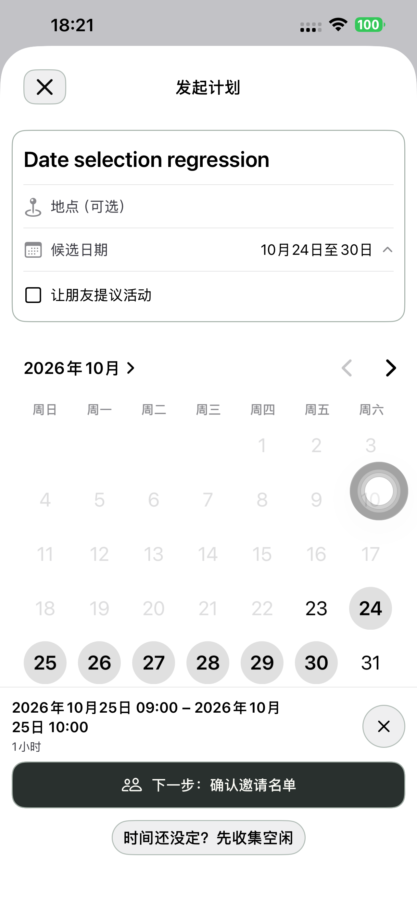
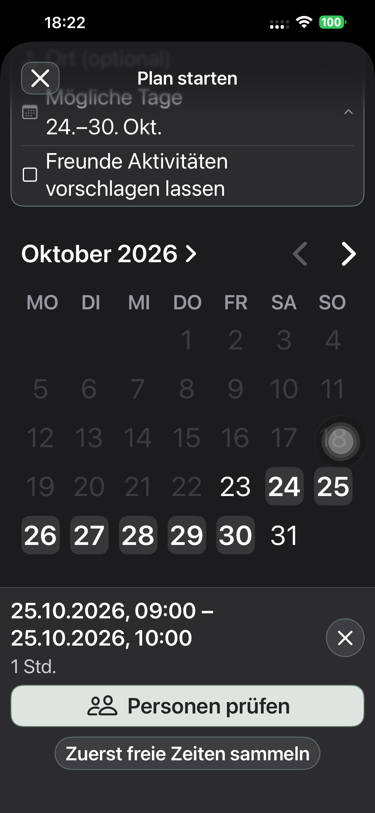
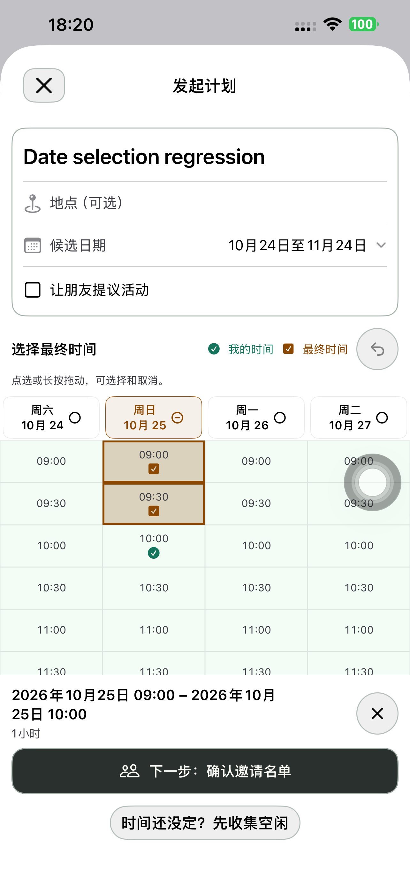
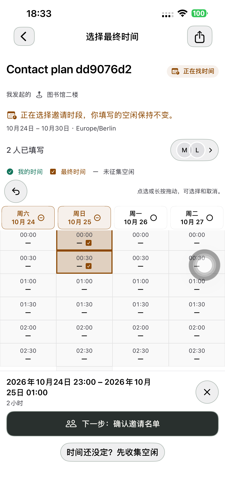
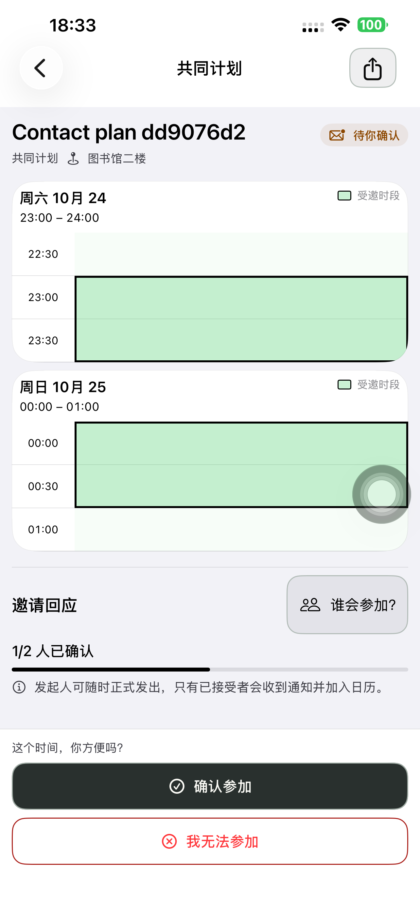

# 候选日期点选闪退 — Preview 189

## 实际原因

默认 iPhone 14 Plus 的系统崩溃记录显示，188 在 2026-10-23 17:40:06 因重复键触发 Swift 断言：`Dictionary.init(uniqueKeysWithValues:) → TimePollTimetable.finalTimeSlots → TimePollCreateView.onChange`。

默认七天的 DateComponents 没有 calendar，而系统 MultiDatePicker 返回的同一天带有 calendar。这两项在 Set 中并不相等：第一下不能真正移除默认日，第二下加入同日的另一表示，生成重复时间起点并崩溃。临时仅记录日期元数据的 188 包在真机两次点选后复现，31.797 秒；诊断代码不进入 189。

上一轮 188 的日期检查只展开/收起控件、保留输入和时段，没有实际取消及重选日期，遗漏了这个路径。本轮新增对应回归，不沿用旧结论替代执行。保留[脱敏崩溃与日期元数据](./evidence/2026-10-23-dates189/crash-root-cause.json)，原始系统日志和含测试凭据的 XCTest 日志不入仓库。

## 修复与精简

- 默认值和系统控件共用明确的 Calendar/locale，日期写入统一为含 calendar 的日组件；时间表候选键和时段生成只保留唯一日期。
- 完整日时段改为每个时间表生成一次；时间格复用单个时钟格式器。编辑日期时卸载下方网格，收起原日期行后恢复，避免每次点击同时渲染数百个时间格。
- 模型、已有校验和底栏仍随日期更新；最终时间和个人空闲继续按实际起点重映射，避免 ID 变化移到别的日期。
- 使用类型明确的日期/起止变化监听及一个重建函数；无诊断开关、临时文件写入、延时保存、重试层或新增确认步骤。全仓当前原生页面只此一处 MultiDatePicker。
- 保留默认明天起七天、零日期和最多 31 天限制，以及已有手动提交、邀请、接受/拒绝/忽略、随时正式发出、过期和唯一日历规则。无后端或网页改动。

## 最终包日期回归

默认 iPhone 14 Plus / iPhone (4)，UDID `00008110-001A69110CC1401E`，iOS 26.6.1。以下均使用最终 189 手机包，无失败或跳过。

| 真机用例 | 结果 | 实际范围 |
| --- | ---: | --- |
| 日期上限与较大时间表 | 102.807 秒通过 | 七个默认日＋下月 24 日；31 日可继续、32 日禁用、取消恢复；收起后显示 31 日并保留原选区 |
| 日期取消、重选和连点 | 116.438 秒通过 | 中文普通浅色/德文最大辅助字号深色；默认日第一次正确取消、重选、每组四批六连点；双草稿保留和 ID 重映射；清空日期禁用下一步 |

日期专项完成后 API 检查为零个新建计划。原生 TimePollTests **29 项**、领域 **16 项**通过；新增单元覆盖组件身份冲突和重复日期/DST 时间线的唯一性。未进行帧率或全机性能基准测试。

已逐张检查中文日期连点、德文最大字号日期/清空、31 日期及恢复后的网格截图；日期选择和主按钮可见，文字无越出控件边界。德文截图处于滚动位置，透明系统导航栏下可见滚动内容；测试机原有 AssistiveTouch 浮钮保持。含外部通知横幅的截图未入仓库。

## 完整流程与交付

| 最终 189 包的一次连续真机路径 | 结果 | API 阶段 |
| --- | ---: | ---: |
| 实际取消/重选默认日期 → 点选最终时间 → 创建/重开草稿 → App 好友卡片 → 正式邀请 → 接受 → 正式发出 → 双方日历 | 181.942 秒通过 | 6 |
| 先征集 → 原位编辑/取消/保存 → 双方手动填写 → 最终时间点选/取消/拖选/擦除/撤销 → 跨午夜 → 邀请/接受/发出 → 双方日历 | 324.016 秒通过 | 8 |

两条均未失败或跳过；业务操作由真机执行，Mac 仅准备专用联系人并在边界读取 API。14 个 API 阶段均验证候选日期唯一；直接流程没有提交空闲，征集流程双方仍为 `[0,1,2,3]`，正式发出前无日历，之后双方各一条，标题、地点及精确起止一致。跨天邀请为 23:00–次日 01:00。实际检查了创建、受邀高亮、跨天摘要及日历截图。

本轮未重跑活动提议独立路径或分享网页；其代码和规则未修改。中间失败均保留于[尝试记录](./evidence/2026-10-23-dates189/attempts.json)，不计最终通过。

系统日志复核没有新增崩溃退出记录。征集流程长时间自动化读取时间表期间产生一份 **202 CPU resource** 诊断：121 秒内 90 秒 CPU、平均 75%，`Action taken: none`，最重调用链包括 XCTAutomationSupport/AXRuntime；该流程随后完整通过。它不是 309 崩溃报告，不能据此声称整张时间表已通过性能基准。日期专项期间没有新资源或崩溃报告。见[日志复核](./evidence/2026-10-23-dates189/crash-log-verification.json)。

- 实现 `c439e25459cd18d53c44968ee7f9bbb85d141845` 已提交并推送。
- 默认手机最终 **1.0.0 (189)** 已安装并经完整流程使用；248 个 App 输入、18 个配置/脚本/工程规格及共享 Calendar JSON 与隔离构建逐字节一致，严格签名通过。
- 清理测试后，普通启动 **PID 7149** 与实际进程、安装路径匹配，无 QA 参数/环境。普通 SideSeat **97** 保留。
- 四个专用账号、两个计划链接删除并核验 401/404；Runner、私密 fixture/xctestrun、临时共享 scheme 清理；诊断日期文件覆盖为空对象并读回核验，正式源码不再写该文件。原始测试日志和结果仅留本机，权限收紧，不入仓库。
- 无本轮后端/网页发布、迁移或 TestFlight/App Store 上传。api/www 只读核对仍为 Ready 的 `dpl_97Yg1PF8Pn2Fb3is5MJC4FNL3Cb7`。

[构建来源](./evidence/2026-10-23-dates189/native-build-manifest.json)、[普通启动](./evidence/2026-10-23-dates189/normal-launch.json)、[清理](./evidence/2026-10-23-dates189/cleanup-summary.json)、[生产核对](./evidence/2026-10-23-dates189/production-status.json)。
