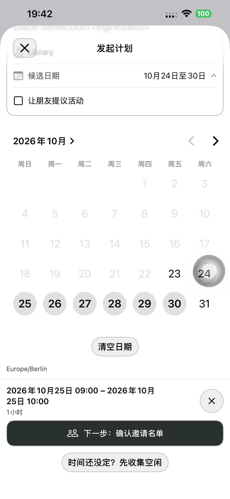
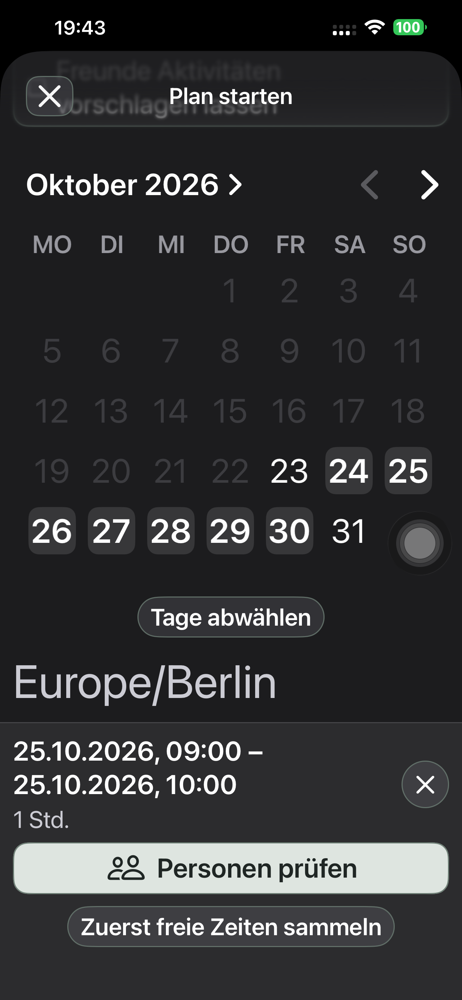

# 日历下方居中清空日期 — Preview 190

展开候选日期后，日历正下方居中显示一个小号描边「清空日期」按钮；征集小时控件仍在它之后。使用已有紧凑按钮样式，文字留在轮廓内，点击范围至少 44pt。

一次点击仅清空候选日期；现有重建逻辑同步清除对应的个人空闲和最终时段。活动名称、地点和其他输入保留。零日期时清空和下一步禁用，重新选日期/时段后正常继续。无确认弹窗、新状态、网络请求或业务规则分支；产品逻辑仅五行视图代码，另补中英德文字。

## 验收范围

默认 iPhone 14 Plus / iPhone (4)，UDID `00008110-001A69110CC1401E`，iOS 26.6.1，最终 1.0.0 (190) 包。

日期专项覆盖中文普通字号浅色、德文系统最大辅助字号深色；取消/重选和批量连点，实际使用清空按钮、保留名称/地点、零日期禁用，再选日期/时段恢复下一步。断言按钮在日历下方、水平居中、至少 44pt，滚动后完整位于底部操作区上方；并检查实际截图。

初轮 128.207 秒功能检查通过，但德文「清空前」截图的按钮被底部摘要盖住，未算视觉验收。测试原来仅比较下一步按钮位置，后改为比较更靠上的最终时间摘要，并在截图前滚动到按钮完整可见。没有为测试增加产品滚动或隐藏操作区的逻辑。

完整流程从清空默认日期并只重选一天开始，继续点时间表、创建/返回/重开草稿、App 好友卡片、正式邀请、受邀者接受、发起人正式发出及双方日历。业务操作由真机完成，Mac 仅准备专用联系人并读取 API。

最终同一产品包的日期/字号/位置复验 **129.287 秒**通过，无失败或跳过。已实际检查普通和最大字号的清空前、禁用后、重选截图；按钮居中、文字完整且有描边内留白，滚动后完整显示在固定底栏上方。大字号页面保留自然滚动，透明系统导航栏后可见滚动内容，测试机原有 AssistiveTouch 浮钮保持。

完整连续真机流程 **141.232 秒、6 API 阶段**通过，无失败或跳过。六次边界核验始终只有一个候选日；没有提交空闲；正式发出前双方没有日历，之后双方各一条，精确标题和起止一致。最终日历及只选一天的创建截图也已检查。日期专项另用独立账号，API 核验为零个新计划。

本轮未改时间线、邀请或日历能力；原生 29/领域 16 项的历史结果见 189，本轮不重复计为新执行。活动提议、征集完整路径、分享网页及全机性能基准本轮未重跑。系统日志复核本轮无新增崩溃或 CPU resource 记录；189 的旧诊断保留。

## 交付

- 实现 `010732775e196544feeb34359ed15adba017e04a` 已提交并推送。没有为截图断言修改最终产品包；最后仅收紧测试的可见范围检查。
- 默认手机最终 **1.0.0 (190)** 已安装；248 个 App、18 个配置/脚本/工程规格及共享 Calendar 输入与隔离构建逐字节一致，严格签名通过。中英德文案文件校验通过。
- 普通启动 **PID 7207** 与实际进程及安装路径一致，无 QA 参数/环境；普通 SideSeat **97** 保留。
- 四个专用账号、一个计划链接删除，401/404 核验；Runner、私密 fixture/xctestrun、临时共享 scheme 清理，私密设备清单清除，原始测试结果仅保留本机并收紧权限。
- 无后端/分享网页发布、迁移或 TestFlight/App Store 上传；api/www 只读重验仍为 Ready 的 `dpl_97Yg1PF8Pn2Fb3is5MJC4FNL3Cb7`。

[构建来源](./evidence/2026-10-23-clear190/native-build-manifest.json)、[普通启动](./evidence/2026-10-23-clear190/normal-launch.json)、[API 闭环](./evidence/2026-10-23-clear190/direct190-api.json)、[清理](./evidence/2026-10-23-clear190/cleanup-summary.json)、[尝试记录](./evidence/2026-10-23-clear190/attempts.json)。
