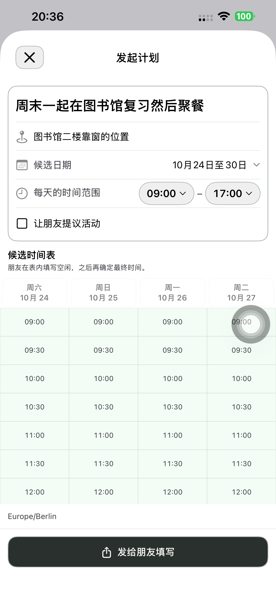
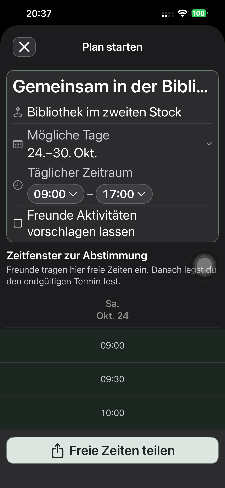
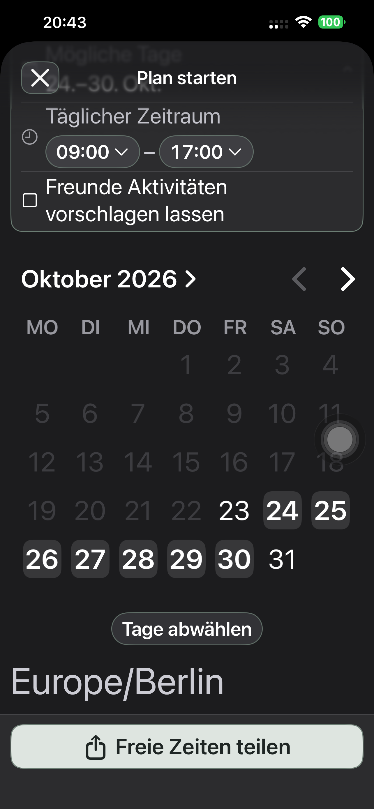
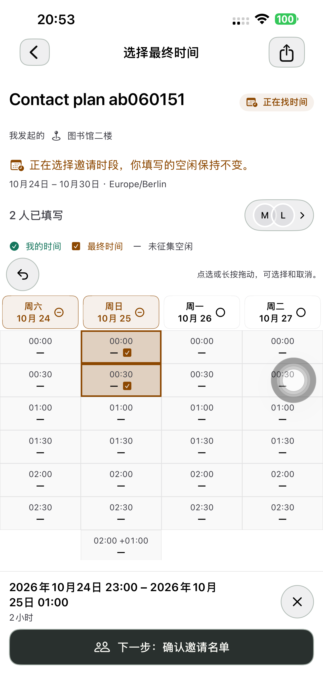
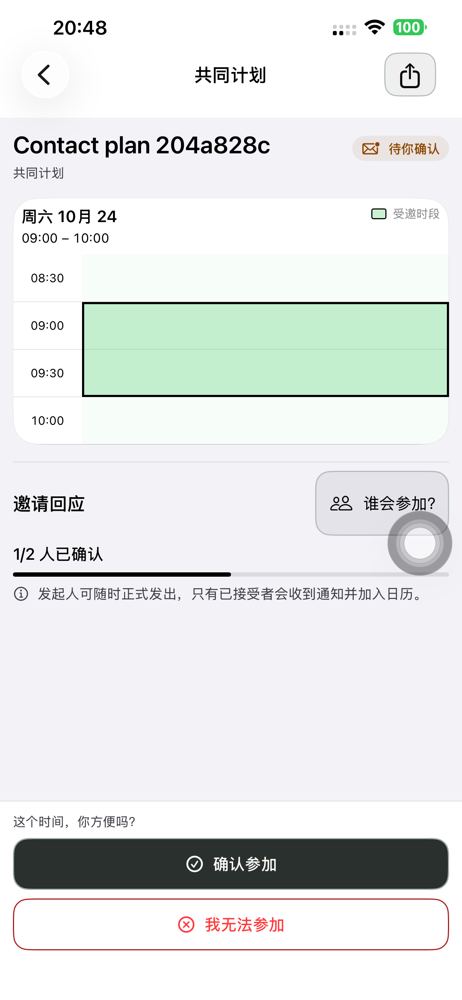
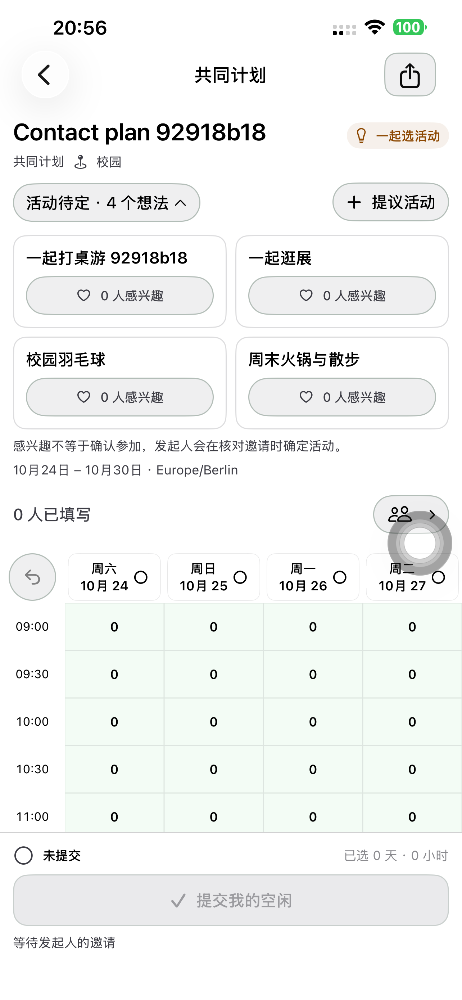

# 统一先征集主流程 — Preview 191

本轮按所有者确认改为：活动/地点 → 候选日期和每天可填写时段 → 发给朋友填写 → 同表查看空闲 → 确定最终时间 → 核对名单并邀请 → 个人回应和发起人正式发出到日历。

## 实现与精简

- 创建仅配置候选时间表，显示已有时间表组件的只读预览。移除创建页的最终/空闲模式、两套选区、最终时间摘要及切换按钮；有效名称和日期/每日范围即可分享。
- 复用现有 COLLECT 创建接口及 share handoff。创建阶段不实例化第二个 TimePollStore、不代填或提交发起人的空闲、不生成最终时段，也不提前发送正式邀请。
- 自己和朋友在现有详情页手动提交空闲；发起人从同一时间表进入最终选时、名单复核并明确发邀请，零投票时也可操作。移除详情最终选时底部重复的「先收集空闲」，原返回箭头保留草稿及返回填写。
- 每日范围在顶部信息组直接编辑，使用两个共用小时菜单和现有描边按钮样式。保持半小时输入、44pt 触区、完整时间读数和大小字号自适应；结束不晚于开始时禁用分享并沿用现有提示。
- 候选预览不显示选区、撤销或点选提示；读屏也不再将只读时间格注册成可点击按钮。详情绿色空闲和琥珀色最终时间仍用原手势与样式。
- 活动提议复用同一分享起点，仍需选活动后正式邀请。旧记录/FIXED 支持、私密草稿、跨天、版本、接受/拒绝/忽略、随时正式发出、只通知已接受者、过期和唯一日历规则保持。
- 无新路由、接口、数据库迁移或独立投票引擎。分享网页已支持同一 COLLECT 记录，本轮未改其代码或发布网页。

## 实际验证

默认 iPhone 14 Plus / iPhone (4)，UDID `00008110-001A69110CC1401E`，iOS 26.6.1。

初轮发现只读格子仍继承默认读屏动作，已按是否可编辑实际移除。截图还发现最大字号时间断行；控件改用现有紧凑描边菜单，补查 44pt 高度及完整单行值。原有 6 连点测试不再假设系统必定接收偶数次触摸，而验证前台无崩溃、独立点选/取消与最终可恢复选择。菜单回归改为等待当前值并滚动原生菜单，避免测试查找未加载或动画前的时间选项。上述失败、被替代的中间包与测试中断不计验收。

最终同一产品包的界面验收：每日范围编辑及无效范围恢复 **43.447 秒**；中文/德文、普通/最大辅助字号、浅深色与长文字 **82.433 秒**；修正测试可见范围后的日期取消/重选/批量连点/居中清空 **104.827 秒**，均通过。前两项来自含一次日期测试失败的结果包，只计各自通过的方法；日期采用后续独立通过结果，不将混合结果包描述成全绿。最后只修改了测试滚动辅助方法。

实际截图确认时间读数单行完整、两个菜单至少 44pt、文字位于描边内；没有模式切换、最终摘要或可点的候选预览时间格。最大字号沿用自然滚动，日历下方清空完整可见；测试机原有 AssistiveTouch 浮钮保留。

本轮原生模型测试 **29 项**、时间计划领域测试 **16 项**通过；最后仅显示菜单/只读可访问性修正未改变这些模型及领域源码，最终真机界面检查使用最终包。完整真实业务操作由默认手机执行，Mac 仅准备专用联系人并读取 API。三条连续流程使用最终同一产品包：

| 路径 | 真机耗时 | API 阶段 | 结果 |
| --- | ---: | ---: | --- |
| 候选表创建后、零人提交仍可最终选时 | 142.227 秒 | 6 | 通过 |
| 双方手动提交空闲、最终点选/取消/拖选/撤销、跨天邀请 | 319.696 秒 | 8 | 通过 |
| 候选表和活动提议、四项想法、选活动后邀请 | 245.149 秒 | 7 | 通过 |

三条均走过 App 好友卡片、名单复核、正式邀请、明确接受、发起人正式发出及参与者实际日历搜索；无失败或跳过。21 个 API 核验阶段检查候选日唯一、正式邀请前最终时间为空/邀请为零、空闲只在明确提交后出现，正式发出前日历为零、之后双方各一条且标题地点和精确起止一致。零填写路径保留未提交空闲、最终时间草稿及返回重开；跨天路径最终为 23:00–次日 01:00、两小时。

源码精简复查另发现旧 `PlanCreationPresentationUITests` 仍依赖早已删除的 FIXED 入口：删除两项过期模式测试，更新原有主按钮文字和分享衔接断言；不是恢复旧产品入口。iPhone 17 Pro / iOS 26.5 模拟器上的保留页面测试 **7 项通过、零失败，181.105 秒**；另一个需要独立真实账号 fixture 的辅助用例 **1 项跳过**，不计执行，真实创建业务已由上述三条手机流程覆盖。[页面测试结果](./evidence/2026-10-23-flow191/presentation-summary.json)。

分享网页本轮未重跑浏览器流程；接受/拒绝/忽略、随时正式发出及过期等未修改的能力不冒充本轮逐项专项验收。手机系统日志复核，18:00 UTC 起本轮没有新增崩溃退出或 CPU resource 报告；旧诊断保留。

## 交付

- 实现 `a06f08f6db125753858f139f6521225c0b3985ea` 已提交并推送。旧测试修正 `14f12835bf16740705ca5b2ca523edda964d42df` 亦已提交并推送；产品输入和已测 App 不变。
- 默认手机最终 **1.0.0 (191)** 已安装；248 个 App、18 个配置/脚本/工程规格及共享 Calendar 输入与隔离构建逐字节一致，严格签名通过，最终二进制 SHA-256 已重新记录。中英德文案校验通过。
- 普通启动 **PID 7351**，进程、安装路径和版本一致，无 QA 参数/环境；普通 SideSeat **97** 保留。
- 六个专用账号、三个计划链接清理，401/404 核验；Runner、私密 fixture/xctestrun 和临时共享 scheme 已删除。设备私密清单已删除，本机原始日志及测试结果权限已收紧。
- 无后端/分享网页发布、接口/数据库迁移或 TestFlight/App Store 上传；api/www 本轮只读核验仍为 Ready 的 `dpl_97Yg1PF8Pn2Fb3is5MJC4FNL3Cb7`。

[创建检查](./evidence/2026-10-23-flow191/creation-phone-results.json)、[日期复测](./evidence/2026-10-23-flow191/candidate-date-phone-summary.json)、[三条真机流程](./evidence/2026-10-23-flow191/phone-journeys.json)、[零填写 API](./evidence/2026-10-23-flow191/direct191-api.json)、[提交/跨天 API](./evidence/2026-10-23-flow191/collection191-api.json)、[活动 API](./evidence/2026-10-23-flow191/ideas191-api.json)、[原生单元](./evidence/2026-10-23-flow191/native-unit-summary.json)、[领域检查](./evidence/2026-10-23-flow191/domain-tests.txt)、[构建来源](./evidence/2026-10-23-flow191/native-build-manifest.json)、[普通启动](./evidence/2026-10-23-flow191/normal-launch.json)、[清理](./evidence/2026-10-23-flow191/cleanup-summary.json)、[崩溃检查](./evidence/2026-10-23-flow191/crash-check.json)、[被替代的尝试](./evidence/2026-10-23-flow191/attempts.json)。
