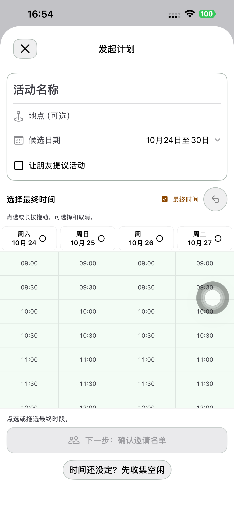
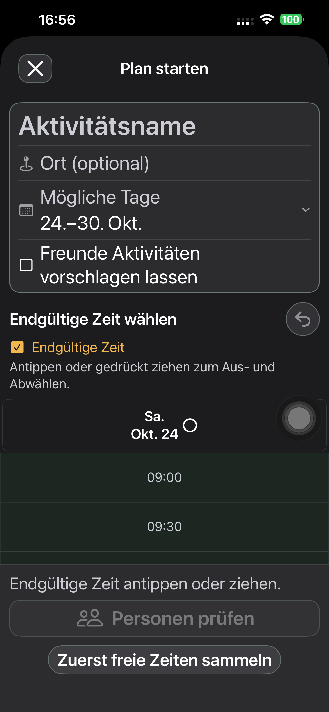

# 发起计划顶部信息与时间表 — Preview 188

本轮将活动名称、地点、候选日期和朋友提议选项整理成一个紧凑信息组，时间表紧随其后。现有流程、数据和规则保持。

## 实现与精简

- 名称作为主输入，地点、日期和勾选项统一图标列、边距与分隔线。复用既有 PlanAdaptiveRow、自适应文字、主题色和轮廓，不另建表单系统。
- 日期行显示明确标签及简短范围；只有范围全部位于本地当前年时省略年份。展开后仍用原日期选择器和征集小时控制。默认明天起连续七天保持。
- 创建页的时间表标题、图例和撤销共用一个抬头，手势说明只在该抬头出现一次。通过既有 TimePollGrid 的可选 heading 复用原表格；详情页的默认呈现保持。
- 名称/地点聚焦时收起创建底栏，键盘完成后恢复，避免底栏挤压输入。没有自动保存、代填或新增下一步。
- 最大字号下信息组文字增长到 accessibility1，图标固定 18pt、展开箭头 11pt；日期标签和值自然纵排。表格和其他区域沿用各自已有字号规则。新分组明确使用 accessibility contain，保留各输入和动作的独立标识。
- 未改创建请求、时间格、草稿存储、邀请版本、接受/拒绝/忽略、随时正式发出、容量、过期和唯一日历规则；无接口、迁移或新流程分支。

## 最终包显示检查

默认 iPhone 14 Plus / iPhone (4)，UDID `00008110-001A69110CC1401E`，iOS 26.6.1。

- 中/德文普通与系统最大辅助字号，浅/深色共四组：185.321 秒通过。包含空状态、长名称/地点、真实键盘输入、选择时段、切换征集并保留两份草稿。普通信息组不超过 210pt，大字号不超过 340pt，行间不重叠、边界有留白，日期和勾选按钮至少 44pt（断言允许半点浮点误差）。
- 日期展开、征集小时与收起，保留名称、地点及最终时段：36.029 秒通过。布局专项未按创建/分享，服务端检查为 0 个新计划，0 份空闲，0 个邀请版本。
- 实际逐张检查了普通/大字号空表、长内容、键盘、展开日期/征集小时、名单和跨天邀请截图。最初仅功能断言通过的巨大图标版本未作为视觉验收；最终图标与文字已修正。
- 原生 TimePollTests 27 项、时间计划领域 16 项通过，均无跳过。原生测试使用与最终手机包相同的当前 App 源码。

## 三条连续真机流程

| 最终包路径 | 一次通过 | API 阶段 |
| --- | ---: | ---: |
| 新建直接选时 → 返回/重开草稿 → App 好友卡片 → 正式邀请 → 接受 → 发起人正式发出 → 双方日历 | 179.715 秒 | 6 |
| 先征集 → 原位编辑/取消/保存 → 双方手动提交 → 点选/取消/拖选/擦除/撤销 → 跨天时段 → 邀请、接受、发出、日历 | 336.617 秒 | 8 |
| 朋友提议＋同表选时 → 四条提议/快捷填入/Tab/取消/兴趣 → 大字号编辑 → 选活动 → 邀请至日历 | 267.545 秒 | 7 |

三条均在最终源文件、同一个最终安装包完整执行，使用专用真实账号和 App 联系人；所有业务动作由真机完成，Mac 只准备联系人并核验 API。

21 个 API 阶段检查：直接邀请始终没有提交空闲；征集流程双方 `[0,1,2,3]` 不被最终选时覆盖；活动兴趣不代替参加。正式发出前双方无日历，发出后双方各一条，标题、地点及精确起止一致。跨天最终区间为 23:00–次日 01:00。各条服务端记录见本目录对应 `*-api.json`。

初轮修正与实际范围见 [尝试记录](./evidence/2026-10-23-compact188/initial-attempts.json)：辅助功能标识覆盖、44pt 浮点断言、最大字号图标越界；原生测试先使用了过期生成工程，改用当前源码生成工程。活动首轮因 fixture 环境变量名称不同而跳过，未计执行或验收；最终活动流程另完整执行并通过。原始 xcresult/录像留在本机 `/tmp/sideseat188-*`，凭据和私密启动配置不入仓库。

## 交付

- 实现 `8e3929accd258a6bf1ef43e8e2db29011a4125b1` 已提交并推送。
- 默认手机最终 1.0.0 (188) 已安装；248 个 App 输入、18 个配置/脚本/工程规格及共享 Calendar JSON 与隔离构建逐字节一致，严格签名通过。
- 普通启动 PID 7027 与实际进程/安装路径匹配，未带 QA 参数/环境；普通 SideSeat 97 保留。
- 六个专用账号、三个计划链接删除，401/404 核验；Runner、私密 fixture 与启动文件清理完成。
- 本轮未发布后端或分享网页。只读核对 api/www 仍指向 Ready 的 `dpl_97Yg1PF8Pn2Fb3is5MJC4FNL3Cb7`；无 TestFlight/App Store 上传。

[构建来源](./evidence/2026-10-23-compact188/native-build-manifest.json)、[普通启动](./evidence/2026-10-23-compact188/normal-launch.json)、[清理](./evidence/2026-10-23-compact188/cleanup-summary.json)、[生产核对](./evidence/2026-10-23-compact188/production-status.json)。
