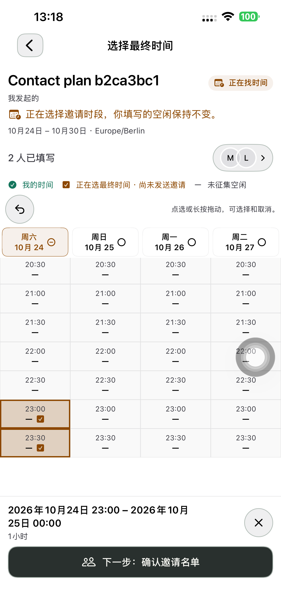
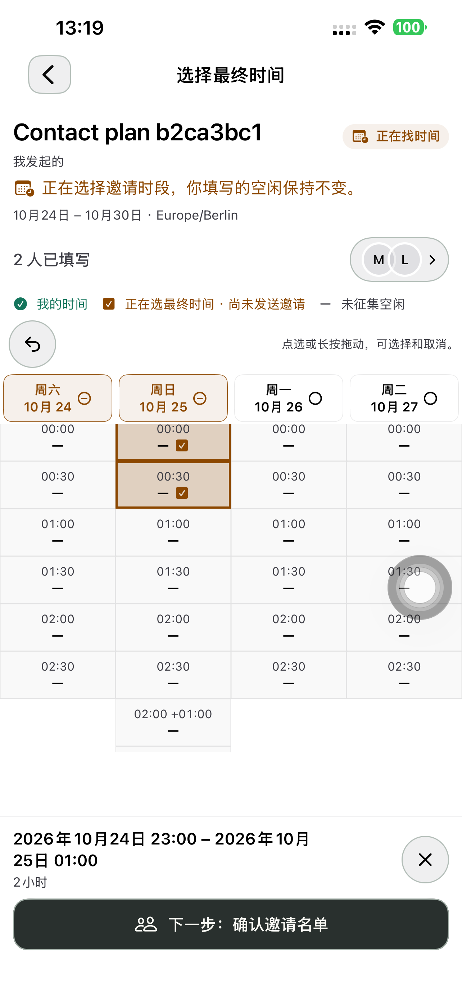
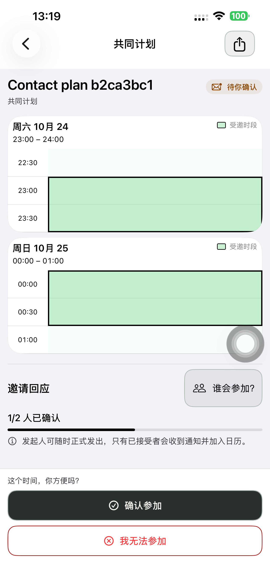
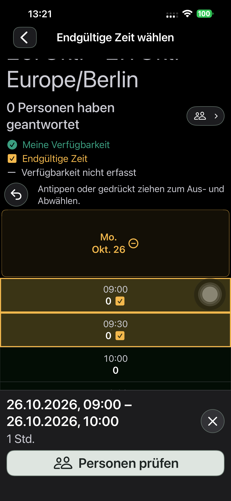
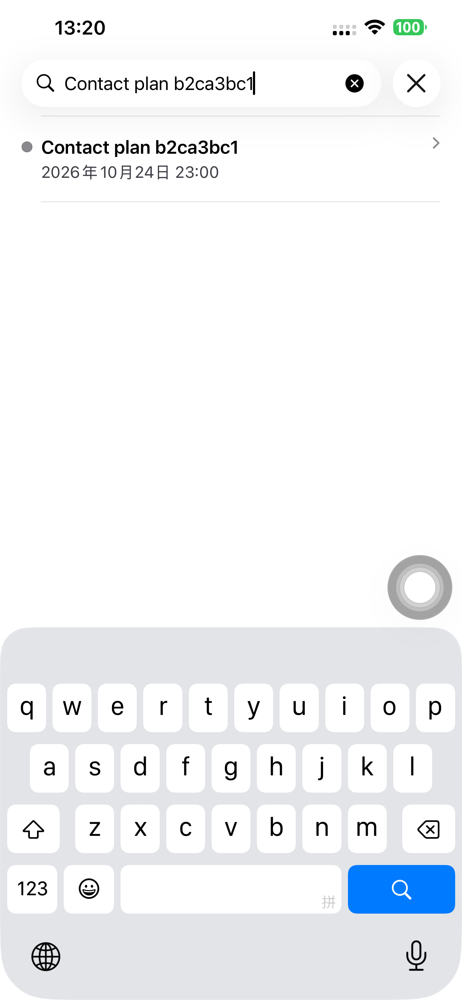

# 最终时间复用时间表选择 — Preview 185

## 实现与范围

- 最终时间复用空闲时间的点击、取消、长按涂选/擦除、撤销和整日选择，共用格子和触摸层。绿色圆勾表示个人空闲，琥珀色边界/底色和方勾表示最终选择。
- 移除原来的整体移动、端点拉伸和单独日期/起止控件；底部保留完整起止日期、时长、清空和核对名单。返回再进入保留草稿，不修改已提交空闲。
- 展开候选日期的完整 24 小时，固定日期表头、可滚动小时、格子内时间；未征集的小时显示横线，复核名单提示未征集，不虚报可参加。原响应 ID 和记录保持。
- 支持连续跨午夜或连续多日；不连续点选保留并提示补齐/取消多余格子，核对按钮禁用，不自动清除或填满间隙。
- 后端仍校验一个连续、15 分钟对齐且属于候选日期的区间；仅取消最终邀请被原空闲征集小时限制的条件。FIXED 时间、邀请版本、逐人回复、发起人随时正式发出和唯一日历规则保持，无 schema/数据迁移。

## 单元、候选及线上

原生 24 项单元测试通过（4.129 秒）：点选/取消、双向跨日涂选与擦除、连续校验、DST 23/25 小时和既有保存/刷新规则。早期两项 Swift Testing 断言把 Double 实际值与 Int 字面量作比较，已将预期明确为 Double 后复验；没有改变业务值。

服务端领域与邀请时间表 11 项测试通过，相关 ESLint 通过。候选与正式各 Chromium / WebKit（390px、浅/深色）完整流程均通过，共四次独立浏览器运行：

1. 游客明确提交空闲，原 15 分钟 ID、发起人空闲保持。
2. 不对齐分钟被拒且不变更版本；候选两天中从 23:00 到次日 01:00 的邀请成功，即使原征集只覆盖 09–11 点。
3. 网页两天分别高亮，参与者明确接受后，正式发出前仍无日历。
4. 发起人正式发出得到一个精确跨日日历，重复发布无重复条目。
5. 原同日、无人填写即可发邀请及无需等齐回复的路径仍通过。

每次浏览器运行删除 1 个专用账号、核验访问 401 和 2 个链接 404；无浏览器运行时错误。截图已实际查看。

## 发布来源

后端源码提交 `cc12cc34`。从生产 `dpl_3QAxBxySh4RLrQYf849ozaqdmZEz` 的 1392 个实际源文件重建并逐项校验哈希，只覆盖 `lib/time-polls/domain.ts` 和 `lib/api/v1/time-poll-service.ts`，新增来源标记文件；1390 个原文件保持。上传的 1393 项与构建上下文完全匹配，变更文件的 Git 父版本与原生产也匹配。

使用 Production skip-domain 候选，显式 `SKIP_DATABASE_MIGRATIONS=1` / `SIDESEAT_ACTIVITY_RELEASE=none`。候选访问保护通过既有 Vercel CLI 登录访问，未更改保护设置。候选通过后原样提升同一构建 `dpl_97Yg1PF8Pn2Fb3is5MJC4FNL3Cb7`；api / www / 根域名分别核验指向该 READY 部署。

## 真机验收记录

初次中/德最大字号检查 18.184 秒功能通过，但实际截图发现德语图例挤断，不计最终视觉通过。图例改用宽度不足时纵向排列，最终时间标签缩短，相关截图与最终复验分开记录。

真实 App 好友完整流程 **292.305 秒，一次连续通过**，八阶段 API 全通过。普通账号从登录开始创建计划 → 未提交草稿分享给 App 好友 → 对方聊天卡片/计划入口 → 双方明确提交空闲 → 最终时间点选、取消、断点补齐、撤销、拖选、擦除、退出恢复 → 当晚 23:00 与次日 00:00 两次拖选得到 23:00–次日 01:00 → 核对名单提示未征集 → 发送邀请 → 受邀者两日期高亮并接受 → 发起人正式发出 → 参与者从已确定活动进入真实日历搜索。

八阶段独立读取检查：双方原空闲均为 `[0,1,2,3]`、好友卡片唯一、正式邀请版本为 1、接受后/发出前日历均为 0、正式发出后双方各 1 条。额外核对双方唯一日历的起止与两小时最终区间完全一致。本次真实日历没有使用 authenticated shell。

完整流程运行包与最终包只差上述图例显示修正。修正后重新构建/安装相同 Preview 185，最终中/德深色最大字号 **18.442 秒**通过；实际查看图例、按钮/底栏、日期与两天高亮截图，德语图例已完整展示。完整流程与最后的图例复验分别记录，不声称同一二进制重复完成全链路。

| 验证 | 最终结果 |
| --- | --- |
| 原生模型、草稿、既有保存/刷新 | 24 项通过 / 4.129 秒 |
| 服务端领域与受邀时间表 | 11 项通过，ESLint 通过 |
| 候选 Chromium + WebKit | 两条完整网页流程通过 |
| 正式 Chromium + WebKit | 两条完整网页流程通过 |
| 真实 App 好友全链路 | 292.305 秒，8 阶段 API 通过 |
| 最后图例修正，中/德深色最大字号 | 18.442 秒通过，实际截图复核 |
| 个人记录与日历 | 原空闲不变，双方各一条精确两小时日历 |

## 精简与交付

产品原生四个 Swift 文件合计净减少 115 行；共用 `TimePollTouchSurface`、格子绘制、toggle、undo 和 apply，最终时间仅添加按真实时序涂选和连续校验。旧的整体移动、端点拉伸、按日搬移与独立时钟编辑已移除；没有并行维护两套选择器。服务端复用原 `buildPollSlots`，仅两项业务文件变动。Git 空白检查通过。

原生/测试/交互合同提交 **`50d8fb51`** 已推送。默认 iPhone 14 Plus（`00008110-001A69110CC1401E`，iOS 26.6.1）最终安装 **1.0.0 (185)**，严格签名、248 个 App 输入、18 个配置/脚本输入及共用 Calendar JSON 资源与隔离构建来源匹配。无测试启动参数/QA 环境的普通启动 **PID 6692** 与实际进程核验；普通 SideSeat **97** 保留。

四次浏览器运行共 4 个账号、8 个链接，以及真机 2 个账号、2 个链接，均已删除并检查 401/404。测试 runner 卸载；私密 fixture、scheme/xctestrun、候选 cookie/响应头移除。没有上传 TestFlight/App Store；无数据库迁移。未改动其他未完成的 `tsconfig.json`。

[构建来源](./evidence/2026-10-23-cross-day185/native-build-manifest.json)、[八阶段 API](./evidence/2026-10-23-cross-day185/native185-api.json)、[双方日历精确区间](./evidence/2026-10-23-cross-day185/phone-calendar-exact-interval.json)、[生产来源核对](./evidence/2026-10-23-cross-day185/source-verification.json)。
