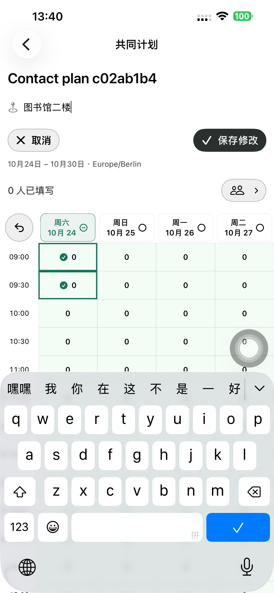
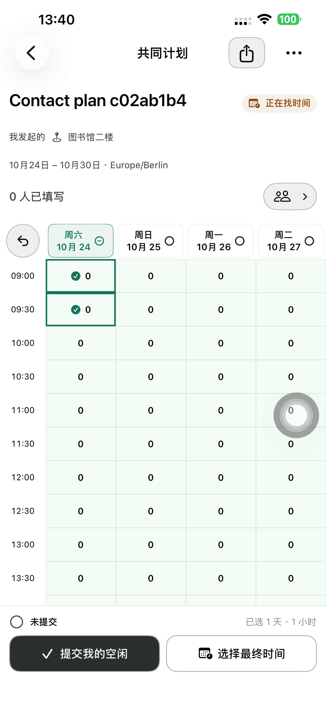
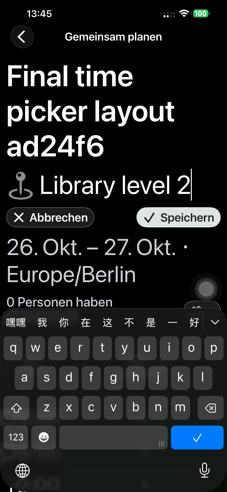

# 一级页面原位编辑计划信息 — Preview 186

用户指出：活动、地点本可直接点选修改，独立「编辑」入口和二级表单是多余步骤。

## 调整

- 删除详情头部的统一编辑按钮和信息编辑 Sheet。点击活动名或地点，在原位置出现输入；空地点显示既有可选地点提示。
- 只有编辑中显示「取消 / 保存」；取消回到已保存内容，保存通过既有 details PATCH 更新活动名和地点。没有键入自动保存。
- 编辑中隐藏空闲提交/最终选时底栏和分享菜单，完成后恢复，避免覆盖当前输入和混淆不同操作。
- 时间继续在现有时间表点选，不重复显示候选日期/时区编辑表单。空闲草稿、活动/邀请权限、邀请版本、逐人接受、正式发出和日历规则保持；参与者与已确认信息保持只读。
- 移除原 PlanInformationEditor / PlanEditorField，直接复用既有详情标题和详情接口；无新端点、数据字段、迁移或后台机制。

## 发现并修正

初次最大字号测试在取消后未返回标题，实际截图证明空闲操作底栏覆盖了编辑按钮。修正为编辑中隐藏该底栏与分享菜单后，中/德最大字号 22.753 秒功能检查通过。随后截图发现德语深色输入文字对比度异常，且长保存文案换行；补显式正文色，将按钮缩短为既有「保存」。这次功能通过未计最终视觉验收。

修正底栏的首次增量构建有一个 Swift 成员初始化参数顺序错误，改正后构建成功；它没有安装到手机。

## 最终验收

真实 App 好友流程 **321.127 秒，一次连续通过**；八阶段 API 通过：

1. 创建后直接点活动名，将临时名称原位改为正式名称并明确保存。
2. 选中尚未提交的空闲，再点活动名编辑并取消，名称回到已保存值。
3. 直接点空地点，原位保存「图书馆二楼」；原空闲格仍选中、服务端响应仍为 0。
4. 给 App 好友发送唯一计划卡片，双方各自明确提交；标题保持正确，地点已保存。
5. 点选/取消/拖选/擦除/撤销最终时间、跨天 23:00–次日 01:00、复核名单、发送邀请。
6. 参与者明确接受，发起人正式发出，参与者从已确定计划进入真实日历搜索。

独立 API 核对双方各一条日历，活动名、地点、起止均与原位保存和最终选择完全一致；正式发出前双方均无日历，原空闲 `[0,1,2,3]` 不变。真实日历使用正常账号登录，不使用测试 shell。

完整流程包与最后包仅差输入前景色和保存按钮短文案。最后重新构建/安装 Preview 186，中/德深色最大字号 **23.948 秒**通过；实际截图核对字段文字可见、取消/保存为完整一行且在键盘上方，44pt 点击范围保留。完整流程与最后的显示复验分别记录。

前两张来自完整流程包，保存按钮当时为「保存修改」；最终短文案见第三张。「编辑」独立入口、旧编辑器和状态开关已从 App 源码移除，旧原位编辑回归的入口/取消断言也已同步。Git 空白检查通过。本轮为原生 UI 调整，没有新增单元测试，没有重跑网页流程。

## 交付

原生、测试及交互合同提交 **`50b47ca5`** 已推送。默认 iPhone 14 Plus（`00008110-001A69110CC1401E`）最终安装 **1.0.0 (186)**；严格签名、248 App 输入/18 配置脚本及共用 Calendar JSON 与隔离构建匹配。无 QA 参数/环境的普通启动 **PID 6754** 与实际进程核验，普通 SideSeat **97** 保留。

本轮没有网页/后端发布，生产 `dpl_97Yg1PF8Pn2Fb3is5MJC4FNL3Cb7` 已重新核实 Ready，沿用现有 details 接口。2 个专用账号、2 个计划链接删除并核验 401/404；runner 卸载，私密 fixture/scheme/xctestrun 删除。没有上传 TestFlight/App Store，其他 `tsconfig.json` 改动保留。

[构建来源](./evidence/2026-10-23-inline186/native-build-manifest.json)、[八阶段 API](./evidence/2026-10-23-inline186/native186-api.json)、[元数据到双方日历](./evidence/2026-10-23-inline186/metadata-and-calendar.json)、[正常启动](./evidence/2026-10-23-inline186/normal-launch.json)。
