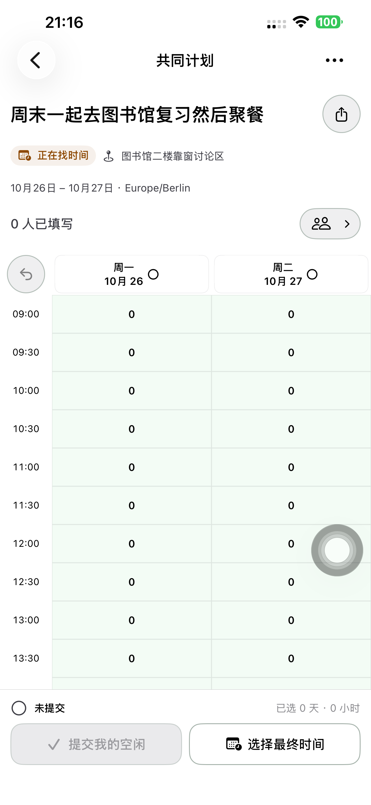
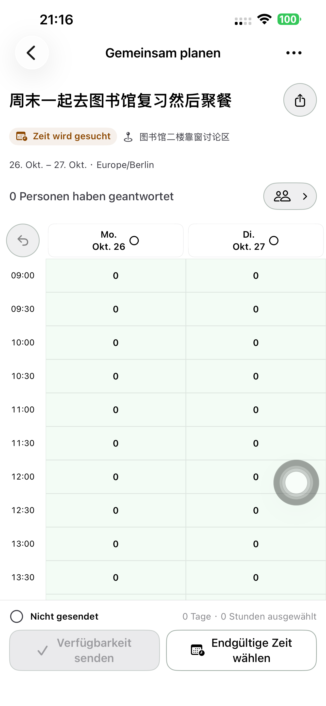
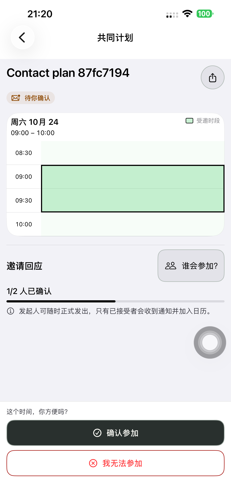

# 计划详情两行抬头 — Preview 192

按所有者确认，活动标题与分享按钮在第一行，状态与地点在下一行。移除重复的「我发起的／共同计划」身份文字；身份与权限规则不变。标题可自然换行，分享图标固定在右侧，使用现有带轮廓圆形按钮和至少 44pt 触区。第二行先尝试并排，空间不足时状态和地点自然纵向排布。

复用 `PlanDetailHeading`、`PlanShareActions` 和现有分享面板：征集、最终选时、邀请确认和已确定共用同一排版，过期详情也保留标题右侧分享入口。移除导航栏重复分享按钮；取消／删除菜单及创建页首次分享主操作保持。标题、地点原位编辑及活动提议输入时隐藏分享的行为保持，无新增状态、请求、业务接口或规则。

## 验证范围

默认 iPhone 14 Plus / iPhone (4)，UDID `00008110-001A69110CC1401E`，iOS 26.6.1。

本轮复查已有原位信息 UI 测试，加入中文／德文、普通／最大辅助字号、浅／深色和长标题地点检查。验证分享唯一且位于标题右侧、状态地点在下一行、44pt 触区，实际打开和关闭原分享面板；直接编辑地点并取消，确认草稿和标题保留，编辑期间分享隐藏。

最终同一产品包的抬头检查 **70.832 秒**通过，无失败或跳过。四种配置都实际打开分享面板并关闭，再进入地点原位编辑并取消；API 复核仍零提交、零邀请版本。已检查四张抬头实际截图：普通字号状态与地点同排，分享图标与标题分离、有完整轮廓和留白；最大辅助字号保留长文字自然换行及页面滚动。最大字号不要求整页同屏，原有固定底栏会使部分长内容需要滚动，本轮没有改其排版。

同一最终包的连续真机完整流程 **145.690 秒、6 个 API 核验阶段**通过，无失败或跳过：清空默认日期并只选一天、创建并分享、保留未提交空闲、详情最终选时／返回／重开草稿、App 好友卡片、名单复核并正式邀请、受邀者接受、发起人正式发出及参与者实际日历搜索。六阶段核对正式邀请前没有最终时间或邀请，正式发出前没有日历，之后双方各一条且标题与精确起止一致。实际邀请截图也确认参与者共用同样两行抬头。

本轮未专项操作过期、取消详情，也未重跑活动提议或跨天完整流程；这些页面继续使用相同抬头或已有规则，不能将前轮专项记录计为本轮重新执行。原生模型和领域代码未改，本轮不将 191 的 29／16 项历史结果冒充重新执行。分享网页未修改或发布；不重跑其浏览器流程。

## 交付

- 实现 `d34ace3989024caf974dbff68091140270d99f28` 已提交并推送；最终产品包之后未改代码。
- 默认手机已安装 **1.0.0 (192)**；248 App、18 配置／脚本／工程规格和共享 Calendar 资源与隔离构建逐字节相同，严格签名通过，二进制 SHA-256 已记录。
- 普通启动 **PID 7394** 与安装路径、进程及版本一致，无 QA 参数或环境；普通 SideSeat **97** 保留。
- 两个专用账号、两个计划链接清理，并检查 401/404；Runner、私密 fixture/xctestrun/设备清单和临时 scheme 删除，本机原始日志及结果限制访问。19:00 UTC 起无新增崩溃或 CPU resource 报告，旧报告保留。
- 无后端／网页发布、迁移或 TestFlight/App Store 上传；api/www 本轮只读重验仍为 Ready 的 `dpl_97Yg1PF8Pn2Fb3is5MJC4FNL3Cb7`。

[抬头 UI 结果](./evidence/2026-10-23-heading192/heading-phone-summary.json)、[布局操作后数据不变](./evidence/2026-10-23-heading192/picker-api.json)、[完整真机结果](./evidence/2026-10-23-heading192/direct-phone-summary.json)、[六阶段 API](./evidence/2026-10-23-heading192/direct192-api.json)、[构建来源](./evidence/2026-10-23-heading192/native-build-manifest.json)、[普通启动](./evidence/2026-10-23-heading192/normal-launch.json)、[清理](./evidence/2026-10-23-heading192/cleanup-summary.json)、[系统报告核对](./evidence/2026-10-23-heading192/crash-check.json)、[生产只读核验](./evidence/2026-10-23-heading192/production-status.json)。
