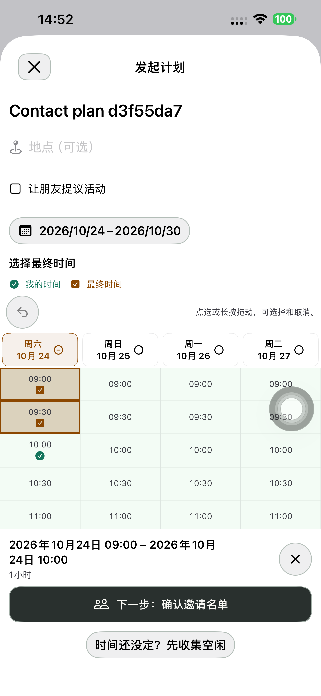
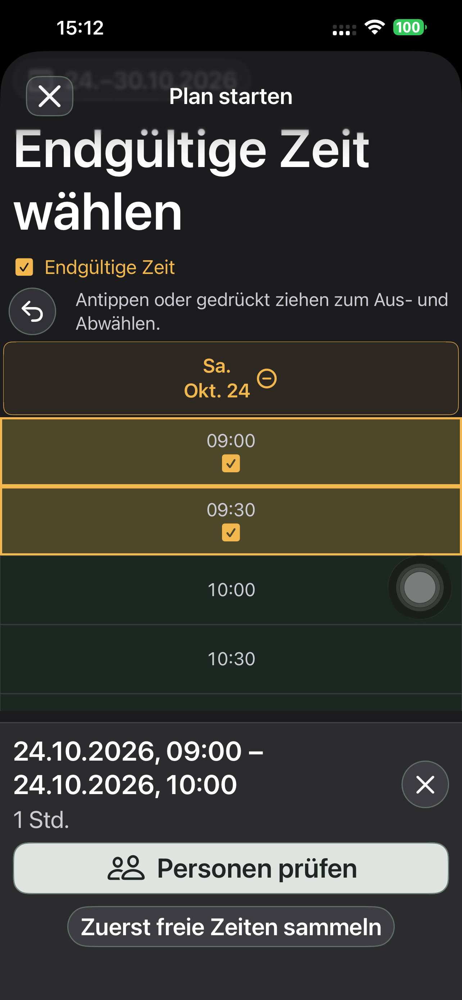
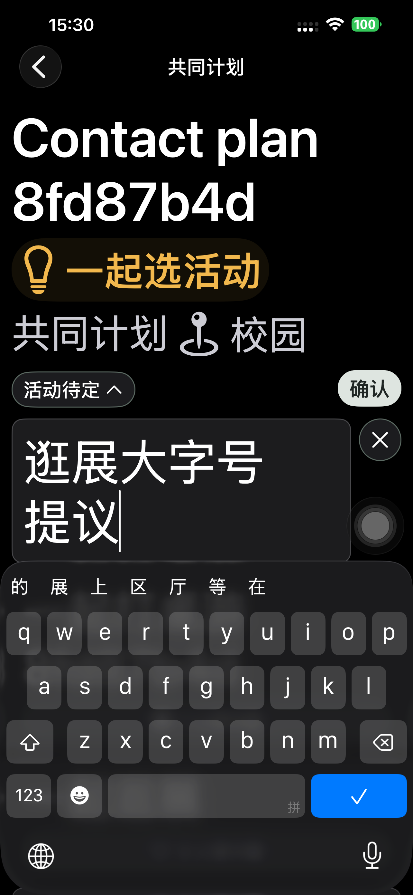
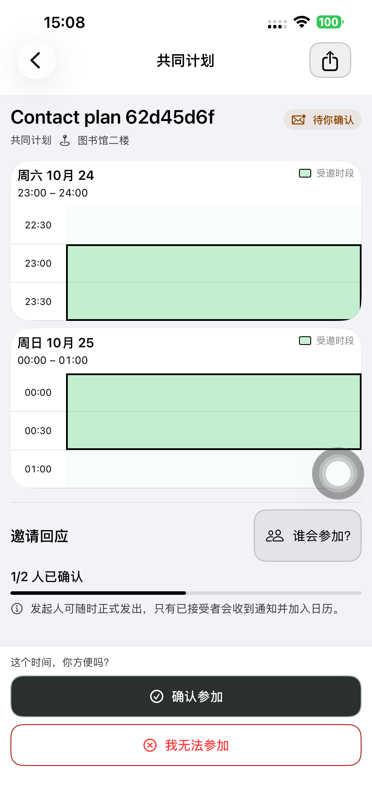

# 从新建开始共用时间表 — Preview 187

主流程改为：活动/地点 → 时间表点选最终时段 → 核对名单 → 明确发送邀请。删除独立「时间已定」的日期、时长、人数创建分支，时长由选区计算。没有人填写空闲，也能直接邀请。

## 实现与精简

- 新建与详情共用 TimePollTimetable、TimePollGrid、手势、撤销、连续区间校验和摘要；复核与 App 联系人选择也复用已有页面。没有新增接口、表、迁移或邀请引擎。
- 「先收集空闲」是同页次要入口；绿色空闲与琥珀色最终时段分别保留。切换后滚到当前选区。更改候选日期/征集小时按实际时间保留选择，避免 ID 移动导致时间偏移。
- 新建先产生 COLLECTING 草稿，最终选时保存在本机，按账号和计划隔离；返回、重开会恢复。只有明确发送才创建邀请版本。已有 FIXED 记录及链接人数/邀请版本、接受/拒绝/暂不回应、发起人随时正式发出、唯一日历规则保持。
- 如果新建时先填空闲，再切回最终时段，原空闲传给既有 TimePollStore 持久草稿；不隐式提交。征集模式的分享操作才明确提交所选空闲。
- 提议活动仍是可选项。分享等待朋友提议，保留最终时段；活动选择后才能正式邀请。提议输入时隐藏时间表底栏和分享工具栏，确认/取消后恢复。输入状态直接由父页面持有，无新增通知或全局机制。

## 真机完整流程

默认 iPhone 14 Plus / iPhone (4)，UDID `00008110-001A69110CC1401E`。真实账号登录、真实 App 联系人、真实日历；不使用测试 shell 的假联系人或假日历完成这些流程。

| 路径 | 一次连续通过 | 服务端阶段 |
| --- | ---: | ---: |
| 直接选时 → 返回/重开恢复草稿 → 添加 App 好友 → 明确邀请 → 接受 → 正式发出 → 日历 | 176.251 秒 | 6 |
| 先征集 → 原位改活动/地点 → 好友卡片 → 双方明确提交 → 点选/取消/拖选/擦除/撤销 → 跨天 23:00–次日 01:00 → 邀请至日历 | 323.090 秒 | 8 |
| 同表选时＋朋友提议 → 四项提议/快捷填入/Tab/取消/兴趣 → 最大字号编辑 → 选活动 → 邀请、接受、正式发出 → 日历 | 267.994 秒 | 7 |

每条流程均核对：正式发出前双方无日历，发出后双方各一条，标题、地点和精确起止一致。直接邀请始终为 0 份空闲填写；征集流程的双方 `[0,1,2,3]` 提交不被最终选时改变；活动兴趣不等于参加。

验证范围分开记录：直接流程在最大字号日期栏压缩前；征集流程在末次提议输入底栏修正前。后两项只影响对应显示分支，普通无提议编辑路径未变。最终包再次完整重跑活动路径，并检查输入框在真实键盘上方、输入中无空闲底栏，取消后底栏恢复。此前活动路径 258.010 秒功能通过，但截图仍有遮挡，未计最终视觉验收。

## 逻辑与显示

- 原生模型/草稿 **27 项**通过，包括创建/服务端时间格 ID 一致、DST、跨天、不连续选择、按账号隔离、创建空闲草稿衔接、保存/刷新旧回归。最后纯显示调整不改这些逻辑。
- 时间计划领域 **16 项**通过。
- 最终日期栏压缩后的真机：中德文深色最大字号，新建页 **98.919 秒**、详情最终选时 **23.454 秒**通过。保留选择、按钮高度和可见位置检查，且 API 核对 0 新增计划、0 空闲提交和 0 邀请版本。最后提议编辑修正不改这两条无活动输入路径。
- 已查看真实截图：普通新建/名单、最大字号中德新建/切换/详情、提议输入和复核、跨天受邀时间表。最大字号日期栏从 128 压至 72pt，内容在边界内；提议输入不再被空闲底栏盖住。

初轮测试脚本修正包括：导航返回层级、参与记录 ID 与账号 ID 的区别、本地化辅助功能值、先把名单控制滚出底部操作区、先等待 fixture 准备再启动观察器，以及重开后展开原有活动列表。另修正了模式切换滚到午夜、创建空闲草稿丢失和提议输入遮挡三个实际显示/衔接问题。失败与修正见 [初轮记录](./evidence/2026-10-23-unified187/initial-attempts.json)。

上图是直接流程包；最终最大字号栏高变更不影响普通字号。

## 交付

实现 `b6d88e07` 和末次显示修正 `84935662` 已提交、推送。手机最终 **1.0.0 (187)**，严格签名、248 App 输入 / 18 配置脚本及共用 Calendar JSON 与隔离构建逐项匹配。普通启动 **PID 6899** 与实际进程一致，无 QA 参数或环境；普通 SideSeat **97** 保留。Runner、私密 fixture/scheme/xctestrun 已清理；18 个专用账号、11 个计划链接删除并核验 401/404。

无后端或网页发布，生产 `dpl_97Yg1PF8Pn2Fb3is5MJC4FNL3Cb7` 及 api/www 别名已重新核验 Ready。使用已有 COLLECT 与邀请接口；未重跑浏览器链路。未上传 TestFlight / App Store。无关 `tsconfig.json` 改动保留。

[构建与安装来源](./evidence/2026-10-23-unified187/native-build-manifest.json)、[直接邀请 API](./evidence/2026-10-23-unified187/direct187-api.json)、[征集 API](./evidence/2026-10-23-unified187/collection187-api.json)、[最终活动 API](./evidence/2026-10-23-unified187/ideas187-final-api.json)、[普通启动](./evidence/2026-10-23-unified187/normal-launch.json)。
