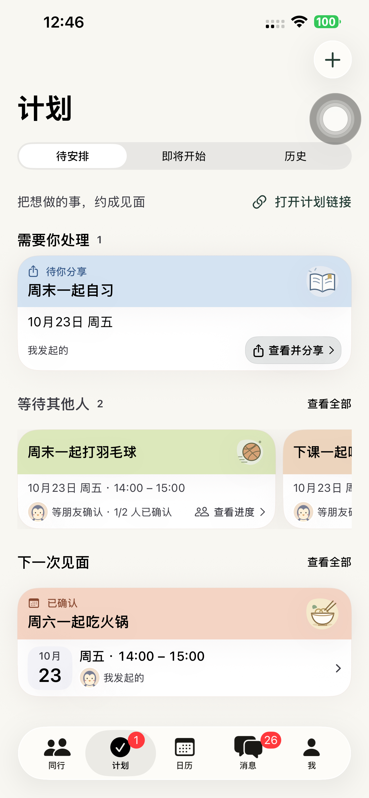

# Preview 144：计划卡片与同行风格统一

三类计划摘要使用与「同行」相同的活动色带、原有插画、圆角、边界和轻阴影。白色内容区保留时间、真实参与者和原操作入口；需要处理纵向、等待他人横向、已确认日期块与紧凑高度继续保留。

- 原生来源 **f1edd7e38349a5e6d02d179d94a634f38eac075d**，已提交并推送当前分支。
- 默认 iPhone 14 Plus 安装 **1.0.0 (144)**；严格签名、源码哈希和实际普通启动 **PID 3397** 核验，无测试参数/QA 环境。普通 SideSeat 97 保留，runner 移除。
- 16 项状态/引导单元测试、7 项界面回归和 1 项真实卡片测试通过；真实原生完整流程 **316.740 秒 / 12 API 阶段**通过。标准样例高度约 134 / 116 / 127pt，长标题约 152pt。
- 修正新色带导致整卡读屏漏读标题的问题；最终状态、标题、时间和入口标签完整。原时间表、手动提交、邀请和日历规则保留。
- 无网页/API/Schema/迁移或依赖发布；生产继续为 **dpl_D7xgQPzwtP4GC9nhTLQoLtgwM8cJ**。本轮没有重跑分享网页流程。
- 4 个临时账号、5 个计划/链接清理，401/404 验证，私密配置清理。未上传 App Store/TestFlight。[完整 QA、初轮问题与实际范围](../qa/2026-10-20-plans144.md)。

