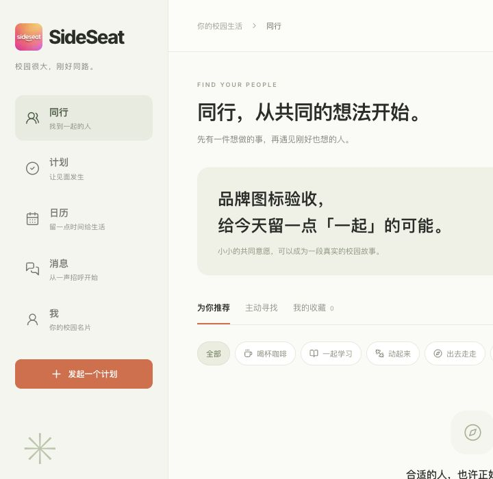

# Web/mobile brand alignment — 2026-10-29

Status: **live at [sideseat.de](https://sideseat.de)**. Source commit
`ba9f1b40b92eff3cf4210f0cd094857e887de379` is pushed on
`codex/ios-uxui-20260922`. All three root/www/api aliases point to READY
`dpl_5BKA8W4f9ga7ZcQaQNP37zL2AxcD`, promoted from the same tested Production
candidate without rebuilding. Previous production:
`dpl_27E69W2D1v5CGphCzP8PqkPSi1LK`.

The new web shell incorrectly introduced an orange `s` badge. Sidebar, login and
signup now share one `WebBrand` component using an exact byte copy of the active
native `BrandMark.png`. The browser/shared-page App icon uses an exact byte copy
of the active native `AppIcon.png`. The 40px mark uses the native22% corner ratio,
with no rotation or reconstructed letters.

The five web navigation symbols now follow native meanings: two people, circle
check, calendar, two chat bubbles and a person. Web uses the existing Lucide SVG
library while iOS uses SF Symbols; these navigation glyphs are corresponding
symbols, not identical platform drawing files. Native App assets and source are
unchanged; no phone build/install is needed.

Verification: exact SHA256 equality with both native image resources, focused
ESLint and React accessibility/component review; local desktop login checked in
the existing active-checkout server on3344. No authentication, API, data-model or
ordinary-account changes are part of this correction. Preserve the user's
unrelated `next-env.d.ts` and `tsconfig.json` edits and existing phone QA services.

## Production verification

The fresh1,424-file production source manifest was checked against the preserved
candidate cache before preparation. Five existing files are replaced, two are
added, and one provenance marker is added:1,419 baseline files are byte-identical
and all1,427 remote files match the expected manifest. No API/business/schema
source or project environment/flag is changed. Build lint/types/routes passed;
the log confirms `SKIP_DATABASE_MIGRATIONS=1` and the activity hook stays `none`.
The own redundant Git Preview `dpl_EXnFWkmPacVxo2gZHFUGGHhmaFG6` for the exact
same source commit was canceled to free the build slot; no other job was stopped.

Candidate and final public production checks downloaded both raw PNG resources
and proved byte equality with the active native originals. Login and signup use
the shared brand component and the old badge is absent. Client configuration is
unchanged, and one disposable account's web/native sessions keep the same identity
across publication. The first read after promotion still saw the old aliases;
no second promotion was sent. Public checks passed after all three aliases were
observed on the new deployment.

Actual production browser UI checked the authenticated desktop sidebar, mobile
navigation, login and signup. The mark loads at40x40; the mobile page and viewport
are both390px, and the five SVG symbols correspond to the native navigation
meanings. Screenshots were reviewed. This visual correction does not rerun the
previous complete business-sync suite and does not claim a physical-phone UI run.
Native Preview260 and the separate pending phone supplement remain unchanged.

The one own account was checked by ID/username, deleted through the API, and old
web/native credentials return401. Browser logout completed; temporary credentials
are removed after the public evidence scan. Ordinary accounts and the existing
3344/15434 QA services were not modified. User TypeScript startup edits remain.

See [source binding](../qa/evidence/2026-10-29-web-brand/source-binding.json),
[remote source proof](../qa/evidence/2026-10-29-web-brand/remote-source-proof.json),
[public PNG check](../qa/evidence/2026-10-29-web-brand/production-check.json),
[UI checks](../qa/evidence/2026-10-29-web-brand/ui-check.json) and
[cleanup](../qa/evidence/2026-10-29-web-brand/cleanup.json).

